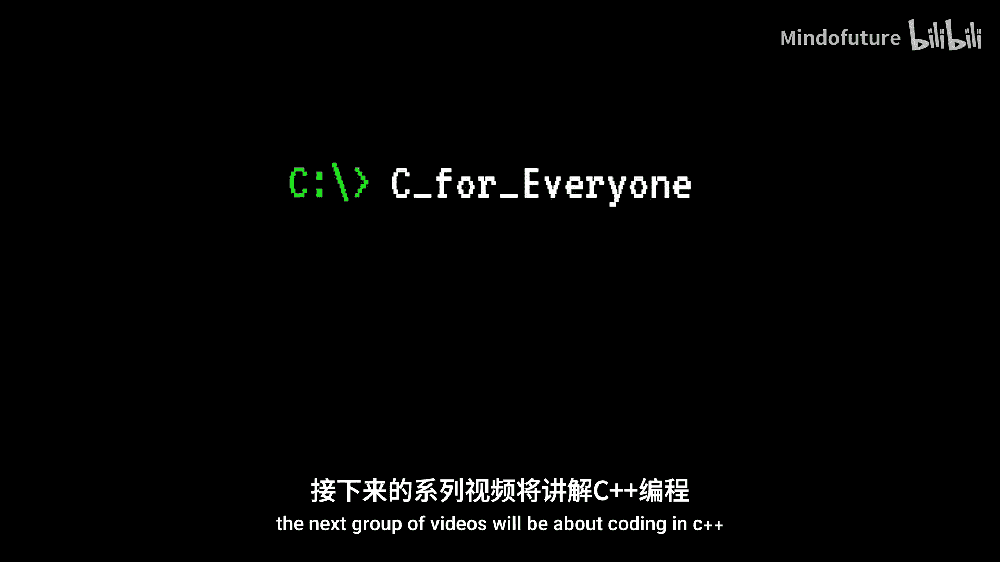

# 024：C++介绍



## 概述
在本节课程中，我们将初步了解C++语言。我们将探讨C++与C语言的关系，介绍C++的一些基本优势，并简要回顾其历史背景。通过学习，你将理解为何C++被视为C语言的现代扩展，以及它如何使编程变得更加容易。

## C++与C语言的关系
上一节我们介绍了C语言的核心概念，本节中我们来看看C++。在某种程度上，C++可以被视为一种现代化的C语言。将代码从C迁移到C++有许多好处。

首先，C++兼容C语言。这意味着你无需进行大量修改，就能享受到现代语言特性带来的便利，这些特性提供了更高层次的编程视角，从而简化了编码过程。

其次，许多同学可能对后续课程“面向C程序员的C++”感兴趣。学习C++有两个主要好处：一是能快速掌握C++的一些优秀特性；二是有助于顺利过渡到我在Coursera上提供的后续系列课程。

## 转向C++的优势
那么，转向C++有哪些具体的好处呢？

好消息是，C语言本质上是C++的一个子集。虽然这不完全准确（在C++模式下运行某些C代码可能无法工作或语义不同），但大体上，绝大多数内容是相同的。C++提供了许多使编程更简单的内存管理改进。

C++有时名声不佳，原因在于它极其复杂。当你包含所有库和模板等结构时，它是一个非常庞大的语言。然而，在大多数情况下，你并不需要那么多复杂的功能，或者可以轻松使用其非常基础的部分，这仍然能使你的编码更容易。我们将在本介绍中看到这一点。

第三点是，C++编译器通常与C编译器捆绑在一起。例如，在GNU编译器系统中，你可以使用`G++`而不是`GCC`来运行你的代码，就像它是C++代码一样。

## 更简单的输入输出
接下来，我们来看看C++如何使输入输出比C语言更简单。

C++的输出可以这样写：
```cpp
cout << "C++ is an improved C";
```
这行代码将字符串“C++ is an improved C”发送到屏幕。注意，这里没有使用`printf`函数。从直观上看，它的意思是“取这个并把它移到那里”，`cout`代表标准输出。从技术上讲，这个移位操作被“重载”以提供输出行为。

类似地，输入也更简单：
```cpp
cin >> miles;
```
这表示从标准输入（你的键盘）获取数据。如果你输入一个值，它将被适当地转换为`miles`变量。同样，这里不需要格式说明符或取地址符`&`。这种方式非常直观。我们将在后续代码中演示这一点。

## C++的起源与发展
在深入代码之前，让我们先向C++的发明致敬。

简要的行业历史是，C++诞生于贝尔实验室，由计算机科学家**Bjarne Stroustrup**在1985年使其成熟。他最初称之为“带类的C”。作为一名斯堪的纳维亚的学生，他接触过一种名为Simula的语言，这是第一种处理抽象数据类型（即类结构）的原始语言。请记住，我们编程的很多工作就是为代码提供结构，而结构有助于封装、防止低级错误。

Simula是第一种真正拥有类的语言，Stroustrup对此非常着迷。但当时他是贝尔实验室的员工，而贝尔实验室的一切基本上都是用C语言完成的，因此他将类嵌入到C中，将它们结合起来。

这样做的好处是免费的。贝尔实验室当时作为一家电话公司（在当时是垄断企业），免费提供了C和Unix系统等资源，这是它回馈社会的一种方式。C++基于C，因此已经了解C的人几乎可以立即添加他们认为合适的功能。同时，它效率很高。当时另一个拥有类的主要竞争语言是Smalltalk，但Smalltalk运行成本非常高，非常耗时。C直接编译为本地代码，效率一直很高，而Smalltalk则编译为解释性代码。

此后，C++不断演进。目前最稳定、大多数人使用的是C++11或更高级的版本。这也将是我们在“面向C程序员的C++”课程中讨论的语言形式。


## 总结
本节课中，我们一起学习了C++的基本介绍。我们了解了C++与C语言的紧密联系及其作为现代C语言扩展的地位，认识了C++在输入输出方面的语法简化，并回顾了其诞生于贝尔实验室的历史。核心要点在于，C++在保持C语言高效性的同时，通过引入更高层次的抽象（如类）和更简洁的语法（如`cout`/`cin`），使得编程变得更加容易和安全，为后续深入学习面向对象编程奠定了良好的基础。