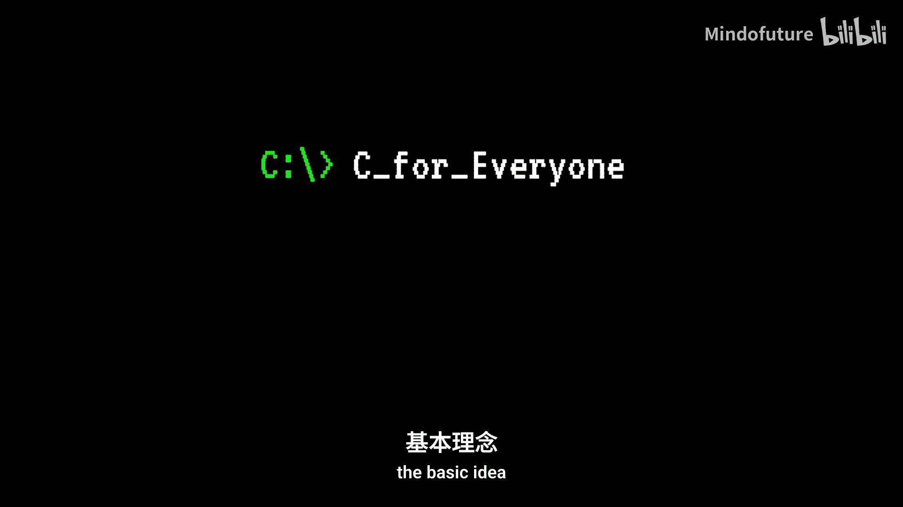

# 028：C++抽象数据类型作为类

## 概述
在本节课中，我们将学习C++语言中一个核心的现代特性：**类**。我们将了解类如何作为抽象数据类型的封装机制，并比较它与C语言中结构体的区别。

## 基本概念
C++之所以成为一种现代语言，而C语言被视为一种1970年代风格的系统实现语言，其核心理念在于C++引入了**类**。

类是封装抽象数据类型的一种方式。

我们一直在讨论C语言中的抽象数据类型，通常使用结构体来创建一种新的数据类型效果。

但结构体本身不包含操作，并且结构体本身是公开的，因此可以被随意修改。现代编程中一个重要的概念是**封装**。

封装允许你隐藏内部细节。可以想象一下修理汽车，引擎中的某些部件只有授权的经销商才能接触，否则不应被随意改动。你可以将其视为一个黑盒，只要知道如何操作，你仍然可以使用汽车。类的概念也是如此。

因此，C++采用了结构体的概念，并为其添加了实现进一步封装的理念。

## 类的应用实例
现在，设想我们需要一种新类型，称之为`shape`（形状）。`shape`是一个名词。在传统的C语言中，我们会用某种结构体来表示它，然后编写各种函数来对其执行操作，这些函数通常会通过指向结构体的指针来调用。

我们可以思考一个形状，计算它的面积，在屏幕上绘制它，或者找到它在平面上的位置。这些都是我们为`shape`这个类型设想的各种操作。

可以想象，你在一家想要开发（例如）建筑图纸软件的公司，他们希望有一种复杂的方法来自动绘制这些图纸以辅助人类建筑师。这样的软件包是存在的。如果我们有`shape`，我们会有不同种类的形状，它们会有不同的描述方式。然后，正如之前所说，我们会对它们执行操作。

## C++中的实现
让我们简单看一下在C++中如何实现。假设我们有一个矩形形状。

我们使用`class`关键字，它类似于`struct`。虽然这里也可以使用`struct`，但有一个细微差别。在现代C++中，你使用`class`关键字。

然后你命名这个新类型，我们称之为`rectangle`。接着你有一个左花括号，就像结构体一样，但之后你有一个表示**访问权限**的关键字，这里是`public`，意味着所有人都可以使用它。

然后我们有一个**构造函数**。这是一种特殊的函数，允许你构建这类对象。其背后的理念是，`int`是一种原生类型，编译器知道如何构建一个`int`（通常是在内存中表示为4字节）。而`rectangle`允许你使用先前定义的类型来构建这个新类型。

这里还有一个对该类型的操作，称为`area`（面积）。`area`函数返回`height * width`。

此外，通常在现代语言（包括Java和Python）中，你会隐藏内部的表示。在这个例子中，我们隐藏了`height`和`width`。如果我们进一步完善这个类，还可以考虑其他操作，比如绘制操作。

## 代码示例
现在，在我们的主程序中，我们可能会声明一个`rectangle`对象`r`，并用值初始化它（例如2.5和2.0）。我们可能有一个变量`ar`用于计算面积，然后我们可以说`ar = r.area()`。这里使用了点表示法，这与C语言中结构体的用法相同。

现在发生的情况是，在这个矩形`r`上，`area`函数被调用，它秘密地使用高度2.5和宽度2.0进行计算。所以`ar`应该得到双精度值5.0。

## 核心特性总结
这就是Bjarne Stroustrup为C语言添加的核心思想，将其转变为一种现代语言。在这种语言中，你可以通过使用**类**的概念以及拥有**成员方法**（或称成员函数）的概念来轻松扩展数据类型。

因此，与普通的C语言结构体只有成员数据字段不同，现在你还有了成员函数（在现代面向对象术语中，有时称为方法）。

## 总结
本节课中，我们一起学习了C++中**类**的基本概念。我们了解到类是对**抽象数据类型**的封装，它通过`public`和`private`等访问控制关键字实现了信息的隐藏，并通过**成员函数**（如构造函数和`area`方法）为数据类型添加了操作。这使得C++能够更好地支持现代软件工程中的封装和模块化原则。