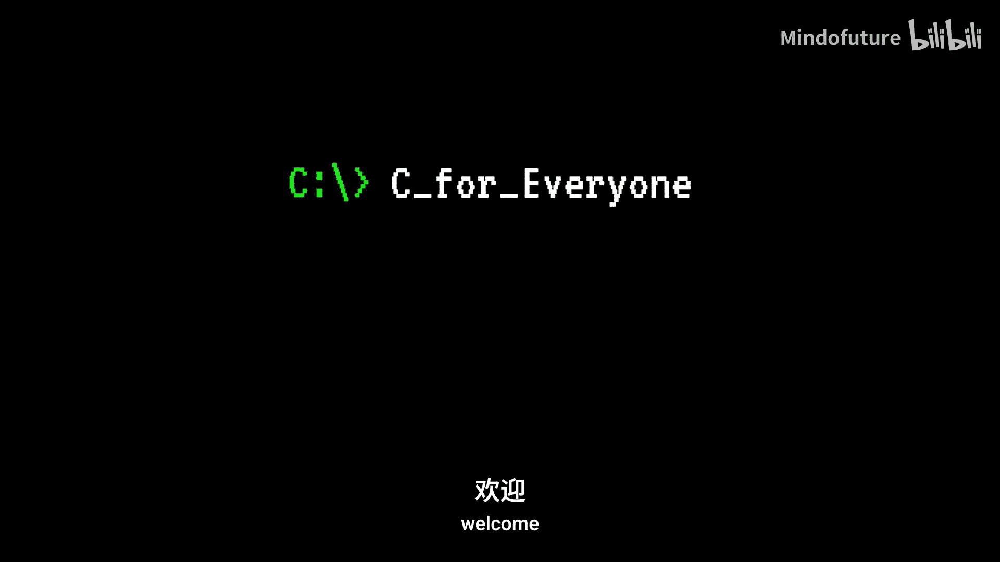
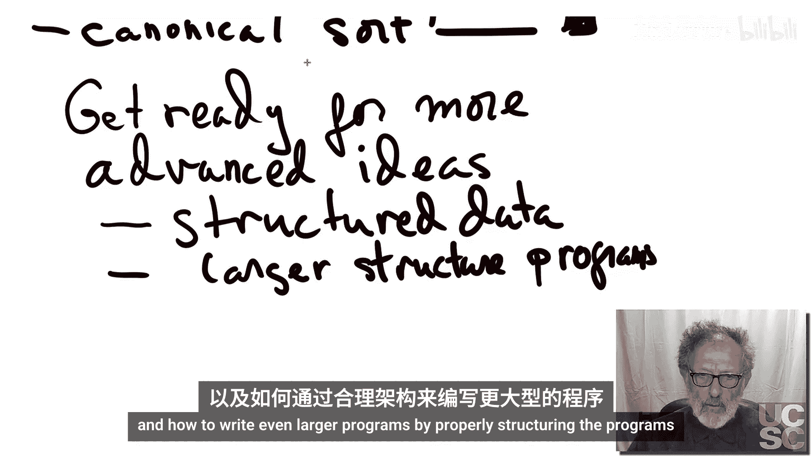

# 【加州大学】C语言结构化程序设计-｜-C-Structured-Programming-p01-P01_本课程的先决条件_01_01_01--BV1wYe7zWE1T_p1-

🎼2。

🎼，Welcome， I'm Professor IRA Pole at the University of California， Santa Cruz。And。I will be your。

Guide to see for everyone。啊。Structured data and structured programming。

And this builds on the earlier course see for everyone fundamentals。But。

What do you need to know coming into this class？There's several ways to have gotten here first off。

 you might be a little rusty and you previously had studied like for example， from my textbook。

 a book on C。Roughly speaking， the first six chapters are what have been already covered。

So coming here， you would have。That form of background。Or as I said more precisely。

 if you came here from the Coursera course， see for everyone one fundamentals。

 you would be exactly where you needed to be。But some one else could get here。

And they may have picked up programming。And it would have been perfectly okay if they had a basic understanding of Java or Python。

As largely a lot of the same elements exist in those languages， as exist in the fundamentals of C。

 Now， of course， you'll have to。Adjust if you know nothing about C and quickly。

 but you could quickly catch up if you already had done a fair amount of basic programming by just quickly reviewing some of the elements from about dimension。

What are they？You need to know how to use a compiler and editor。

 ones we've been using have been Good newss compiler， C compiler or VI or VIM as an editor。

 but there are many other choices。あ。And now when you get to starting in a language。

 you need to know the language is lexical elements， it's basic components。

And basic components in C include identifiers， constants， operators， punctuation， keywords， comments。

So those are the little pieces that you stick together to get a program。

Programs have to operate on something and they operate on。

Data types and most programming languages have what are called native types。

 built in types and for example。Key ones in the C language are the integer types and the floating point or real number types float and double。

And a character type char。Those are among the central ones you need to know about and were already discussed。

fourthour thing you need to know is flow of control。It'sFor a program to be interesting。

It has to do things like have a compound statement where a whole bunch of actions are clustered as if they are a single action。

You could consider that the idea there is like writing a paragraph。There are while and four loops。

I must have just watched a golf tournament because。We mean four as in the four statement。呃。

And then there are conditional statements。s as the FF or switchitch， where decisions get made。

 each of these things will influence where in the program you are， where to go next。Finally。

 the principal organizing concept in C。That we've learned。

Our functions and the one function we always use is main， and mainine is where a program starts。

 but we also have learned now to write what might be called subroutine sub functions。

And they are an organizing principle。For writing large code。

 you don't want just one function where everything is thrown in that tends to be too hard to organize。

 too hard to debug， and so a function should be no longer than possibly the amount of code you can see。

On a page。In front of you。And functions have arguments and see the way arguments are passed into functions is via call by value。

 so that's critical to understand it， this is where you start to get a little bit more advanced thinking。

A function has to have a definition and a declaration way to declare a function is through what's also called prototyping and then functions as with。

Variables make use of things like storage class， so the storage class static has a particular effect on data inside of function and you have to understand how that works。

The final topic we covered in the fundamentals course were arrays pointers and strings。

So the array is a basic way to deal with a large amount of data， that's what computers are good for。

 lots of data having to process there's very little data。

 you might be able to just work out your calculation by hand。

But if there are millions of items of data， if you're a big organization。

I like Social Security and you have 100 million records and people representing。

 then you have to do enormous amounts of calculation。

 and you can do it readily by organizing your data into what are called a arrays。

Rs get addressed through indexes。And the indexes have an important relationship to the data type pointer。

 so that's to be understood， indexing and the pointer relationship。Finally。

 there is no native string type in the C language， there are in some of these other languages that I already mentioned。

But instead， a string is treated as an array of characters。

 and so you need to get used to that and special libraries that let you use that conveniently。

 that idea gets used conveniently Finally， pointers allow you to simulate what's called call by reference and if you've already learn the previous material。

 you know that's very important to the IO function scan app。

And among the things that you should already know how to do is something like a canonical sort。

 like a merge sort。or like a bubble sort even or a quick sort。

 these are sorting routines that show that you have a command of using arrays and fusing iteration。

Okay。So let's get ready for this new course。Review what you need to and now we're going to go on to more advanced ideas。

 especially the idea of。How to structure data more elaborately， in fact。

 we'll be able to create our own new data types and how to write even larger programs by pop。

Structuring the programs。

