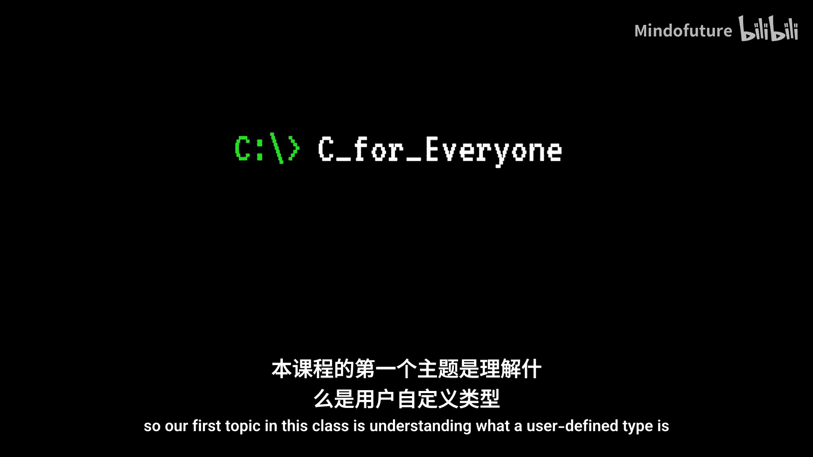
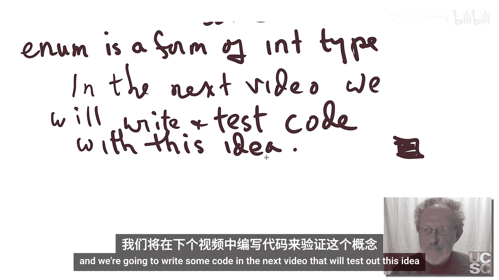

# 【加州大学】C语言结构化程序设计-｜-C-Structured-Programming-p02-P02_枚举作为抽象数据类型_01_01_02--BV1wYe7zWE1T_p2-

🎼2。

🎼，So our first topic in this class is。Understanding what a user defined type is and the simplest form of user defined type is the enumeration type。

And if you're following along in a book on sea。It's in section 7。5。

So critical to a programming language and what problems it can readily solve are。

It's native types and the native types for the sea language are int and flow double char， short。

 long pointer。All of those are useful。With different kinds of problems， so mathematical problems。

 you're going to be using the integer and double types， data processing and string processing。U。

Problems， you're going to make heavy use of char and point it to char。However。Languages can't just。

Have every type that's of use to a particular problem domain。 The chemists have their kinds of types。

 Physicists have their kinds of types。 biologists have their kinds of types。

 and they have ways to thinking about their problems in relation to those types。

 or types or ways to describe things。So most languages。

 especially modern languages like Java and C++ have。Very powerful type extension abilities。

C is a more primitive language。It was really designed specifically for a system implementation language and the types it had were adequate for those tasks。

 But then it became a more general purpose language。

 People just found it very efficient and very convenient。So。

There are ways even within C to do type extension， and the way we're going to discuss in this video is what are called enumerators。

So think of a type where you want to do calculation on the calendar。

And you want to talk about the days of the week。And， of course。

 why you want to do and have a type is it allows the compiler to do what's called type checking and type checking at the compiler level。

Is a way to make debugging easier。And even in a language like C。

 which is called a weak typing language as opposed to a language like Javabo。

 which is a strong typing language。U。Type safety is still extremely useful。

 Why is it thought that C is a weekly type language？ Well。

 it's because C allows a lot of funny things。 like in C， if you say if a equals B。

 if expecting what an。What。Conceptually is thought of as a Boolean expression。

 C doesn't have a boolean type。So she looks at this。And tries to translate it to zero or non zero。

 That's how it uses true or false。And if you intended a equal equal B， which would be normal。

Instead of A assign B， A assign B still works。Because the value of an assignment is just what ends up on the left side。

And that then gets interpreted as a boolean type， so most compilers actually will give you a warning about this。

 they'll be sensible enough to say， oh， that's such a common error。

Because equal looks like logical equality。That we must warn about it。So。Type safety is very helpful。

And even though the language the compilers try to provide for common make mistakes。

 there are other things that really can't。Manish， so you typically have errors where you say he divide B。

And。Maybe A and B were integers。And one divide 2。As an integer。Get you。0。

 even though your intention may have been to get a half。

And the way you could get a half is to force it using a cast。

But you might have forgotten that and your haste to write the code。

 and you just forgot that there's a lot of loose type conversion， which is convenient， in most cases。

 convenient。 And if you're careful about it， it works perfectly okay。

 but sometimes you're not careful， sometimes you have oversight。 And that just shows you where。Type。

 automatic conversion， all of that can be very important to program correctness。Okay。

 so let's turn to how we're going to extend how we're going to create user defined types and enumeration here's how you might do it with the type day。

 so you say aum day。And this announces through the compiler that this is an enumerator type。

And its tag name， what's called its tag name， is day。So now a noome day becomes a new type。

And what is its domain， What are its values， It values are these things， enumerators， sun。

 Monday to Wednesday， Thursday， Friday， Saturday。We could have written them out。And also。

 some people use the convention that with the numerators， you should have them capitalized。嗯。

Why should you have them capitalized， Because implicitly， these enumerators are assigned to value。

 The first ones assigned to value 0。 Everything in C starts from 0，0，1，2，3，4，5，6。 So they secretly。

Small integer constants。And then if I say a noon day variable today， initialized to Friday。Well。

 of course， secretly， this is zero，1，2， three，4，5， so that's five or Friday， the enumerator。

And now we have a variable of this type and our compiler。Can decide whether。

You are manipulating types and expressions correctly。And also， it adds to the program clarity。So yes。

 you could do all this with ordinary integers， but this is a very nice extension that makes your program more literate。

 it also provides if you want a more readable program。By the way。

 the default operation can be changed， the way they can be changed is within the enumerators。

 you could deliberately assign a different value。So you don't have to rely on the implicit values。

 you can assign a different value， and then it breaks the sequencing and resumes the sequencing implicitly from whatever explicit value you've assigned。

So。In reality， enumerated types in the C language are a form of integer type。

 or restricted form of integer type。And we're going to write some code in the next video that will test out this idea。

