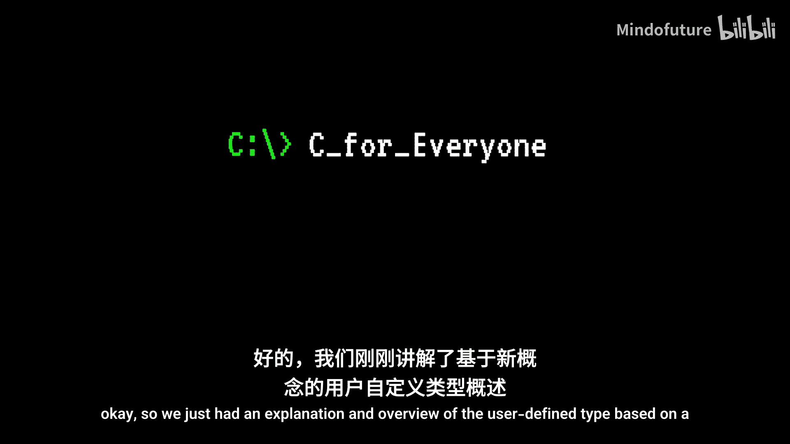

# 【加州大学】C语言结构化程序设计-｜-C-Structured-Programming-p03-P03_枚举代码_01_01_03--BV1wYe7zWE1T_p3-

🎼2。

🎼，Okay， so we just had an explanation an overview of the user defined type based on a nu。

AndNow we're going to see actual code， see if it runs and get a little bit more of a feeling for it。

Here's where I'm declaring the type， a nom， we need that as a keyword。Da。That's the tag name。

For that particular type。And then the enumerators， Sunday， Monday， Tuesday， Wednesday， Thursday。

 Friday， Saturday。 And this declares this as a type。

 It's actually a restricted form of integer type with sun Monday 2 when Thursday。R。

Secretly entered your constance。Can't be modified， their value is given as zero， first in the list，1。

2，3，4，5，6。And as I said in the last lecture， if you wanted， you could change those values by doing。

A initialization inside， with an inter value。But in most instances we're。Okay， with the default。

Initialization。And here's。A function that is going to act on that type。 So when you declare a type。

 the type is。Has a set of values。But also， a type combines operations on it。

And so you have to think when you are doing user defined type， just like with a native type。

 what's an operation on floating point number， well divides an operation？

So you have to present natural operations so that the type is useful。

 So one thing we want to do is we want to be able to print them， and there is no。

Way to extend in print F with new。Formats。呃。A day type。 So instead。

 if you tried to use the standard formats like percent D， all you would see would be an integer。

 and we'll show that in a second。So here we're going to use。The day as a switch label。

And we'll have a case Sunday， Monday， Tuesday， Wednesday， Thursday， Friday， Saturday， and this is。

An idiom for doing a lot of work with enumerators。 namely。

 each enumeration can be used inside a switch type， and your behaviour is determined by。

Wet enumerator。That function is going to see， so if it sees sun， it's going to print Sunday。

 if it sees Monday， it's going to print Monday and so on。What if it sees a value？

Outside one of those cases。Then will be a default and we'll assume that value is typically a。

Integer value will print it as an integer。 must be different than one of these integers。

 So somehow we printed something that's an error and will let。

The person know that they attempted to print something that did not turn into a day of the week。

And notice again， because we didn't emphasize switch。

 You should have come in just as knowing if and else。Switch。And this is canonical for switch。

 You typically have an action with a break， an action with a break。

 You want to avoid a fall through semantic where you would， without the break。 Get all these action。

 You don't want a Sunday value to end up printing you all days of the week。So the brakes are， again。

 typical idiomatic for this kind of action。What if you want？If I tell you。

 what's the next day and I say， oh， what's the next day after Friday， it's Saturday。

So that's a common operation when you think about this as data type。

So here we're getting you next day。 we're passing an enumerated value。

 and we're going to return the next day。 And what's the next day， Well，0。 The next day is Monday。

 which is a one。We have a special case with Saturday at 6。 When we add one， we get to 7。

 but there is no 7。That would be outside the range of these enummerator types。

 So we have to map it back into the next day， which is Sunday。

 and we have a simple operator in nice use。Of the modlo operator。Okay。

We're just going to use this in a very simple way。Let's look at mainine。

Main is going to start by declaring a variable。Today is Friday。Okay， let's make sure it prints right。

And then we're going to show you some of the problem。 Remember， in that first lecture， I said。

C is weekly type language because it allows a lot of implicit conversions。 And that's true for noome。

 which is really a form of in type。 And so to day is allowed to get other values than those。

Strict enummerator types。Other languages， which implement as a concrete type。

 avoid this by doing heavy type checking and。This would be causing an error。Unfortunately。

 we're living in the sea world。So we do the best we can。This will。If we got our logic right。

 this should print out as an error。We're going to jump to a new line。

 We're going to get a next day and see what the next day prints。So let's try and run that program。

I already compiled it。And sure enough。We had a sign to the day Friday， and we get the print Friday。

 even though it's secretly 6。 If we try to use an integer outside that range。

 we get the default value， the default case and that 7。 And it shows that it's an error。

 And then when we do next day， we get Saturday， okay。So。We saw how to make use of the anum type。

 and you can try to add to this type by creating。Some routine， you might think of， like。

Why not create instead of a next day routine， a yesterday routine。

So you could have a tomorrow routine and a yesterday routine。And try and write that piece of code。

I'm going to leave you with one further。Well I dear。I'm going to。

Look at very similar code to what we just look at， but there's going to be one change。

And in that one change， we're going to add what's called a type def。Deeclaration。

So when we go over to user defined types， this is。Very useful。

 typey T is another key word that says associateiate to type a noom day。With the term purely day。

 So this now， instead of a noon day， lets us everywhere else use day。 So they can be used there。

 They can be used here。 They can be used as a return type。In other words， it works exactly the same。

 but it takes something that's somewhat complex。 And we'll see that。Routinely and more advanced。

Typing。That type the。It's useful to improve the clarity of your program。Okay。

That's it for this topic。

