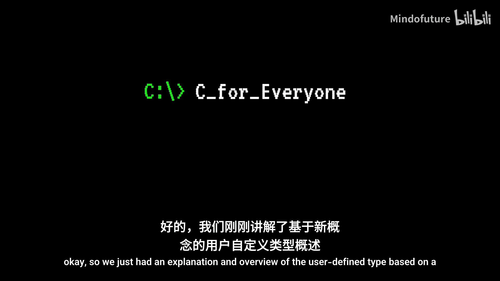

# C语言结构化程序设计：P03：枚举类型代码示例



在本节课中，我们将学习如何在实际代码中定义和使用枚举类型。我们将通过一个具体的例子，了解如何声明枚举类型、为其编写操作函数，以及如何使用 `typedef` 关键字来提升代码的清晰度。

## 枚举类型的声明与定义

上一节我们介绍了枚举类型的基本概念，本节中我们来看看如何在代码中具体实现它。

以下是如何声明一个名为 `enum day` 的枚举类型，它代表一周的七天：

```c
enum day {Sunday, Monday, Tuesday, Wednesday, Thursday, Friday, Saturday};
```

在这个声明中：
*   `enum` 是定义枚举类型的关键字。
*   `day` 是这个类型的标签名。
*   花括号 `{}` 内的是枚举常量，也称为枚举器，它们分别是 `Sunday`, `Monday`, ..., `Saturday`。

这个声明创建了一个新的类型。本质上，它是一个受限制的整数类型，其中的枚举常量在底层被赋予了整数值。默认情况下，列表中的第一个常量（`Sunday`）值为0，后续常量依次递增（`Monday`为1，`Tuesday`为2，依此类推）。这些常量是**不可修改**的。虽然可以通过显式初始化来改变这些默认值（例如 `Sunday=1`），但在大多数情况下，使用默认值就足够了。

## 为枚举类型定义操作

当我们声明一个类型时，不仅定义了一组值，还需要定义在其上进行的操作。就像浮点数有除法操作一样，我们需要为自定义类型提供有意义的操作，使其变得实用。

一个常见的需求是能够打印枚举值。由于无法扩展 `printf` 函数来直接支持新的枚举类型格式（如果使用 `%d` 只会打印出底层整数），我们需要自己编写打印函数。

以下是打印枚举类型值的函数 `print_day`：

```c
void print_day(enum day d) {
    switch (d) {
        case Sunday:    printf("Sunday"); break;
        case Monday:    printf("Monday"); break;
        case Tuesday:   printf("Tuesday"); break;
        case Wednesday: printf("Wednesday"); break;
        case Thursday:  printf("Thursday"); break;
        case Friday:    printf("Friday"); break;
        case Saturday:  printf("Saturday"); break;
        default:        printf("%d is not a valid day!", d);
    }
}
```

这个函数使用 `switch` 语句来根据传入的枚举值执行不同的操作。这是一种处理枚举器的常用模式。每个 `case` 对应一个枚举常量，并执行相应的打印动作。`break` 语句至关重要，它防止了“贯穿”现象，确保只执行匹配的那个分支。如果传入的值不在定义的枚举常量范围内（例如一个无效的整数值），则会执行 `default` 分支，打印错误信息。

另一个有用的操作是获取“下一天”。例如，星期五的下一天是星期六。

以下是实现“下一天”功能的函数 `next_day`：

```c
enum day next_day(enum day d) {
    return ( (d + 1) % 7 );
}
```

该函数接收一个枚举值，返回它的下一天。这里巧妙地使用了**取模运算符 `%`**。对于 `Sunday` (0) 到 `Friday` (5)，加1即可得到下一天。对于 `Saturday` (6)，加1会得到7，但7超出了枚举范围。通过 `(6 + 1) % 7` 计算，结果为0，即 `Sunday`，从而实现了星期的循环。

## 主函数演示

现在，让我们在 `main` 函数中看看这些代码如何运行。

```c
int main() {
    enum day today = Friday;
    print_day(today);
    printf("\n");

    today = 7; // 赋值一个超出范围的值
    print_day(today);
    printf("\n");

    today = Friday;
    enum day tomorrow = next_day(today);
    print_day(tomorrow);
    printf("\n");

    return 0;
}
```

程序运行结果如下：
```
Friday
7 is not a valid day!
Saturday
```

在主函数中：
1.  我们声明了一个 `enum day` 类型的变量 `today` 并初始化为 `Friday`。`print_day` 函数正确地将其打印为“Friday”，尽管其底层值是6。
2.  接着，我们给 `today` 赋了一个整数值7。这展示了C语言作为**弱类型语言**的特性：它允许这种隐式转换，而某些强类型语言则会将其视为错误。我们的 `print_day` 函数通过 `default` 分支捕获了这个错误，并打印了相应信息。
3.  最后，我们将 `today` 重新设为 `Friday`，调用 `next_day` 函数，并成功打印出了下一天“Saturday”。

你可以尝试为这个枚举类型添加更多操作，例如编写 `yesterday`（前一天）函数。

## 使用typedef提升代码清晰度

最后，我们来看一个能提升代码可读性的小技巧：`typedef` 关键字。

以下代码与之前的功能完全相同，但增加了一个 `typedef` 声明：

```c
typedef enum day {Sunday, Monday, Tuesday, Wednesday, Thursday, Friday, Saturday} day;
```

`typedef` 关键字的作用是为一个已有的类型创建一个新的别名。这里，它将 `enum day` 这个类型与一个更简单的名字 `day` 关联起来。

之后，在所有需要类型名的地方，我们都可以直接使用 `day` 来代替 `enum day`：

```c
void print_day(day d) {
    // ... 函数体不变
}

day next_day(day d) {
    // ... 函数体不变
}

int main() {
    day today = Friday;
    // ... 其余代码不变
}
```

使用 `typedef` 可以简化复杂的类型声明，使代码更加清晰易读，这是在处理更复杂类型时的一种常见做法。


本节课中我们一起学习了枚举类型的具体代码实现。我们掌握了如何声明枚举类型，如何为其编写实用的操作函数（如打印和计算下一天），并了解了C语言中枚举的弱类型特性。最后，我们还学习了使用 `typedef` 来简化类型名，以提高代码的清晰度。