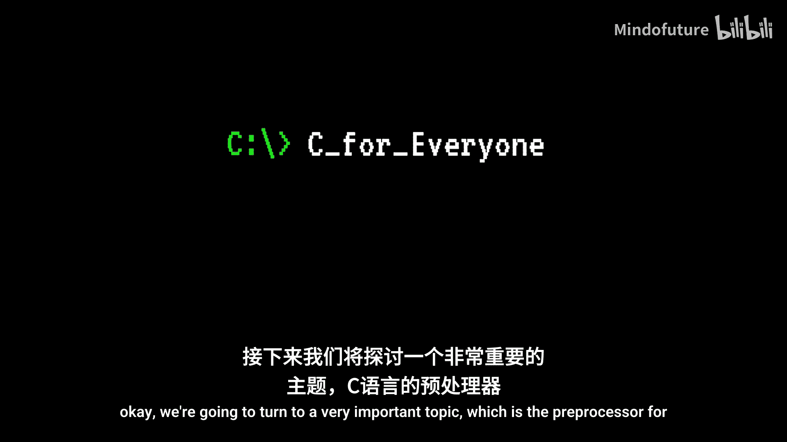

# 【加州大学】C语言结构化程序设计-｜-C-Structured-Programming-p04-P04_C预处理器_01_01_04--BV1wYe7zWE1T_p4-

🎼2。

🎼，Okay， we're going to turn to a very important topic。Which is。The preprocesor for the C language。

And don't forget the C language is an old language， it goes back to 19。72。

And it had a very heavy reliance。On the use of the preprocessor to do things。

Before the actual code got compiled。So you really look at the C system and you have the pre processoror。

 and it does important things like link in standard files。And it also does macro expansion。

Now in more modern languages。Those。A frequently just a component of the overall compiler and。

There is no。啊。There's frequently nothing to do with a pre processor。

So you could consider this more advanced because so far what we've used the prepro for is really 90% of conventional programming you don't really。

A need to have a hugely more sophisticated understanding of it。

 But I think everybody should at least go through this video。At least casually。

So we've sharp included things like Standard Io。h， it gets us our printf and scanf， et ce。

 we've sharp included our math。th， it gets us things like strict value decent values of pi。

 the use of function such as fine function or the square root function。

The Sha is a special character that occurs in column 1。And announces。

That there's a preprocessor command。And as I said， so far。

 we've used sharp include and typically the angle brackets， which means go look for it and。

A standard place。 And get one of the C standard header files。

And that's very important because any time you use a programming language。

 you want to make every use of the library， libraries written by professionals。

 there's no point in most instances to replace a professional library by your own， in fact。

 that can make the code more unreadable and frequently buggiier。So sharp in of standard Io。

th gets us a hand at this file。But you got a lot of IO stuff and inside there's a declaration。

 the declaration looks something like int print F。Pen conchar star format， comma dot， dot， dot。

 And what that tends to mean is this returns。An integer， we almost never use that。

 That integer is actually how many characters get printed。

So if there's some strange reason to need that。啊。You could。

 you can actually use that value if you want， that dot dot dot means that。

What's being processed by the format string is a indefinite number of arguments。

 So it has to link up。 You have to have appropriate arguments for things in there typically things that are shown as percent like percent D or percent LF。

And such standard files， if you want to look at them。

 which I do recommend for the honor student or the student who wants to go on to be a professional。

That they are generally found in a directory called user In。

 and just go there and you can take a look at them。Failly elaborate。

But it's just something to know about。The other thing you can do with an include is you can include in large programs。

Some of your own files。And again， typically， they might be header files。Maybe you have your own。

Standard set of compiled programs that you need for large application。

 so you might have something like my。 H。And generally， it'll search for that in your local directory。

Don't forget。And out in up。System like Unix or any complicated operating system。

 There are what are called file path names and。呃。Things like sharp include need to know how。

To find the specific code you want。 So it'll either assume that it's in your local directory or if you give what's called a full path name。

 it'll look explicitly in that， in that place like。Source and user include。Okay。Enough said again。

 that's more of your professional or honor student。

The other thing we find that the preproor does a lot of is what we call the sharp define。

 which is a basic macro。Facility。And as I said before。

 that's generally no longer used or much used in more modern languages like Java and C++。

It's a powerful feature， it really helps extend the language。But。It can be dangerous because。The。

Macro facility。Jaction。Have a。The equivalent of compilers。

Doing things like type checking or making sure that expressions are legal。

So you can frequently do something subtle。That causes a later error that's not going to be easy to catch。

So it's better to work with things in the language than to make use of this powerful facility。

 that's just a rule of thumb。Okay， a simple use is to sharp define a constant。

 let's say the constant capital C is 2，9，9，7，9，2， and that speed of light in kilometers per second。

 kilometers per second。And it is often the case that in the C community。

 while it's not a requirement， these constants are found in CAs， so you'll find constants like pi。

 Max and， EOF， and the file。And then。When they are expanded using the preprocessor。

Pi will show up as 3。14159。 Max Sels show up as 2 billion and change。 UF O show up as a -1。

And we'll see in a second why frequently something like this when there's an operator involved。

Is parenthesized。Now， again， this is not recommended， but。A lot of people like to play with it。

 something to be aware of。 There are ways to affect。

What seems to be the syntax of the programming language by introducing your own private macros。

 So you can do something like this。 We call it syntactic sugar， sharp， to Q as。They are。

Operator equal equal and all thats the logical equals。So if you see an if statement later on， a E。

 Q B。The preprocessor will expand that to equal equal。And。

That will tend to avoid the mistake that almost everybody makes at some point in some program。

 which is to forget that it's a equal equal B and say a equal B。Which is assignment。

 which still works， which is still an integer expression。 It's not a boolean type， so。It may。

 in fact， cause a mistake that's hard to find。Okay。

 even more powerful than you use for syntactic sugar。And this is。Frequently still use。

 but we'll explain why again， it's something that you should avoid， as I said。

Theiliity with section is useful。It's for you to understand other people's code or code from an earlier time。

Somewhat still in use， but you can do something like sharprp define SQ and then have parameter。

So you'd have an identifier here。And then what this is gets expanded to。 and here we see。Pen， Paren。

 X star， Par， X， X， X par。And these x's。A going to be what are explicitly expanded。

So if textually in your code。You see something like this。 x is equal to square of y plus 3。Then。

It's replacement。Is y plus 3 goes into that parenthesized thing。 Remember。

 we heavily parenthesize it times y plus 3。And we get this expression。

And why is that convenient Well， if for some reason， we're doing square all over the place。啊。

This is a convenient abbreviation。How we can do it for things that are even more complicated and we can do it for multiple arguments I won't show that for the moment。

But I am going to show why there's a pitfall here。Let's say instead。

 square x was replaced textually by x times X， and we didn't have all that elaborate wrapping of parentheses。

 Then when we saw in the code， X is a sine square of y of 3。 We would end up with x equal。

 we have a textual replacement， Y plus 3 times Y plus 3， oops。For whoops。Remember precede。

Times is of higher precedence。So you're really getting three times y。Plus y plus3。

 you're not really getting y plus3 times y plus3， which is what was expected。Again。

If this is a topic of interest for you and we want to explore it more。

You can use your compiler frequently with the flag minus capital E for expand macros。

Acting on your file， this will not compile to executable code， but the compiler will spit out。C code。

🎼The actual sea code after。🎼After the prepresss。

