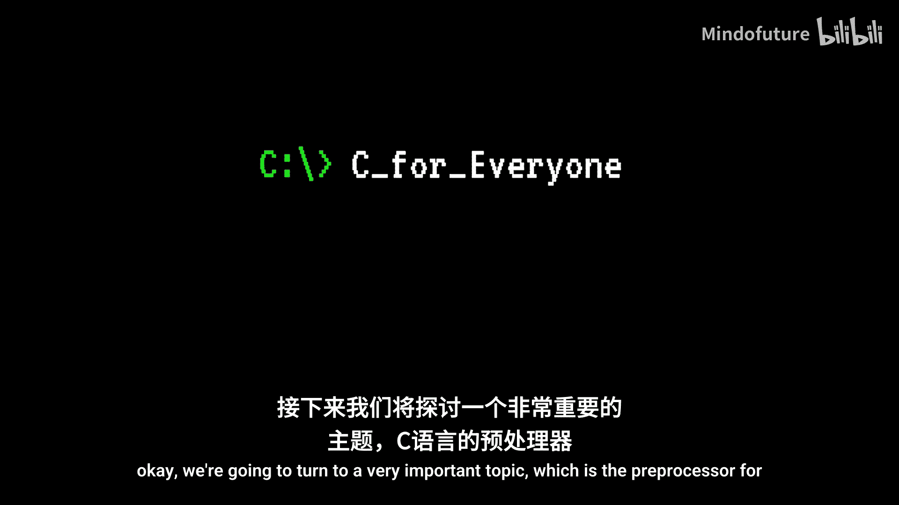

# C语言结构化程序设计：P04：C预处理器



## 概述
在本节课中，我们将要学习C语言中一个非常重要的组成部分——预处理器。预处理器在代码被实际编译之前执行，负责处理诸如文件包含和宏展开等任务。理解预处理器对于阅读旧代码和掌握C语言底层机制至关重要。

## 预处理器简介
上一节我们介绍了C语言的基本结构，本节中我们来看看预处理器。C语言诞生于1972年，其设计严重依赖预处理器来完成编译前的准备工作。在更现代的语言中，这些功能通常直接集成在编译器内部，但在C语言中，预处理器是一个独立的阶段。

预处理器指令以井号 `#` 开头，并且必须位于第一列。到目前为止，我们最常用的指令是 `#include`，用于包含头文件。

## `#include` 指令
`#include` 指令用于将其他文件的内容插入到当前源文件中。这使我们能够使用标准库或自定义的代码库。

以下是 `#include` 的两种主要用法：

1.  **包含标准库文件**：使用尖括号 `<>`，编译器会在标准系统目录中查找文件。
    ```c
    #include <stdio.h>
    #include <math.h>
    ```
    例如，`stdio.h` 中包含了 `printf` 和 `scanf` 等函数的声明。`math.h` 则提供了数学常数（如 `M_PI`）和函数（如 `sin`, `sqrt`）。

2.  **包含自定义文件**：使用双引号 `""`，编译器会优先在当前目录中查找文件。
    ```c
    #include "my_header.h"
    ```
    在大型项目中，开发者常将自定义的函数声明、常量定义等放在头文件中，以便多个源文件共享。

对于希望深入理解或成为专业开发者的学生，建议查看标准头文件的内容。它们通常位于类似 `/usr/include/` 的目录中。

## `#define` 指令（宏）
预处理器的另一个核心功能是 `#define` 指令，用于定义宏。宏是一种文本替换机制，虽然强大，但在现代C++或Java等语言中已较少使用。使用宏时需要谨慎，因为它不进行类型检查，可能引入难以发现的错误。

### 定义常量
一个简单的用法是定义常量，这有助于提高代码的可读性和可维护性。在C语言社区中，常量名通常使用大写字母。

```c
#define SPEED_OF_LIGHT 299792 // 光速，单位：千米/秒
#define PI 3.14159
#define MAX_INT 2147483647
```

当预处理器遇到 `SPEED_OF_LIGHT` 时，会将其直接替换为 `299792`。

### 定义带参数的宏（函数式宏）
宏可以带参数，实现类似函数的功能，但这存在风险。

```c
#define SQUARE(x) ((x) * (x))
```
这个宏用于计算平方。注意，参数 `x` 和整个表达式都被括号包围，这至关重要。

让我们看看如何使用它：
```c
int result = SQUARE(5); // 展开为：((5) * (5))，结果是25
```
如果宏定义中没有足够的括号，就会出现问题。例如，错误定义：
```c
#define SQUARE_BAD(x) x * x
```
使用它时：
```c
int y = 3;
int bad_result = SQUARE_BAD(y + 1); // 展开为：y + 1 * y + 1
```
由于乘法运算符 `*` 的优先级高于加法，实际计算是 `y + (1 * y) + 1`，即 `3 + 3 + 1 = 7`，而不是期望的 `(3+1)*(3+1)=16`。因此，**为宏表达式和每个参数都加上括号**是一个好习惯。

### 宏作为语法糖
宏有时被用作“语法糖”，让代码看起来更符合个人习惯或更清晰，但这可能降低代码的可移植性。

```c
#define EQ ==
```
之后可以这样写：
```c
if (a EQ b) { ... } // 预处理器会将其展开为 if (a == b) { ... }
```
有人认为这可以避免将 `==`（比较）误写为 `=`（赋值）的常见错误，但现代编译器和IDE通常能直接警告此类错误，因此这种做法并非必需。

## 查看宏展开结果
如果你想查看预处理器处理后的代码（即宏展开后的结果），可以使用编译器的 `-E` 选项。

```bash
gcc -E your_program.c
```
执行此命令后，编译器会输出经过预处理（包含文件展开、宏替换）后的C代码，而不会进行编译和链接。


## 总结
本节课中我们一起学习了C语言预处理器的核心功能。我们介绍了 `#include` 指令的两种用法，用于包含系统头文件和自定义文件。我们重点探讨了 `#define` 指令，学习了如何用它定义常量和带参数的宏，并强调了正确使用括号以避免运算符优先级问题的重要性。最后，我们了解了如何使用编译器选项查看宏展开的结果。虽然宏功能强大，但在现代C语言编程中应谨慎使用，优先考虑使用语言本身的特性（如 `const` 变量和函数）来保证代码的安全性和可读性。