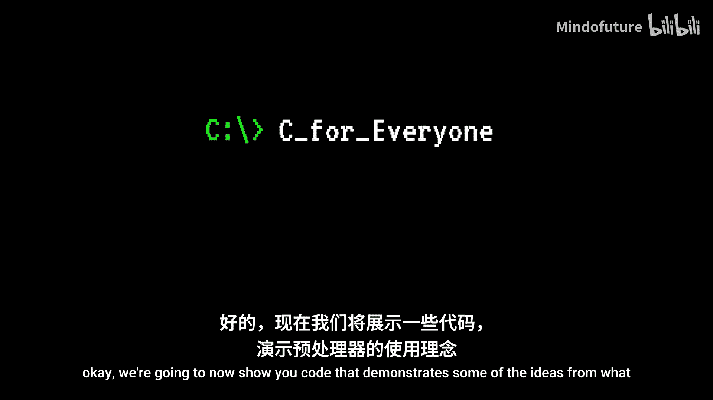
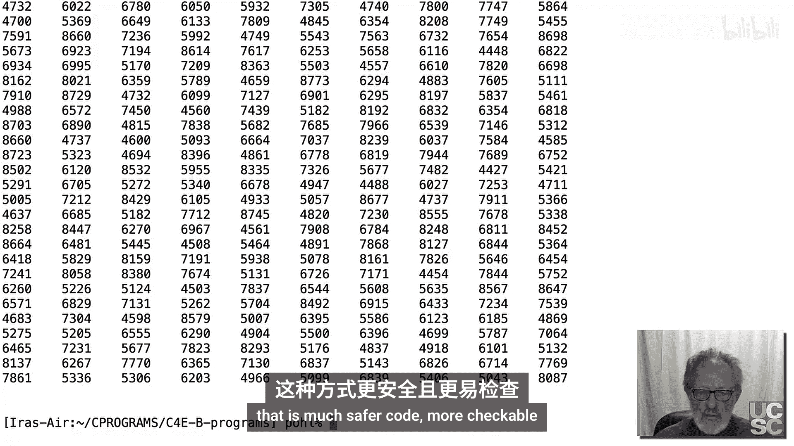

# 【加州大学】C语言结构化程序设计-｜-C-Structured-Programming-p05-P05_预处理器代码_01_01_05--BV1wYe7zWE1T_p5-

🎼2。

🎼，Okay， we're going to now show you code that。Demonsstrrate some of the ideas。From。

What we were just talking about in the use of the preprocessor。

And this piece of code is going to generate at random。A thousand elephant male elephant seal。

 actually southern male elephant seal weights。Let's look at it。We， of course。

 have our sharpened includess。 and here we're using three of the standard libraries。

Each one has some。Functions already defined。Well declared that are available to us for this。 And so。

 again， important rule。 anytime there's a standard function that does the job make use of it。

Next thing we use is a very simple macro。And that's a sharp define of a constant。 And we use the。

Identifier。For constants where we use all caps， and you can see one's called Max elephant seal。

 weight male， 8800 pounds， and min elephant seal weight male 4，400 pounds。Just if you want the。

You can look up the southern elephant seal females。

 they're considerably smaller and they're typically somewhere in excess of 880 pounds。

And now we have some more complicated macros。 We， again， have some。呃。Range。

 that's the gap between the minimum max weight is 4400。

We want a generate a population of a thousand sample weights。

And here we're defining a macro that calls some code。

 and here you can recognize the code as our basic RA， which is found in standard library and。

We modular it over range， why， Because we want to get something within the range of 0 to 4400。

Now the weight is going to be the weight。Over。That's generated by this。

 so this macro coming after that macro makes use of it。Plus， the minimum elephant seal weight mail。

 So we're generating a range， and we're adding it to what could be the minimum。

 So that could be anywhere from 0 to 4400。And then we'll get。In effect， random weights in this range。

 And look how we generate them。And now we write a multiline。Macro。And in this multiline macro。

The backslash character says the macro is really defined on two lines and that could be extended as many backslash needed for that macro。

And here we have some more elaborate code for I equals0， I less than population。I plus plus。

Data of y equals weight。So you can see what it's doing for each entry in。What has to be a。Aay。

Our data array， we're going to call on this weight function。

 a weight function is calling on the weight over macro and adding in the minimum elephant seal weight。

Finally。We have。A function to print the data。 It's a basic function that should be no no surprise to you。

 You have to pass in the array and the size， and it says just print the size。

 printed tab separated and then every 10 values。Priinnt on a new line。

And then we actually have the code and。That code is int Ma and I and data population。

 So we're getting our thousand there。 So it's relatively easy to redefine this code。

 We could redefine also the range if we want， if we wanted to build something for。

The northern elephant seals， which are slightly lower。

 we could rewrite the code for northern elephant seals。Here again， is something we've seen before。

 When we use the random number generator。 we want each time we call the program to have something different。

 And this allows us to reset the seed based on a systems clock。

 and we don't always get the same value。 So we get a different seed。

 So we'll get different data each time we call this。

Then we get the fill notice fill and all of this stuff depends on a preprocessor。

And then you'd actually see if you could expand， if you use that minus expand flag。

 what the actual code for these things would be this is more readable， population， fill population。

And let's execute the code。And just to show， I already compiled it。And sure enough。

 if you look at these numbers and just scan them， you can see they're in。あ。The given range。Okay。

So that shows you how powerful macros are， one cautionary tail。

Nowadays in the CNC plus plus community， there's much less reliance on macros。

 especially ones that involve code in general for。Code segments。

 we either let the compiler optimize it or for example in the。

C++ language and in some C compilers you can call a function in line and that asks the compiler to optimize it much like it would be for a macro and that is much safer code more checkable。

🎼。