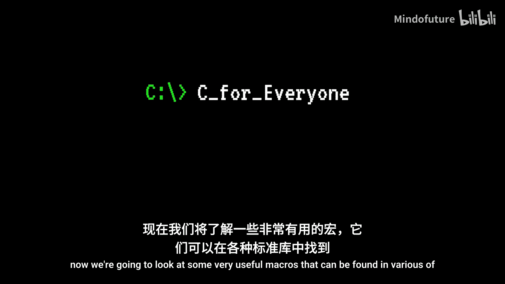
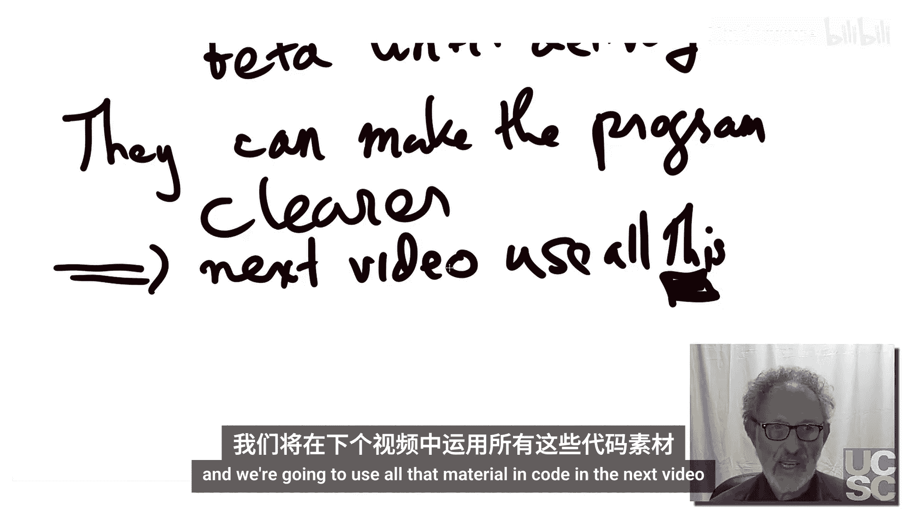

# 【加州大学】C语言结构化程序设计-｜-C-Structured-Programming-p06-P06_使用断言保证程序正确性_01_01_06--BV1wYe7zWE1T_p6-

🎼2。

🎼，Now we're going to look at some very useful macros that can be found in various of the standard libraries。

 including standardIo。h and type。h。And we're going to emphasize the use of a macro。

Sort of a piece of code found by using a sharp define。

 and that sharp define will be the define of what's called an assertt。

So some useful macros for preprocessing that include character preprocessing。And also for Char Star。

 which is our way of talking about a string。Namely the pointer to char。

Includes something like sharp Def get cha。Pen，paren。

And that is sharp defined as get C of standard in。Standard N is the。Name。Assigned to。Output， not。

 not output input， excuse me， Standard in is assigned to input。 That's why it's in。

Which generally will start by being。The keyboard。So if you want to get a character from the keyboard。

 you can use get jar， or you can also use get C of standard N。But getchar is a little simpler。

 Why bother with what's otherwise a standard name。So this a macro。

 it exists in the standard I O Library。And it helps getting characters from input。

You can generally use Get C with a file name and we'll see when we start processing files how useful something like that is。

There's an equivalent output。Macro， which is called putchar of C， which means put a character。Namely。

 the character C into standard out again standard out is。Predefined to be your screen。

So these simple macros let you do character by character processing。Which includes using white space。

 which is a little different than using。啊。Prrintf and Scanf， where white Space might cause a hiccup。

We also in C type dot age。Have processing， and you can look it up yourself。

 you should by now be able to use things like online lookup， lots of reference material。

 including material in Wikipedia on the language and on its standard libraries。

It's too much information to just have it all memorized in your head to either book or in this case。

 its typically convenient to get it off the internet， and we have things macros like is Alpha of C。

And that says， is that character alphabetic？That means it an A to z， either lower uppercase。

And is reflects the fact that we expect a Boolean value。 Now， Boolean， of course。

 in the C language is0 for false and non zero， which in this case will return a one for true。

So if it sees an alphabetic character， it's going to return one。

 if it sees a non alphabetic character or white space character， it's going to return zero。

This checks for white space。This checks for digits。

This checks for whether some characters in lowercase。 Let's say you want to do something on lowest。

 let's say you want to make everything uppercase。 So you would check it。

You found the lowercase character and then you can use an action to uppercase。

 so this would turn a lowercase character this in action into uppercase。

And now let's turn to what I said was going to be a very important topic。

Also found in the preprocesor in the standard libraries， and that's to use Ass。And。

These asserts can be turned on and off。And they can be turned on and off with a flag called End D bugg。

And the way they work。Is you an assert a lot of an expression？Typically。

 it should be thought of as a logical expression。And if。

Whatever the expression is is true you keep running。

 that means this is what you expected at that point in the program。

 but if for some reason it's not what's expected， then it calls in a port which is theres an appropriate message and we're going to see that in code in our next segment。

Asserts can be injected to test routine code。And they can be used。

To prove the correctness of your program， so in some sense initially。

Famous computer scientists touring award winners like Dk Strand or。Actually。

 were attempting to mathematically prove that their programs were correct。

Turns out practically speaking， not too many of us can do that。

 and we can even great geniuses have trouble doing it for something other than a small amount of code。

Though some people envisioned ultimately theem improving programs。

 proving that the code could be correct。Fortunately for human labor， this is not yet there。

So we can put in those asserts in effect。 They also act as comments saying here's what we expect to be true at this point and they can be left in。

And delivered。And then the program， when we understand it to be correct。

 can use the end bug flag to either turn off or turn on whether those will be tested。

And we're going to use all that material in code in the next video。

