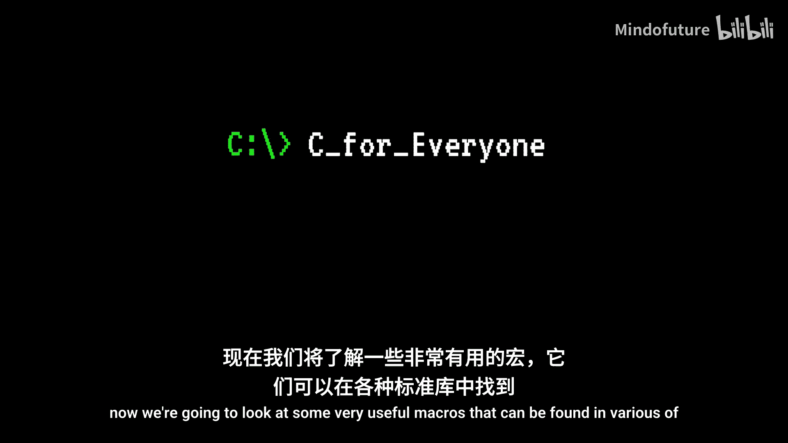
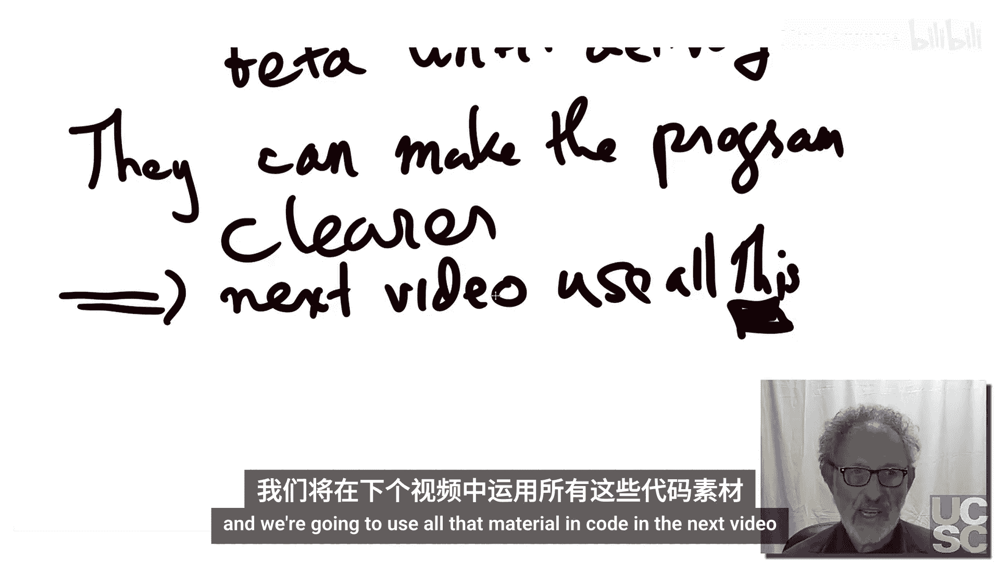

# C语言结构化程序设计：P06：使用断言保证程序正确性

## 概述
在本节课中，我们将学习C语言预处理阶段中一些非常有用的宏，特别是`assert`宏。我们将了解如何利用这些宏来检查字符、处理输入输出，并重点学习如何使用断言来验证程序在运行时的状态是否符合预期，从而帮助我们发现错误并增强代码的可靠性。

## 标准库中的实用宏
现在，我们来看看一些可以在各种标准库中找到的实用宏，包括`stdio.h`和`ctype.h`。我们将重点介绍一个通过`#define`指令定义的宏，即所谓的`assert`宏。

### 字符输入输出宏
首先，我们介绍用于字符预处理的实用宏。对于`char *`（即指向字符的指针，我们用它来表示字符串），标准库中包含了类似`#define getchar() getc(stdin)`的定义。

`stdin`是分配给输入的名称，通常初始指向键盘。因此，如果你想从键盘获取一个字符，可以使用`getchar()`，或者也可以使用`getc(stdin)`。但`getchar`更简洁。这是一个存在于标准I/O库中的宏，它有助于从输入中获取字符。

有一个等效的输出宏，叫做`putchar(c)`，意思是将字符`c`放入`stdout`。同样，`stdout`预定义为你的屏幕。

这些简单的宏允许你进行逐个字符的处理，这包括处理空白字符，其行为与使用`printf`和`scanf`时略有不同，后者中的空白字符可能会引起问题。

### 字符类型判断宏
在`ctype.h`中，我们还有用于字符判断的宏。你应该已经能够使用在线查找等参考资料，包括维基百科上关于语言及其标准库的资料。将所有信息都记在脑子里是不现实的，通常从互联网上获取这些信息很方便。

以下是`ctype.h`中的一些宏示例：
*   `isalpha(c)`：判断该字符是否为字母（A到Z，大小写均可）。函数名中的`is`反映了我们期望一个布尔值。在C语言中，0表示假，非零（本例中返回1）表示真。因此，如果看到字母字符，它将返回1；如果看到非字母字符或空白字符，它将返回0。
*   `isspace(c)`：检查是否为空白字符。
*   `isdigit(c)`：检查是否为数字字符。
*   `islower(c)`：检查字符是否为小写。例如，如果你想将所有字符转为大写，你可以先检查它是否为小写字符，然后使用一个操作将其转为大写。
*   `toupper(c)`：这个操作可以将小写字符转为大写。

## 断言（Assert）宏
现在，让我们转向一个非常重要的话题，它也存在于预处理器的标准库中，那就是使用断言（`assert`）。

这些断言可以通过一个名为`NDEBUG`的标志来开启或关闭。

它的工作原理是：你断言（assert）一个表达式（通常应被视为逻辑表达式）。如果该表达式为真，程序继续运行，这意味着此时程序的状态符合你的预期。但如果由于某些原因它不符合预期，那么它会调用`abort`函数并输出相应的错误信息，我们将在下一节的代码中看到这一点。

断言可以被插入到常规代码中进行测试。它们可以用来证明程序的正确性。从某种意义上说，最初一些著名的计算机科学家（如图灵奖得主Dijkstra等人）曾尝试用数学方法证明他们的程序是正确的。但事实证明，实际上没有多少人能做到这一点，即使是伟大的天才也很难为大量代码做到这一点，尽管有些人设想最终能够改进程序并证明代码的正确性。幸运的是，对于人类劳动而言，这尚未实现。

因此，我们可以插入这些断言。它们实际上也充当了注释的角色，说明在程序的这一点我们期望什么是真的。它们可以被保留并交付。然后，当我们确信程序正确时，可以使用`NDEBUG`标志来控制是否测试这些断言。

我们将在下一个视频的代码中使用所有这些内容。

## 总结
本节课我们一起学习了C语言预处理中的实用宏。我们了解了用于字符输入输出的`getchar`和`putchar`宏，以及用于字符类型判断的`isalpha`、`isspace`等宏。更重要的是，我们深入探讨了`assert`宏的用途和工作原理，它通过在代码中插入逻辑检查点，帮助我们在开发阶段验证程序假设，及时发现错误，是提升代码健壮性的重要工具。在下一节中，我们将通过实际代码来演示这些概念的应用。