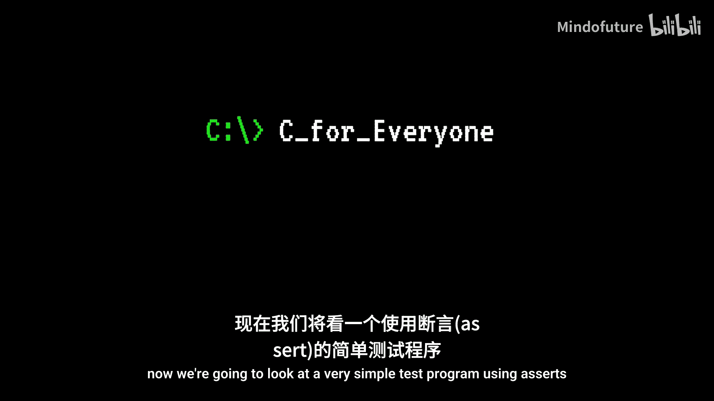
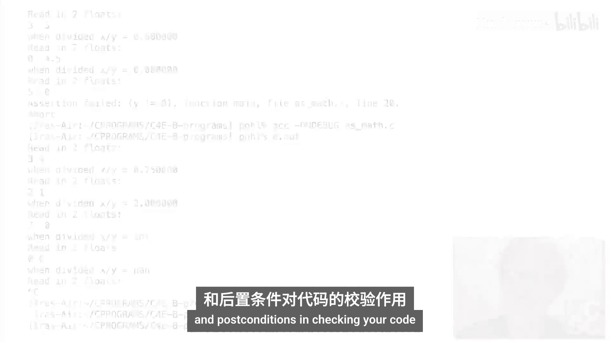

# 【加州大学】C语言结构化程序设计-｜-C-Structured-Programming-p07-P07_断言代码_01_01_07--BV1wYe7zWE1T_p7-

🎼2。

🎼，Now we're going to look at a very simple test program。Using asserts。Okay， let's look at this。

 we've included the assert headed file。呃。And the program merely says the zero and remember zero。

 of course， means false。So。This is so simple that it basically says， oh， this assert fails。

And rather than print my program runs， we should compile this and see the program failing。

So let's do that。And when the assertion fails， you see assert failed function main。

The file was aert test 1 do C line 16， and there was an abort。So。The assert is saying a certain。

Precondition does not hold at that point in the program。

 and as part of what it gives you besides aing the program is showing you where that happened。

 and indeed， that happened exactly at the assert。Now。Let's look at a second test program。

In this program， the differences we've included。En debug flag。Its sharp defined。

And what that does is it turns off the asserts when compiled with the end the bug flag。So now。

 the same program as we saw before， with the exception of adding and a bug。Willll do as follows。

And it runs as if the program did not have the assert0 there。So in some sense， you end a bug flag。

Lets us use。Asserts， but then。Wips them out after we find that the program is running correctly。

 we can just insert that and say， stop using assertions。 So that's one way to develop code。

 Stick in your assertions， in effect， to dynamic proof of correctness。

 And after you're convinced that all the assertions are no longer needed。

 you can just turn them off for the moment。 Of course。

 if you further develop code based on that source。They'll be available and anytime you don't have the sharp defined。

 the assertions will be turned back on。Let's look at one more program using Asts。

 it'll be a simple math program。In this program。What are we asserting， There are two doubles。

We're going to run an infinite loop。We ask。For two floating point numbers。

 scanning them and reading them into X and Y。And then we assert that y is not equal to zero。

And why is that， we don't want to divide by 0 here， Otherwise， we print。X divided by y。

So if we run that code and I think I already have it。Compiled。So let's read into floats。

 let's read into floats。Dividing 4。54 by 5。6 is 0。714 can read into more floats。And five。That's 0。6。

We can divide。0ero。Byい。4。5 that's going to be zero， we're in that infinite loop。

 but now let's try dividing5。By zero， see what happens and there's an assertion fail。

So that's not recommended for us getting out of such an infinite loop。

 normally we would have something we would either read as Sentinel or we would use。

In the case of most UniX operating systems control C to end the program as well。Now， one last thing。

 what happens if we compile that without？With an effect an end of bug flag and we can see how to do that with our Ga new compiler。

We do a minus d and debu。As part of the compilation， and that's telling us turn off the asserts。

And now let's run the same program except that the asserts have been turned off and now we can read in。

 let's say， three and four， sure enough。Two and one， sure enough。But now when we read。

Seven over zero。Instead of getting an assertion error， we get when divided x over y is INF。

 and that's the system。Provided。Infinity。Now it's sort of interesting。

 what if you divide zero by zero？It also doesn't abort instead it just says not a number。

So these are two interesting constructs when we get some mathematical operation。

That can't be interpreted in the normal set of reels。And now because we can't。

 we're in the infinite loop and it's waiting for floats and we don't have the ability to。

Right in zero， which we used before to create boat， we will just do control C。

And get out of there Okay， so that's our asserts， we saw it in code， very useful。

 especially if you're going to be a careful coder， it helps just in your logic to think about what asserts can do as preconditions and post conditionsitions in checking your code。

