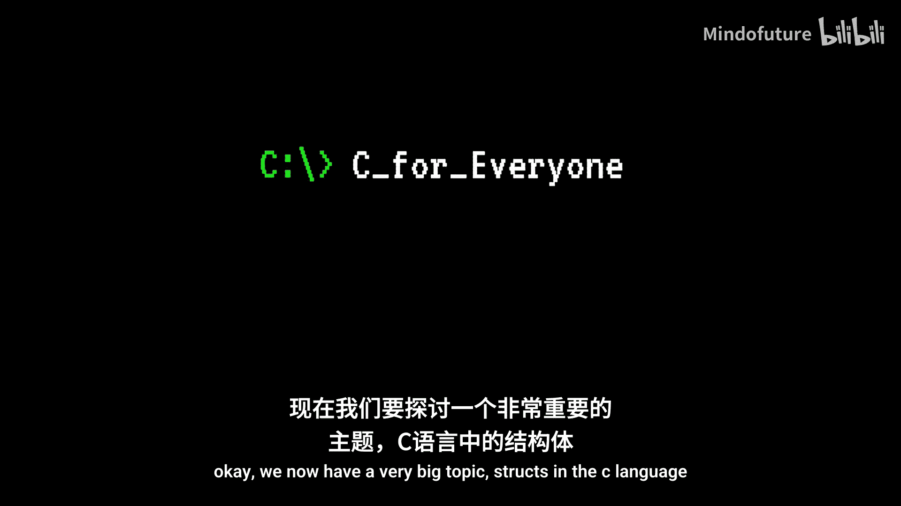
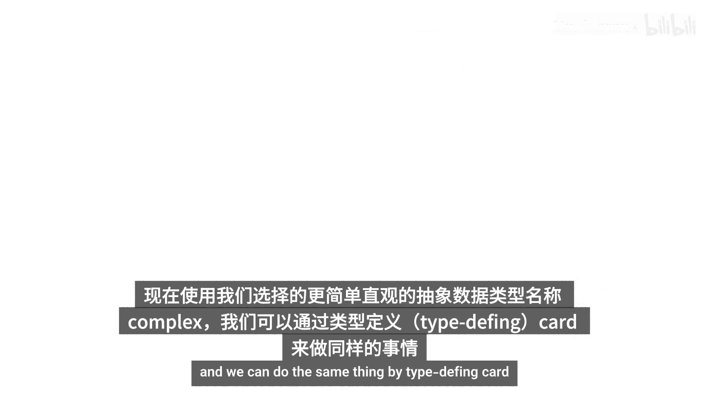

# 【加州大学】C语言结构化程序设计-｜-C-Structured-Programming-p08-P08_结构体介绍——更高级的抽象数据类型_02_01_01--BV1wYe7zWE1T_p8-

🎼2。

🎼，Okay， we now have a very big topic， Strs。In the C language。

Now we've already talked a little bit about what an abstract data type is， namely。

 it's a user defined type。We've seen it with enumerated type。So type。

It's very critical to a problem solution。And we have native types inch cha float and so on。

Including various pointer types， and these types can be used in a natural way to solve a lot of problems。

 especially。Text and mathematical problems。What if you have？

A need to do something in gameplay and you want to produce。A data type。

You could think of as playing cardss。Planing card。Not the best drawing of all。

 but that's just me a of Spdes。We want to have a way to represent that。Why well？We might have。

A strategy game in which you get to play poker against a bunch of other poker players。

 and in such a strategy game， we want to be able to compute the likelihood of five card hands。

So if you're drawing five cards only， that's what typically is a hand in poker。

What is the likelihood that your five card hand is going to be a straight Now straight is something where you have。

Five consecutive values in a row， like a 78910 jack。

Jack is like an 11 Queen is like a 12 King is like。啊。A 13。An ace can be either one。

 the low end of a straightit or the high end。So if we were to compute that。

 we we have to have a way to represent cards and then make that computation I'm going to show you how to do this over the next。

Few lectures。Typically when somebody talks about a card， we're talking about its pps value。

And for our purposes， we're going to represent the Pipps value as one to 13， 13 being a king。

One being an AC for the moment， H 2，3，4， up to 13。AEces are going to end up special in many cases。

 because ACEces can be used as both a low card and a high card。

And that will add to the complication in some of our calculations。And then we have suit。

 and a suit can be clubs， diamonds， hearts， or spades。Now we're going to use this。啊。

Abstract data type mechanism， thestruct mechanism to build our own data type for a card。

 and it's not the only way， it's not unique in the way to do it。

 I'm not even going to claim it's the best way。So struck card iss going to have two components。

 it's going to have a PPS component where it's going to be an in， it's going to be between 1 and 13。

And a cha component whichs going to be a suit and it's going to be one of these four characters which will be either a Cfer club。

 a Dier diamond at H for heart or nest for a spade and that's how we're going to for the moment represented it so I said it's not unique。

Think about it you could also。Refine these things as en numerator types。

 and that might even be better because an numerator type is a specific way to just have。

A few specific values that can be named。But for the moment。

 let's stick with this because it's fairly easy to use。Look at the syntax of how a struck works。

Is the keyword struck？There's what we call the tag name and the above it was card。

And then there's what's called a Declarator list， followed by a semicol。

And the Dec this were itself declarations， comma separated declarations。So we had a keyword。

 an identifier。And remember， when we write denifiers。

 we want to make sure they're literate that they contribute to the readability of the program。

 so when we say struck card， it becomes clear that we're using that as a abstract data type for card。

And now we can use that declaration， so we can say struckuck card， Bren and bips cha suit。

And declare a deck to be an array of 52 cards。That would be a perfectly reasonable way to represent the ordinary poker deck。

There's a further important thing that's very convenient， and that's a use of the keyword type de。

To simplify declarations。 so we can also say。For example， type de struck。Open brace。

And then we say float R E， float R float I M for real part， and imaginary part， semicolon。

 close paren， call it complex semicolon。 And now with this type deft。

 this specific struck did not have a tag name， but it has this。啊。Identifier。

That's basically the type theft， the declaration that's going to be used and now complex。

Intrinsically represents the same thing as what before would have been struck。Complex。

 so instead of having to say struck complex all the time， we can now use a much simpler。

And intuitive。Abstract data type name that we chose complex and we can do the same thing by type defing card。

