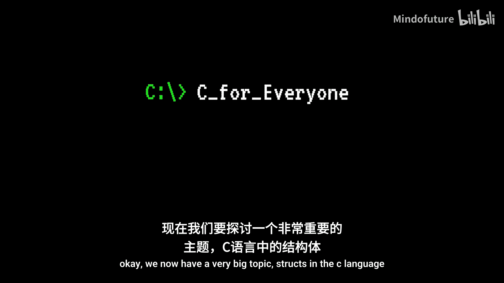
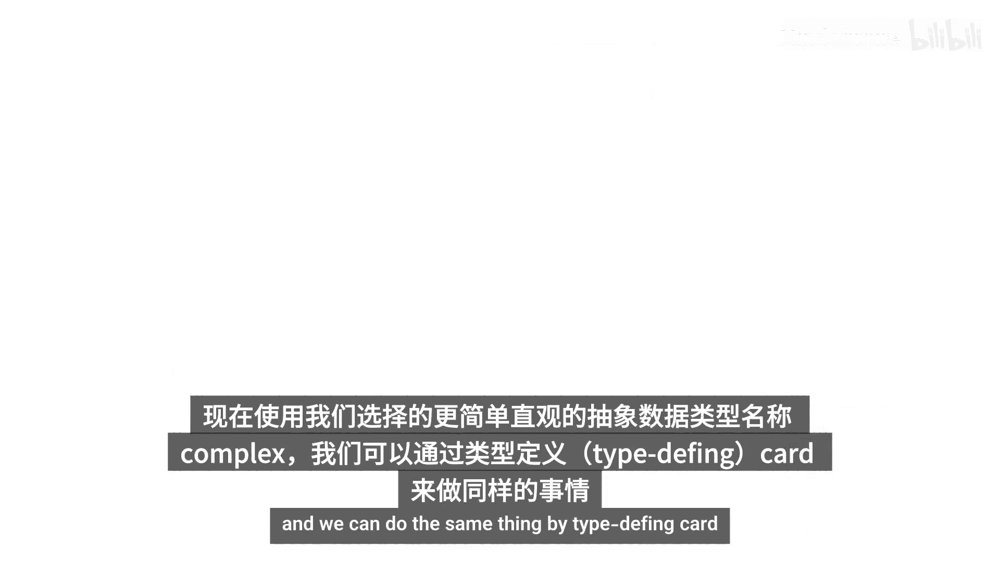

# C语言结构化程序设计：P08：结构体介绍——更高级的抽象数据类型



在本节课中，我们将要学习C语言中一个非常重要的概念：结构体。结构体允许我们创建自定义的、更复杂的数据类型，这对于解决现实世界中的问题至关重要，尤其是在处理像游戏卡牌这类由多个属性组成的对象时。

## 什么是抽象数据类型？

上一节我们介绍了抽象数据类型的概念，它是一种用户自定义的类型。我们已经通过枚举类型见过它。类型对于问题解决方案非常关键。C语言有原生类型，如 `int`、`char`、`float` 等，包括各种指针类型。这些类型可以自然地用于解决许多问题，尤其是文本和数学问题。

但是，如果你需要在游戏开发中处理某些对象，例如想要创建一个表示“扑克牌”的数据类型，该怎么办呢？

## 为什么需要结构体？

想象一个策略游戏，你需要与一群其他玩家玩扑克牌。在这样的游戏中，我们希望能够计算五张手牌的概率。例如，计算你抽到的五张牌恰好是“顺子”（即五张连续点数的牌，如7、8、9、10、J）的概率。

为了进行这种计算，我们必须有一种表示单张牌的方式。一张牌通常有两个属性：点数和花色。

*   **点数**：我们用1到13的整数表示，1代表A，2到10代表对应数字，11代表J，12代表Q，13代表K。A在某些情况下（如顺子）既可以作为1（低点）也可以作为14（高点），这会增加计算的复杂性。
*   **花色**：花色可以是梅花（Clubs）、方块（Diamonds）、红心（Hearts）或黑桃（Spades）。

我们将使用结构体机制来构建我们自己的“卡牌”数据类型。

## 如何定义结构体？

以下是定义结构体的语法：

```c
struct card {
    int pips; // 点数，1-13
    char suit; // 花色，'C', 'D', 'H', 'S'
};
```

让我们分解这个语法：
*   `struct` 是关键字。
*   `card` 是**标签名**，它标识了这个结构体类型。
*   大括号 `{}` 内是**声明列表**，包含用分号分隔的成员变量声明。
*   每个成员声明就像普通的变量声明，例如 `int pips;`。

定义了 `struct card` 之后，我们就可以用它来声明变量了。例如，我们可以声明一个代表整副扑克牌的数组：

```c
struct card deck[52]; // 一个包含52张牌的数组
```

## 使用typedef简化

每次声明变量都要写 `struct card` 可能有些繁琐。C语言提供了 `typedef` 关键字来为类型创建别名，从而简化声明。

我们可以这样使用 `typedef`：

```c
typedef struct {
    float real; // 实部
    float imag; // 虚部
} complex;
```

在这个例子中：
*   结构体本身没有标签名。
*   `typedef` 将整个结构体类型定义了一个新名字 `complex`。
*   现在，我们可以直接使用 `complex` 来代替 `struct {...}`。

我们可以对卡牌做同样的事情：

```c
typedef struct {
    int pips;
    char suit;
} card;

card deck[52]; // 现在声明变得非常简洁直观
```

通过 `typedef`，我们创建了一个更简单、更直观的抽象数据类型名称 `card`。

## 结构体的优势

使用结构体将相关的数据组合在一起，有以下好处：
1.  **组织性**：代码更清晰，逻辑上相关的数据被封装在一起。
2.  **可读性**：`card myCard;` 比单独使用 `int myCardPips; char myCardSuit;` 更能表达意图。
3.  **可维护性**：如果需要为卡牌增加新属性（如是否正面朝上），只需修改结构体定义，而不是散落在各处的多个变量。

## 总结



本节课中我们一起学习了C语言的结构体。我们了解到结构体是一种强大的工具，它允许我们创建自定义的抽象数据类型，将多个相关的数据成员组合成一个单一的单元。我们学习了如何定义结构体，如何声明结构体变量，以及如何使用 `typedef` 关键字来简化类型名称，使代码更加清晰和易于管理。通过以“扑克牌”为例，我们看到了结构体如何帮助我们更自然地建模现实世界中的复杂对象。在接下来的课程中，我们将学习如何操作和使用结构体变量。