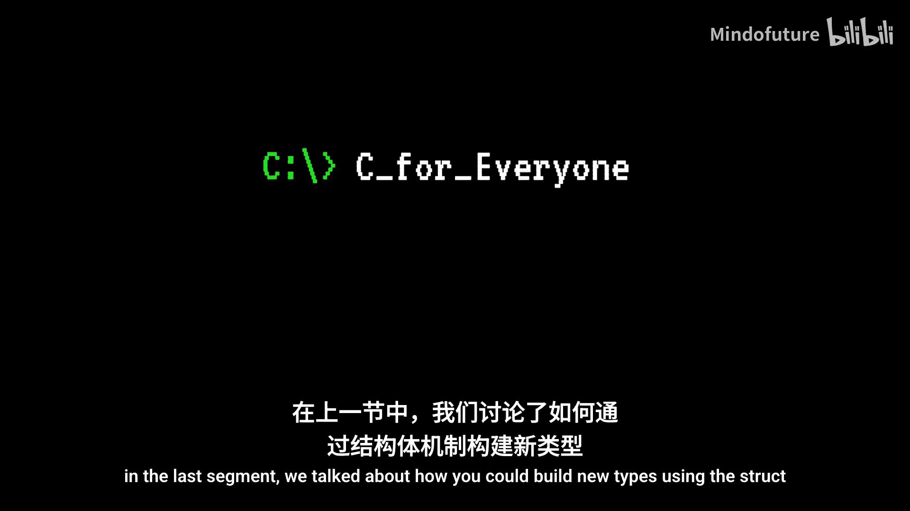

# 【加州大学】C语言结构化程序设计-｜-C-Structured-Programming-p09-P09_如何访问结构体成员_02_01_02--BV1wYe7zWE1T_p9-

🎼2。

🎼，Okay， in the last segment， we talked about how you could build new types using thestruct mechanism。

Basically， a user defined type。And we illustrated it with how to build a card type。And now let's。

See how to manipulate such a type。 Well， critical to manipulating the type is we have to have the ability to。

Give。Values to the individual members of that struck and recall that struck had pips and suit。

 so we have to have a way to access the members。We're going to have two。

Operator types that will allow access to members will have two ways to do it。

 one will be the dot operator。In a way it's a little simpler because it's more direct。

 the second way will be a member access operator。Arrow。

So it sort of indicates it will make use of addressing。Let's show this now。

So here we have struck card。We have this declaration and now we'll declare three different variables。

 C1， C2， and C3。If we're using the point， the dot operator。What we say is we use the variable C1。

Which is struck card。 That's its type。We dot the member name， Pps， and then we assign it three。

Similarly， we can do that with the suit， in this case we assigned the character value H。

 so this in our representation is the three of hearts。Pretty straightforward。Remember。

You have the variable name。And then you dot it with the member name。

 and then you can manipulate that in a normal way， you can treat that as a naming convention for the field inside or the member inside thestruct type。

Now the second method。Is going to be using pointers and there we're going to have struck card pointer type。

 and we'll use pointer to card because pointer to card。Is a literate identifier tells us what it is。

 and we're going to set pointer to car to the address of C1 so in effect。

Pointer to Car is a second way to access C1。It's the address of the variable C1。And now。

 since what we really need to get at is members， we use the arrow operator and using the arrow operator。

 we say pointer to card， accesses the PPS member， set it to P， pointer to card。

 access the suit member， set it to。啊。Character value S， and in this way。

 C1 would now be a five spades here。Okay， so this involves some a pointer use。

That's a little trickier， but it's something you're。

Really going to have to get used to if you're going to master the C programming language。

So in summary， there are two ways to access a member， a dot operator。On the structure。

 it gets the member。Or。A pointer operator。With the arrow。

Which is an address that's the struck and then gets a member。So。

Point to arrow pointing at the name or dot on the name。Are there two ways to get at the structure？

Now。If we've mastered those ideas。We can combine them。In the following sense。

If we were to the reference pointer to card， remember it's pointing at C1。

That means this de reference takes high precedence。啊。It gets us now the card C1。

And that can be dotted to suit。So we can get to C1 through a dereencing of the pointer as well。

Now we're going to show this in real code， but before I show it in real code。I want to also。Show you。

Because we've。あ啊。Used a lot of things here。And。I want to also show you。At this point。

 what we know about the operator precedence table。That would be useful。ItsAgain。

 something when you're a beginner in the C programming language， you've got to make sure to study。

 understand which operators come before other operators。

 and notice on the highest precedentnce in the C operator list。

 there's the arrow and there's the dot。And they are as high presidents as。For example。

 post fix auto increment or function call， that's what that parenthees means there or indexing。

And notice as you go down， you get to the lower and lower levels。 Here are all the assignments。

 They're pretty low。 The only thing lower than all the different kinds of assignments is the comma operator。

 Then you have logical and the special ternary operator is very low。

And then up here you have mathematical operators。For example， multiplication。

 which is higher than addition。And then you have shift in relational operators。So。

Those things are something to keep in mind， but very important to understand how high in precedes。

A way of getting at a member is it's at the highest level of precedence。

