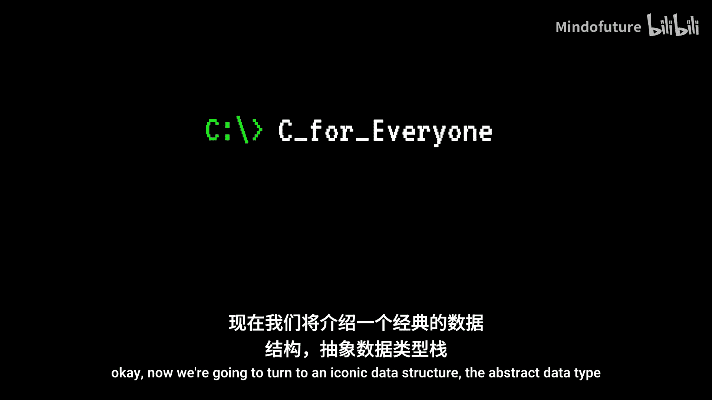
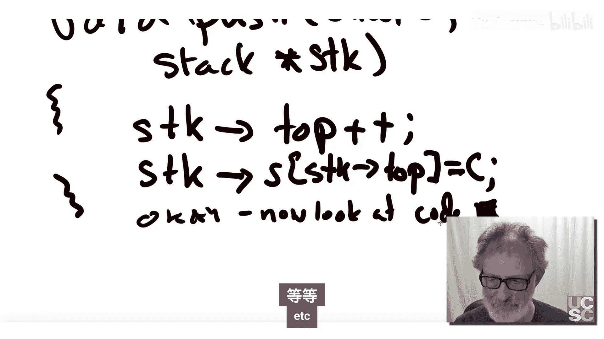

# 【加州大学】C语言结构化程序设计-｜-C-Structured-Programming-p10-P10_栈抽象数据类型介绍_02_01_03--BV1wYe7zWE1T_p10-

🎼2。

🎼，Okay， now we're going to turn to an iconic data structure， the abstract data type stack。

And think about how when you were。In high school and you'd go to the cafeteria。

There would be a stack of trays。 They would be on a spring。 You would take the top tray off。

And then if you were good about it， you would put the top tray back。

 And that's called last end first out， because whatever was last on would be the first one taken off。

So we call that lifefo。And this is what we call a canonical non trivial data structure it appears a lot in both computer algorithms and even in computer architectures。

 its very， very useful。Along with the data structure， there is a set of verbs。

 the actions you can do to the data structure。So the actions that we are used to with a stack are push and pop。

 those are the chief two actions there are in verses。Then there's a way of looking at the top。

 seeing if the stack is empty， seeing if the stack is full and then resetting the stack。

 So those will be the operations that we're going to build。To have a full data structure。

And we can see here are some stacks。 Thiss a stack of books。 Again。

 you're not going to take a book out of the middle。 You take it off the top。

 You put it back in the top。 Here's a stack of Legoos。 You're not going to connect in the middle。

 You're going to put one on the top as you grow them or you take one off the top， as needed。

And here conceptually is the stack， and you can see here's element2 being pushed onto the stack and then the stack is 2 plus1。

Here's an element 3 being pushed on the stack。 and then it grows the 32 1，4，5，6。

 And here's your pops。And notice as you push them 2，3，4，5， you pop them in reverse order，6，5，4，3，2。

And we'll see in a second that if you want to invert some。List， string， whatever。A snack。

Is a convenient。啊。Abstract data type。Where you push things on and then you pop them off and you get them in reverse order。

Now how are you going to implement that in the C language？Well， we're going to go back to our。

 we're going to say type theft struck stack。We're going to build it as an array of something called Max length。

We're going to have an element。In this case， we're going to stick chas in。 Now， in general。

 in a stack， you will have some arbitrary type of element that you'll put in a stack。

 So you'll need to have a stack of different kinds of elements for each kind of element。

 You'll have a It'll necessarily have a different stack。呃。

In some very advanced implementations of this， there is a way to deal with the generic element。

 but we're not going to talk about that。And then the top of the stack。

Whatever is currently the top of the stack will be a pointer top， thatll be next top。

And that's our data structure stack。And you can see the underlying representation is an array。

More advanced classes will be able to say there's other ways to implement a stack。

Let's see how we perform a push。So putting something on the stack is going to be one of our arguments。

 it'll be a jarr。And。To access the stack， we're going to do it through a pointer。

Because the stack is going to be changed。So。And the stack is in effect， an array。

We could have this as。Stack SDK。Open parenten， open paren as well。So here。

We have stack point at top order increment。There's an element at the top， the current top。

Add one to the current top。 So the new top index is one more。

 and then stick in that current top stack our top the character we want see。And that's it。Okay。So。

These are some of the basic ideas， this is a non trivial abstract data type。

We're going to see some more advanced data types as well。

 and in the next segment I'm going to develop。All the code will see it as a code base。

That will implement the full representation of stack with all the different operations push pop。

Reset。Et cetera。

