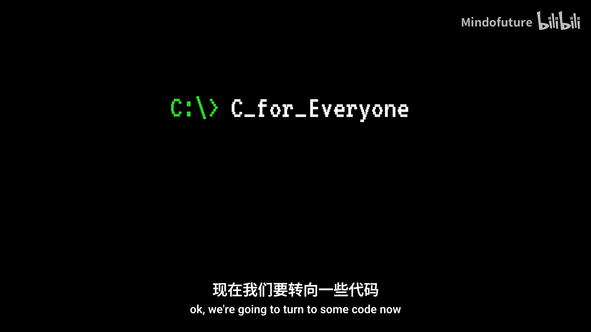
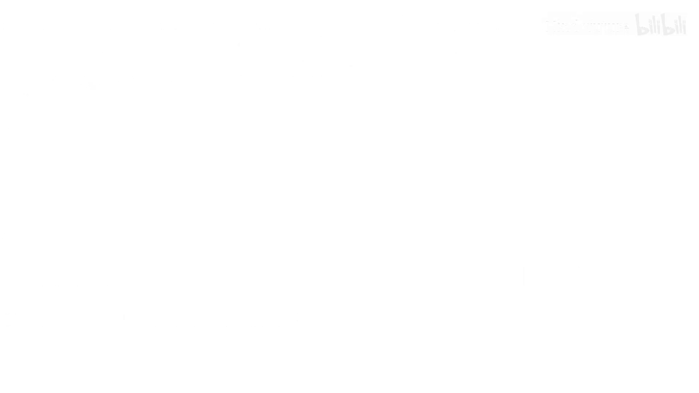

# 【加州大学】C语言结构化程序设计-｜-C-Structured-Programming-p11-P11_使用栈反转字符串_02_01_04--BV1wYe7zWE1T_p11-

🎼2。

🎼，🎼Okay， we're going to turn to some code now where I've implemented。

A basic stack with all of its operations， remember， this is abstract data type user defined。

And it's fully featured。So let's look at how I've done that。

 I described a lot of it in the last lecture， but here we'll see it in code。嗯。So。I have。A max length。

 my stack can have up to a thousand elements in it。

I define empty when I want to know whether the stack has any more elements。

 because if it's empty and I try to perform a pop on it。I will get。An error。

 I also need to know when it's full and I no longer can stick things in the stack。

So those will be two constants that the stack will need。Here again is my type F for the stack。

 it's basically implemented as。A character array。 So the kind development I'm storing in the stack has to be cha。

 So it's here。 If you want a different kind of stack that you have to change。啊。What you would use？

Yeah。Again。We have a series of basic operations， the first operation is a reset。

And most of these operations are going to operate on a pointer to stack。

And so we're going to have to be familiar with pointer access。So in this case， we just set the stack。

And we。sThe top of the stack to empty。And that's so recent， in other words。

We're ready to start with whatever is in the stack， with the stack empty。

Then we have the basic operation push， which we described before， namely。We stick something。

 we increment the top of the stack。And then we stick something in what's now the new top。Again。

 if there was a different type of element， it wouldn't be chai。 It would be whatever type that was。

 it could even be its own user defined type if we need something more complex。And in each case。

 we would stick it into the stack for something more complex， we'd have to make sure。

That we might have to use a routine instead of assignment。Signment's only going to work on。

Simple native types typically。Then pop pop the inverse operation to push again。

 we have star stack pointed to stack。And a pop is we take something off the current top of the stack。

Return that value and then。Derement。The stack top。So that's why we it's very important that we use post fix here post fix is critical to having this operation act right if we use prefix there we would。

Not be taking something off the top of the stack， wed be taking something off the next to the top of the stack。

And then if we just want to examine the top of the stack， we use this operation it just says。

Look at the top of the stack， but it doesn't affect the stack。 That's why we can use cons there。

 The stack is' not affected。So these are almost the same。They both get a char off the stack。

 but one pops it and one just examines it。And then we have the tube。

Operations to check on whether something is empty， empty is if the stacked top is。啊。

Equality to empty。Full is stack top in quality to fold。And let's now use our routine。

We're going to use it。To reverse this string， so I am auto am I。That can be stored。

Backwards and and a character string of。Roughly of less than 20。Characters。And we reset the stack。

We print the original。So this will be the original strength， so what should show up。I am O am I。

And then。We go ahead。And while the string is not。The end of string character， namely the zero。

And this is， again， recognized it as an idiom for working on strings。

I'm going to print that character。Individually。And then I'm going to push the character。

Onto the stack。So notice that because everything was pointeder to， this has to be ampers of S。

Remember all of our pointer operations again， you'll have to refer to it。

 you've got to get used to it， this is some of the more advanced concepts。

 this is where a lot of students stumble， so you have to maybe if this is unfamiliar to you。

 work fairly hard at this idea。Address of。Is what's going on there， remember we also use that。

With scanf。And now we reverse it by looking at while is empty。And the stack。

 we know the stack is less than 20。We're going to。Push， pop the stack。Into。

String back and then we're going to see if indeed。That lifeO mechanism will reverse it， so。

I've already。Compilile this program。And there I am originalig is I am O am I。

 Here are the individual letters as they are pushed onto the stack I。White space am， white space。

 auto， white space M， white space I and then。The reverse。

 when I've stored that back into a character array is Ima Automa I。N， it's3 first。So I' done。

 so you now see a full implementation at stack， you've seen an algorithm that provides reversal。

 sort of a standard algorithm。And this is a serious non trivial data structure。

 widely in use in computer algorithms and in computer science in general。🎼う。

