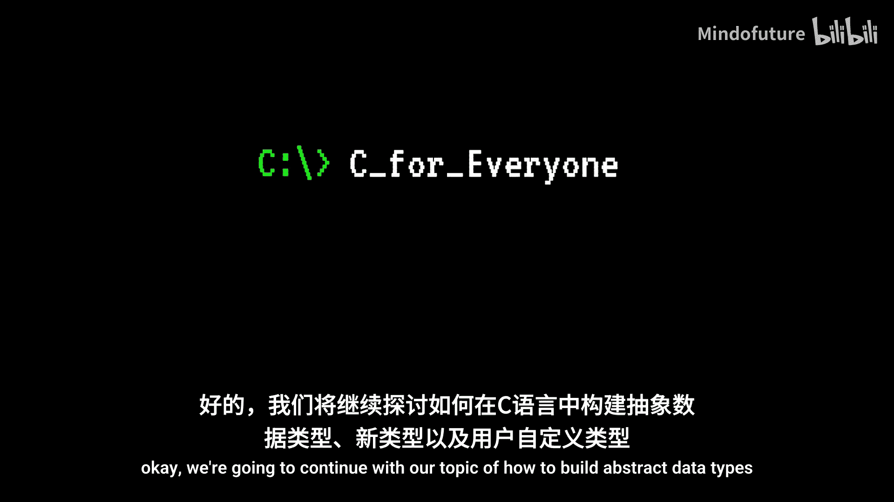
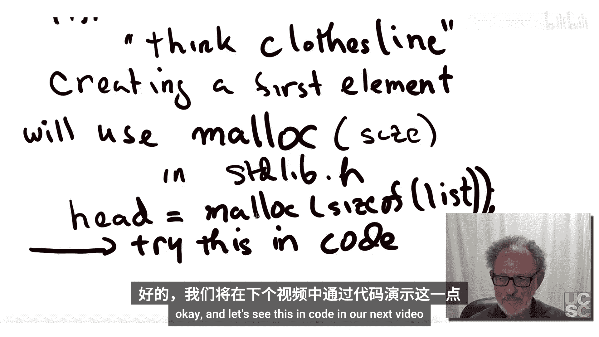

# 【加州大学】C语言结构化程序设计-｜-C-Structured-Programming-p12-P12_列表抽象数据类型介绍_03_01_01--BV1wYe7zWE1T_p12-

🎼2。

🎼，Okay， we're going to continue with our topic of how to build abstract data types。New types。

 user defined types。Within the C language。And again， the key idea is the use ofstructs。

 and as we'll see， it's very important to understand and know how to use pointers。And this time。

 the abstract data type we're going to use。Is again， a very canonical one。

 computer science is called the list。The list is a form of what we call a self referential type。

In other words。To make a list， for example， is to add an element on in the front of a list。

 So you can see that。The definition。Contains itself as part of its definition。

 in some sense it's recursive， so we see that a lot。And and computers。Here's the list。

A list has a head head is typically this pointer。And then it points to an element。

Which points to an element， which points to an element， which points to an element， which points to。

Ultimately， the end of the list a tale a sentinel。 And again。

 with a lot of the sentinels that we use to end strings and to end other things。

We use the special value zero or sometimes sharp defined as null。

So an element is some kind of data type。And then an arrow to the next element。 This is next， next。

 next。 We'll see that this is a singly linked list。 Later。

 we'll see that there are doubly linked lists。Which allow you to go backwards inside the list as well as forwards。

But。You're paying a price， you have to add a link， which is。Previous， as opposed to just next。

 So the simplest of these types is the singly linked list。Now again。

 we're going to use struck list int data， struck list star next as definition。

So that's going to be each internal element。So each of these is one of those。

So each itself is what you might call a list， is's basically data。And then an next pointer， data。

 and then an next pointer， and the head is simply a pointer to list。

And we'll type F struck list this list， so we don't have to keep calling it struck list。

And then here's a way of constructing a list。 The simple one， we say list head。So again， that's just。

呃。Head H H D， if there are multiple lists， we might say H1 H2。

 we might have our array of them in which case they'd be list R in some kind of array。

And just as there's a head of list， there's a tail， the tail is zero， otherwise。

 nullah could have been null。And again， think of this abstract。Data type as a closed line。

And we've just created a first element。 It' a close line， and we can。

Draw the clothes line and go to the next element until we're at the end at the tail of the list。

Creating the list。Requires。Something we haven't used to date， which is Malik。

 caalik is a special routine that's found in the standard library。StandardLirary。h。

 so that must be included。And Malick。Is a routine that goes to what's called the heap。

Which is a pile of storage available to a sea routine， which is dynamic。

 so it can be in use any time。In the course of the program。

And when we go to Malick and we ask for a particular size， like for his 4， it would be 4 Bs。

4 Bs is a word We could store in a word， an int。So we say malik of some size。And that returns。

ア pointer。In that point it can be used， for example， to initialize head。And indeed。

 the way we might do this。His head is assigned， Malik， namely an address。

 where we've gotten size of list。Number of elements。 and you should try this in code。

Size of his Gnnet。A special。Keyword。In effect。It's a keyword that returns as an unside long。

And number of bytes， whatever this object is。And that allows us to construct such an object。

 so we have。dynamicynaically allocated space and we'll see as well that when you dynamically allocate space as a good citizen you want to later return the space when it's no longer useful。

 of course it'll return itself automatically the end of the program。

But if for some reason you're going to use large amounts of the space， you would be asked to free up。

The space。That's being pointed at and so just as with Malick， there's a。

Routine calls free that allows。Pointed to。🎼Amount of storage to be returned to the stack for reuse Okay。

 and let's see this encode code in our next video。

