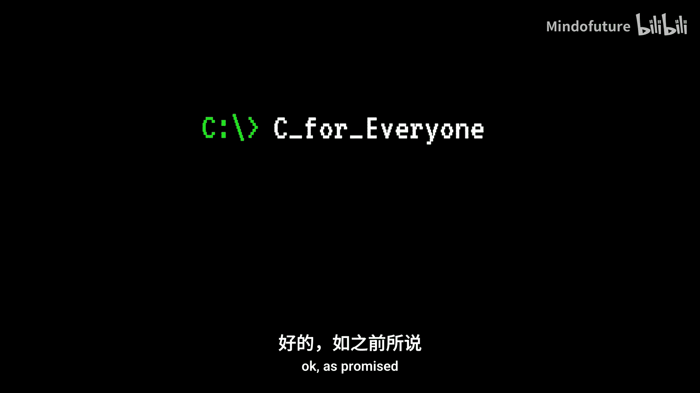

# 【加州大学】C语言结构化程序设计-｜-C-Structured-Programming-p13-P13_单个元素的列表代码_03_01_02--BV1wYe7zWE1T_p13-

🎼2。

🎼，Okay， as promised。We're going to look at code for。The most simple part of the implementation of。

The Sly linked list。Bit of a tongue twister， Sly linked list。Okay。

 recognize this from what we had just described。Notice。In this type de。That we have in data。

 but in datata could be anything， it could be some much more complexstruct of its own where we're storing a whole chunk of data in this case。

 we're just making it int。And we're showing， as with any ADT。

 we want to be able to do some operations on it。 So here's the operation to show if the ADT list is empty。

 Remember， an empty list。As his head pointer。Or。The beginning of the list pointer。No。

 so it's just a test on whether。That link that we're testing is null。

 and that means that list is empty。It can also be a way to see if we're at the end of a list。

 imagine。Running down a list。And then you get to the tail， which is basically。this particular value。

 no， and that's when you might stop so you can do something iteratively by testing for that sentinel or you can do it recursively again in the recursion testing for the sentinel and that would know when you're finished。

Here is an iterative way of going down the list。 So we look at。The head。

We're going to print this list， we're going to give it a title。So first， we print its title。

And then we ask。Is the head？Empty。Symy were done。So the title might be oh。

 this is some list and all you would see is nothing otherwise we're going to print the element value。

 which in this case is H pointed at data， and then we have to chain along the list。

 H goes to H next so again this is a crucial idiom to remember if you remember the iddm。

 you remember lots of what's going on。Namely， here's the test on the Sentinel， you'll keep iterating。

 here's where you do something based on the data。This could be something complex。

 it could be a function call， just like print F is。And you。Massage the data。

 and then you advance the pointer， you keep doing this until you get to the empty list。

And if you're an honor student trying to take this course。

You should be able to rewrite this as a recursion。The recursive base case would be testing whether something is not。

So we have a list， we have。The head starting out as null， so that would be the empty list。

 and then we create the list， remember by using this Malic。

 the special function found in the standard library。Maik again， goes off to the heap。

Grab size of list memory， and if you wanted to check that， that would be。16 bytes， fact。

 we're going to show that we're going to print off size of this list。

We're going to use long unsigned， that's the return type。

It has to be unsigned because you want a certain number of bytes， you're not going to have， quote。

 negative bytes。And then we're going to just create a simple one element list where the data was set equal to five。

Next points at null， otherwise we could end up with some weird thing。

and frequent error is to not properly terminate a list。

 and then we're going to call print list with that head。

 and we're going to title that a single element list because that's what it was。Okay， so。

Let's look at this， compile it， UCcc。F slice do C。And then execute it and see if everything worked。

As described。Sure enough。The size of list is 16， so that' so many bytes malik at to allocate。

 the created list was a single element list。Whose value was5。And the colon was thrown in because。

As we'll see in the following program， if we have a multi element list。

 that'll be five colon next piece of data， next piece of data until we're at the end and then we're done。

Okay， so study this very carefully because it has。A critical idiom that's if you understand it gives you 90% of what you need to understand in doing list processing。

