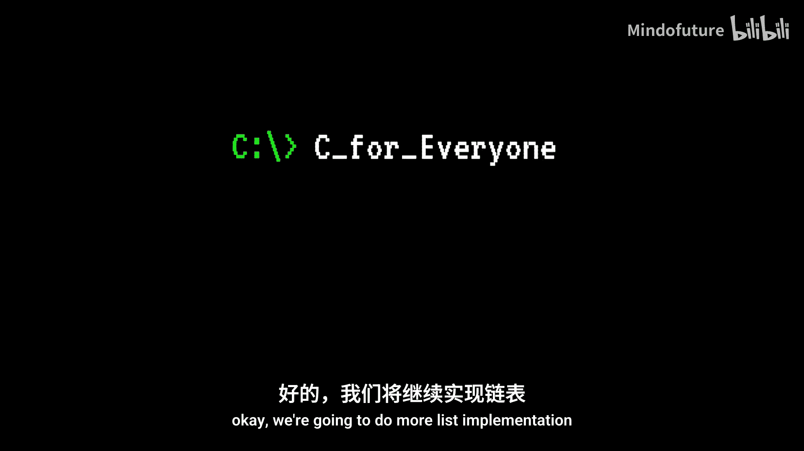
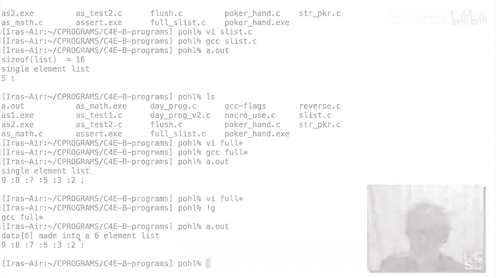

# 【加州大学】C语言结构化程序设计-｜-C-Structured-Programming-p14-P14_完整列表代码_03_01_03--BV1wYe7zWE1T_p14-

🎼2。

🎼，Okay， we're going to do more。List。Implementation。This is such a critical topic and the。

Past experience with people who are beginning programmers is they need a lot of practice to try and understand。

What pointers are？How they get used and the use of dynamic memory。Heat based memory。

This is among the most sophisticated things you learn in this class。

And without really practicing the basics， it can be a big hurdle。

 so we're going to see some of the same material we already talked about and we're going to extend it and again。

 keep in mind。That it's critical to understand these idioms。

 So if you master these idioms that we're giving you， even though therefore。Very basic cases。

 they still will let you do very much of the same thing and in more advanced instances。

So let's look at。This code。Again， a type F shows its self preferential nature。

 a list appears inside a list。So it's a piece of data。With a link to next。

And then we have things that operate on such a construct， for example。

 we can tell if a list is empty by seeing whether the current pointer at the list is null。

 that's dis Sinel for being empty。Let's look at creating a list。

We can create a list out of a piece of data， so this would be data， noticeice that when I say in the。

If you're doing this with some other data type， you have to again just use the same thing。The same。

Idim。You just change what's being。Deposited in the list element。

So we take the list and create its head， and the way we create its head is we go to the heap using Malck out of the standard library。

And we create an element size of list we saw in a previous case at that 16。Bs。

And then inside the data。Remember， we store D。And inside the head next， we store the k null pointer。

 So in effect， when we initialize a list to a single element。

 the single element has as a snacks pointer， the tail or null。

And then what you return from creating that list is the head that you found dynamically。

Now if we want to build the list。That we're going to do by adding to the front of the list。

 so remember the list is like a closed line。You can't just put things into the middle。

 it's not like an array。So it has limitations。But。It has features that。

It takes advantage in certain algorithms， so not every algorithm wants to use an array。

But certain algorithms benefit by using list access。

 even though you don't get to randomly look at elements inside a list。

 So searching a list can be what's called order N the size of the list to look and find something as opposed to order one。

 which is how you go and look something up in an array。So we add to the front of the list。

 we give it the current out of the list， we give it the data that we want。With that piece of data。

 we create the list。Remember what that does that goes off and gets malik， makes up an element。

60 in it， and then。What was the current head？Is now going to point it。At。Next。

And then this newly created element will be the new head of the list。So we had a list。

Of how many ever elements we create a new one with its head。

 we link its next pointer to the old list。 and the head is now the head of the whole list。

 and that's add to front。Now。Let's say we have an array， which is another data structure。

 and we want to take an array and convert it into a list， how would we go about doing that？Well。

 we can do。A rate to list。An operation that we want to use often。And again。

 we have some array of data。 We have the size of the array or even a subar。

 We start by creating the list using the first element of the array。And then。

Until the size of the array， we keep adding to the front。So we have to update the head。

 keep adding to the front one by one， and we get。A list。Created， we return head at the end of this。

 And we've already seen how print list works again。A lot is going on。

 these things remain idioms for how to process things one by one。Remember， in our print list。

 we're using the sententinel head k null， and then we stop when the head is null otherwise。

 we keep doing something。 and here it would be print。So that was our print list。

And now we're going to take it。A data array of six elements， 2，3，57，89。

 we're going to create a list from them。Using that data array， then we're going to print it。

And what we're going to notice is。Two is the first element。

 then three becomes the first element then5。So in the end。

 two is going to be because we're adding on the beginning of the list。

 nine will be ultimately the beginning of the list 87532。That will be the order in which elements。

We're placed on the list。So， let's。Leave that。Try that code。And now execute it。And sure enough。

 we print single。So I did something I used with an old thing that gave the heading as single element less than it isn't。

9，8，7，5，3，2。 Let's go and correct that program。So we found a little bug that's always useful。

 so I'm going to go and correct that。So that title shouldn't be single element list。

So that's going to be data of six made into a six element list。And just to， by the way， let's just。

Okay， that's。Recompile this。And now run it。Okay， data of six made into a six element list， 987532。

Okay。So again， study that program carefully， along with the other beginning material。

 make sure you understand how Malik fits in。 How is Malik producing an element of the list。

 Make sure to understand how next works， how you have these linkage that gets you a linear list。

And that should get you familiar enough that you can start handling lists and even more complex data structures that involve pointers。

🎼Yeah。あ。