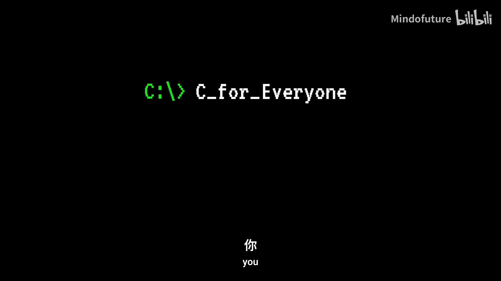

# 【加州大学】C语言结构化程序设计-｜-C-Structured-Programming-p15-P15_列表处理细节_03_01_04--BV1wYe7zWE1T_p15-

🎼2。

🎼，Now let's look at。Ls processing in detail and provide a significant number of operations。

On linear linked lists。Those operations will include count。

 so that'll tell us how many elements are in the list。 concatenate。

 It'll take two lists and link them together。 insert that will。

Put an element into a list and delete that will remove an element for a list。

 Those are four of the fundamental operations on list。

 and it'll let us get more practice with both pointers， recursion， list processing。

 and in some cases。Allocation off the stack， namely using Malik。As well。So let's start with count。

 that's very simple。Count is going to work at by just。Navigating through a list。

 and each time through we'll add one as we go along until we get to the Sentinel。Link。

 which is no link。And we can do this by recursion or by iteration。

 but I'm going to show it through recursion， and you should be able to go off and write it。

Ieratively as well with something like a wild statement。So recursion， if we're at。The no。

 that will be the base case， in that means。For example， if we had an empty list。

 the list is of L zero。But if the head of the list isn't empty， then we add one。

 and then we move to the next element in the list and then recur by calling count again。

 so they'll be。A one added each time through each element until we get to the end。Very trivially。

 that will recursively count。The length of a list。A little more non trivialvi application。

 which we will also do recursively， is to do concatenation。

And while that's a little bit of a poor drawing， sorry for it， make your own， there's two lists。

 H1 and H2， H1 is non empty， and we're concatenating H1 to H2。

And that means H1 is going to chain along until it gets to。The snowll pointer。

And that's it's next here。And rather than go off to null， which is the end of this1。

 we'll instead link it up to what was H2。So that's how we'll concatenate list one to list two。

We've done an assert。Remember a searchs。Our。A macro sharp define。

 which does a test and will abort if the condition isn't true。 This in some sense is a precondition。

 which is saying。The first list pointed at by H1 is not null。If that is not no， we chain。

And we find no。And each time through the recursive step， we keep concatenation until we hit。No。

 in which case we take H1 next and link it to H2 just as we said in the above diagram。

And that now concatenates it。So again， very straightforward to do。

 especially if you understand recursion。So again， H1 in that form of concatenation must point it in an empty list。

But again， as an exercise。If you understand this material。You should be able to make it work。

 even if H1 is empty。In which case？You should just。Report H2 as the beginning of the。Discarded list。

 so you could。Test on H1 being empty。And if H one is the nu list。

Just return the second list and you could add that， so it would work。In either case。

Now let's look at the insert of an element。So we'll have a position。

A particular element that will want inserted at a particular position。

And that'll be between a P1 and a P2。For example， we might search this list and look for a particular element if it was alphabetized。

 and we need to add another record alphabetized by something in this field。

And when we find P1 and its adjacent element P2， we're going to take the element pointed up by Q and shove it in the middle。

Notice this will be a lot simpler operation than to do something equivalent with an array。

So lists have value。And can improve on efficiency when certain kinds of operations are needed that are difficult or expensive for array operations。

So here's how to do the insert。First， the last element， the element to insert。

We assert that P1 next is P2。So there are adjacent elements。

 then we say p21 next points at Q Q next points at P2。And we're done。The elements's been inserted。

We're going to leave delete。For。Our next video where we'll show deletelete in Real code。

