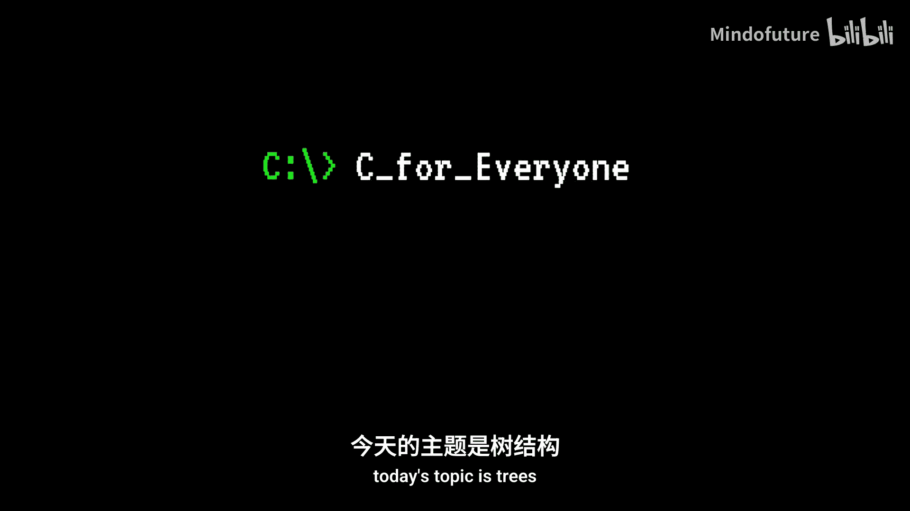
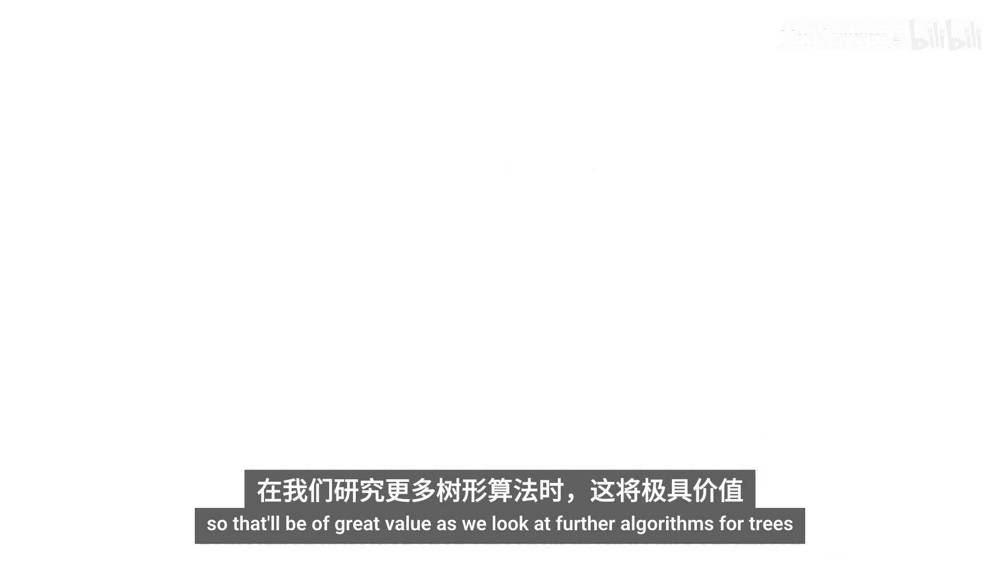

# 【加州大学】C语言结构化程序设计-｜-C-Structured-Programming-p16-P16_荣誉课程_二叉树介绍_03_01_05--BV1wYe7zWE1T_p16-

🎼2。

🎼，Today's topic is Tes， it's another abstract data structure。Againm。Going to。

Say this is a honors topic。Very important for those who want to move on to a course like C++ for C programmers and for somebody who wants to be a professional。

啊。With。A computer science background。But for those of you who just want to learn basic programming。

 you should look at the topic， get what you can out of it it's just， but won't be。Test it on。

So here's a tree。Tree has a root， tree has branches， tree has leaves。

Keep that picture in mind because that's what the data structure。

That we're going to look at also has。And we're going to look at。A special case of such a tree。

And that's going to be a binary tree。In a binary tree。Here again is the root。The node labeled one。

And it has two descendants， a left descendant and a right descendant。So those are its two branches。

More generallyly， a tree might have。K branches。But。

Minary trees all by themselves are the most important。Type of tree available。

They have the most bang for the buck when you go to study the topic。So again。

 you have internal nodes， you have up to two branches off those nodes。

 and then at the end of the tree are what we call leaf nodes。If you look at this binary tree。

It has two levels。10 is the root node。And this tree is called complete because every node has two descendants。

And the leaf node， of course， have no descendant。And if you have such a tree of level 2。

 then you have one plus2 plus four nodes or seven nodes total。Similarly。

 if you were at another level， then the next level would have 8 nodes，16 nodes。 So for each level。

You are。2。To that level。Number of nodes if you have a complete tree。

So you can see that tree structure grows exponentially in the number of levels and accommodates。

In effect two to the end。Plus one， minus one total nose if you have your complete tree。

There's another interesting characteristic about this binary tree。We store a value in these nodes。

So frequently in these trees。Internally， they're storing。Values think this is。呃。

Going to be modeled by a struck。Then there's going to be a left and right descendant。

 which will be pointers。And this will be data。And in this case。Six is less than 10。

 18 is more than 10。So in effect， this a sorting order on that tree。

 which makes it useful for storing data and retrieving data in an efficient manner。

When we have such trees with a sorting order， generally speaking。

 they have what we call a log base2 property that many of the operations on that tree for N data elements can be done in log of N。

Which means that there can be highly efficient。For storing information。

So that'll be of great value as we look at。Further algorithms for trees。そは？

