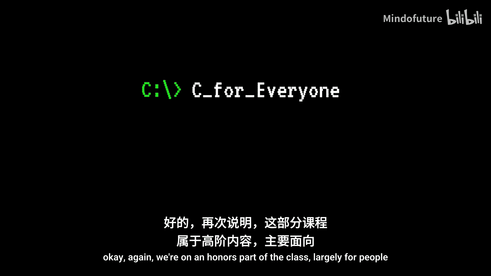
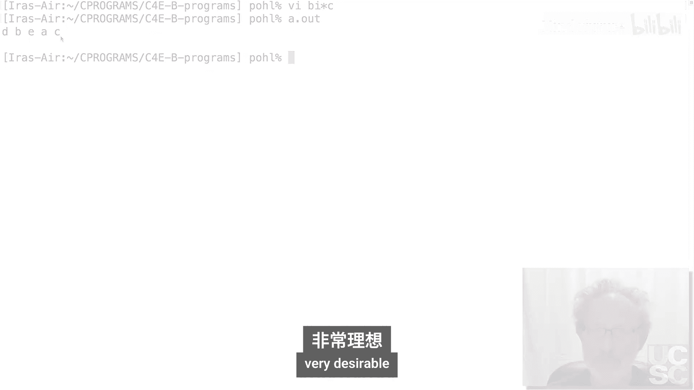

# 【加州大学】C语言结构化程序设计-｜-C-Structured-Programming-p17-P17_荣誉课程_详细的二叉树代码_03_01_06--BV1wYe7zWE1T_p17-

🎼2。

🎼，Okay， again， we're on an honors part of the class。

Largely for people who want to go on in computer science or in the C++ sequence。

 we're dealing with a especially important data structure called the binary tree。So again。

 with these data structures， you're going to see a lot of recursion。

 you're going to see a lot of use of indirection links， pointers。

 and we're going to try and simplify the stuff by using type defs and this material is also。

Found in a book on sea。And。Chapter。10。8 so if you have that available。

 you can read about it as well in detail。So。😡，Let's start with a type def of char。

And let's realize that while we'll think of data。As something that could be complex。

In our simple case， we're just going to store a character in a node of the binary tree。And。

Str node looks very similar to what we had for lists， except that now there's a data element。

And now there are two pointers， a left and a right pointer。So those are the branches。

And then we're going to make things easier to write， we'll type def，struct node as capital node。

 and we'll type de。A node。Well type def up a binary tree as a pointer to node so in effect you'll be able to。

Look at a binary tree by a pointer to its root， that will be the critical representation within sea。

And。We have different modes， different ways to traverse the tree。

And one of them is what's called in order。An in order mode， there's also preor and post order。

 but I won't discuss that right here， but that's something for you to investigate so if we do an in order traversal of the tree we check to see if the root is null。

The route is nowhere done otherwise。We recur。To the left。We print the current。

What essentially is what the what the。Data is being pointed at。And then we occur to the right。

So all the lefts are going to be done first before the rights get done。

 and that's going to be in order traversal。Now we also need a way to build a tree。

 and we're going to build a tree by allocating。Off of Malck。

 remember Malck is our standard library function that goes to the heap。Size of nodes。

 so however node gets defined size of。Which in effect is a keyword and a built in operation gets as much memory as needed to represent a node。

We return that value， which is pointer value。So's a pointer value to this much memory。

And then we also have。A method for initializing the data。And。So there'll be a data item。

 a left pointer and a right pointer， and then we assign all that。

 we create a new node that's calling this function。And then we。啊。

Assigned values to each of the three members of that struck。And we're going to return。A B tree value。

 namely a pointer value， which is what we are currently pointing at。

 that's going to be the item created。Now let's say we want to create a whole tree。From our。

Common data structure where we might be storing a lot of data in an array。In Create tree。

 we're going to check to see。If we're done with the size of the array。

 this is going to be the size of the array。If we're done， we don't have to do anything any more。

 So we' return the sentel point of value。 null， otherwise。We'll call initialized node。

Create that initialized node， so let's say it's a0。And then we create。

The left pointer and the right pointer。And those are also by calling Cry， so this is recursive。And。

We use the fact that there's a mapping of the data elements AI into remember the tree。Buy for cage。

By factors of two， so you get2 times I plus1 and2 times i plus2。

 and those are going to be a left and right element。And they will be stored in that tree。

Let's see all that work。And again， if this is all new to you。

 you're going to have to play with this kind of code to make sure you understand it。

Once you can understand it。You can just use the idioms over and over again or in more advanced languages like C+ plus。

 such trees come in data packages， so you don't have to recreate them。

 you just have to understand how to use them。So here's a character array。嗯嗯。

So main is going to create a five element character array。And we're going to store ABC。

 D E into that character， so D of zero is a， D of4 is Z， etc。Then we have a bee tree。Remember。

 this is that type the and it's a pointer and then we call that routine。

 that recursive routine up here to create the tree。

 we have five elements in data and we're going to start with element zero。

And we will do the in order。Printing of that tree。So let's try all that out。

N'ever already compiled this code。And here is the execution。ABCD。Created in the code。呃。

Printed and in order gets to be D， B， E，AC， C。And if you walk such a tree。

 you will see that it comes out in that order。So this is a use。Of storing。Data into a binary tree。

 and remember， the binary tree is going to be very useful because。

It can do certain kinds of operations in logarithmic time as opposed to searches that might require。

Linear time。When the data is。Just stored。Yin。A raise。

So there are certain kinds of problems for which。This kind of data structure。Is very， very desirable。

