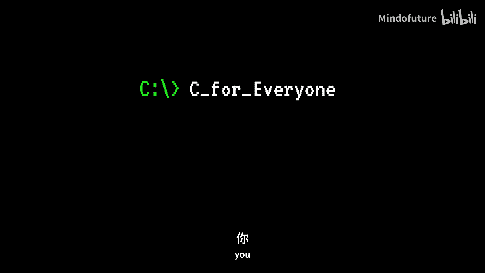

# 【加州大学】C语言结构化程序设计-｜-C-Structured-Programming-p18-P18_更高级的输入输出_printf_03_01_07--BV1wYe7zWE1T_p18-

🎼2。

🎼，We're going to start a new and very important topic and that is to do more advanced things with C。

 input and output， and that of course， also connects up with some ideas about the operating system and how the operating system connects to fileIO so that gives you a lot more power and flexibility in using your computer。

Now， what have we done so far？Largely what we've done is use printnt F and scanf。

Those are two workhors。Their fairly basic print goes to the screen， it uses standard Out。

Scanf goes to the keyboard it uses standard in。We've also used occasionally what we call redirection。

 which is。Instead of going to。The screen， we have this greater than sign。

 and then the output goes to a file。And if we have code。 Ec。

Less than a file then a file is providing input into Scth。

So we've also occasionally made use of what's called file redirection， which uses a feature of。

The operating system。Now we want to get more sophisticated。

So one thing we can do is learn more about print E。Prntf has。Always has a control string。

 which is a quoted string。And that。Gives instructions either verbatim as to what's printed out on the on the screen like a low world or it has。

Things with presents in them。That do conversion of things that occur in a list of other arguments。

 and that's a comma separated list of arguments。 And here's an appropriate example。

 If we were to say print F sum of x and y is percent D and percent D equals percent D。

 we would get on the screen sum of x and y。Is。Say x is3， y is 5， x plus y is8， and we would get3。

5 and8， the equal sign would show up and that would be on the screen and that's sort of the standard kind of thing we've already done to date。

And that's where we've used Peri as a conversion of one of these arguments。Well。

 there's lots of conversions。 They haven't used the full number， some are fairly obscure。

 for example， percent sign。Is a way to print a percent sign， so if you have a double percent sign。

Rather than percent with some character， you actually literally put out a percent sign and you don't do a conversion。

What we've generally used so far are things like D for integer， F for float， C for character。

 S for string， those are what have been most used in this course。呃。

This is where we've already mentioned， where you had 2% signs or would percent。A percent。

Now we can add to that something called format specifier modifiers。

 include modifiers and control codes， this is a table taken from something at Sun。OS。

Some microsystems was a very famous。Producer of。Large scale。Industrial strengths。Computers。

 computers， especially that be used with advanced graphics。嗯。The company， I believe， got absorbed。呃。

I don't think you see many sun machines anymore， but there's still a lot of software that Sun produced and they had very。

 very good。C compilers and。Most of their work was in UniX using。Pro the programming language C。

Then they later actually invented Java。Now， why are these modifiers useful， I put up a table there。

 you could see it。This is a standard thing where you'd print a character。 let's say， the character A。

Here you're using 2 C。2 is a width modifier。And that is a width where it's。Pushed to a right margin。

 so you have a blank space and capital A。And you can also do it with a minus， and if it's a minus。

 you have a with a blank space。We've also used percent D。So if we were to print 123。

 it would show up as 123。But if we do it with a width modifier and a first0。It says， oh。

 however many digits you need to fill the space， the leading digits will be zero。 So you see 0，0，1，2。

3， because that's of length 5。So that's modifiers that do integers with pad as zeros。

And here is something where we modify and use an exponential way to write out a floating point number。

And if that floating point number is 0。123456789。It's a little less than an eighth。

You would see on the screen that the 12。Would get you 12 spaces。The conversion here。

Is such that we have an exponent part。So the exponent is minus1。

 so that's why one is really a minus one， so that really means this is1/1。And that's2100s。

 and that's。3，100s， et cetera。 And since it was 12， you would have a final empty space character。

 we're going to play with this for a second。I'll show you how to do it， of course。

 very straightforward and it's a much easier way to capture these ideas because there isn't。

That much of a logic to it， but it really pays to。Experiment with it。

 see how the output actually appears on your own screen。And just keep in mind。

 clear output is a sign of intelligent coding。 It's a saying from Doctor P。So let's go and look at。

And I've already written this program。So's a program to demonstrate a little bit of what we just saw。

 here's your double x equals that number。And here's some general。

 we're going to entitle it general printing ideas。 So we have some literate。Expression on the screen。

And now watch what I'm going to do， I'm going to show you how X would be expressed。Has that-12。5 E。

 making sure that。That is what I just said。Will also compare to just using a normal exponential。

Without any modifiers， well also use floating point of。Way of doing it with some modifiers。

 She also has。A space modifier and a precision modifier。So space is 10， precision is5。呃。

And then we're going to do something， which actually is。No， no。

 we're going to use the inappropriate conversion x is a floating point number。

And we're going to convert it to an integer。 and we're going to see that。

Gues us what basically is an era。But would be very hard to to understand。

 And it's an easily made error。 So I've already compiled this。Let me run it。And there we are。

So we can see here。This is using。With of 10。And that's why there's a whole bunch of leading white space。

And then， this was a 10。05 F。So we get these。5 significant figures。

Here we get the ordinary use of E without any modifier。 So we get a much lengthier number。 We get 1。

23456。And the seven is turned into an eight because thats it was seven and a fraction that was greater than a half。

 so that ups the conversion。So we're actually getting six significant figures here here。

 we only got five significant figures， which is is what we originally specified。

And both of these are。10 to the minus1。So that's why there's a one here as opposed to the way this floating point representation is。

 but here look at this。Converting at the integer， we get something that looks like nonsense。

 why is that？Nonsense because。Internally。That。Was stored。

As a 32 B representation of a floating point number。 And this is how it converts to an integer。

 So there's no relation。 We don't end up with what you might think would be。A zero， in other words。

If I had said， let me in fact， do that so you can see it。Going to go back。

I will create a second program print 2 times C。I will incorporate。AndNow what I'm going to do here。I。

I won't change that， I'm going to change this。And I'm going to cast it to an inch。

So I'm going to compile。我 it。And indeed， now we get this value zero。We get what？

We had mistakenly thought was going to happen before。Okay。

 and you should play with such code yourself and modifiers and all the various kinds of conversion characters to the extent that you want to。

Learn in a deeper way how to make use of the fancier。Outpput formats that are available to you。

