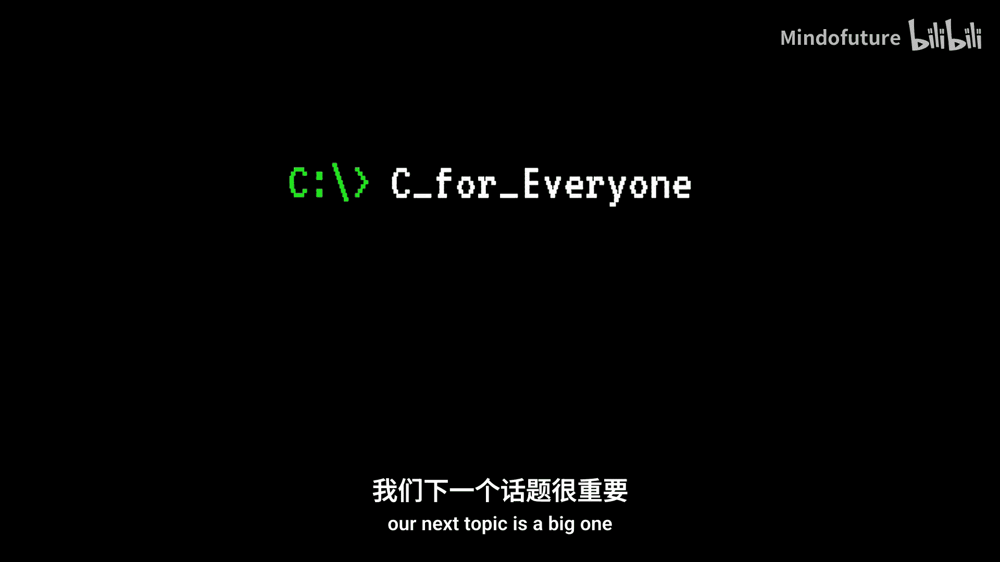

# 【加州大学】C语言结构化程序设计-｜-C-Structured-Programming-p19-P19_文件输入输出介绍_04_01_01--BV1wYe7zWE1T_p19-

🎼2。

🎼，Our next topic is a big one。It makes programming it。Way more useful。To be able to。

Hook your programs up to the file structure。Of your machine。

 so what we'll be talking about is the basics of using C for file IO。

Let's assume you have a data file of homework scores。And however， you got that file you could have。

Create it yourself using your editor where you entered a bunch of scores。And that would be typical。

 that's one of the ways you're using your computer。

It can store a large amount of data and it can store it electronically。

And let's say you want an average， maybe you even want a maximum minimum of those scores。

So here's a data file it has a bunch of homework scores。

And maybe you create it in something called my homework under Bar scores。Now， if。

We already had the data。Inside。A CRray。Let's say we had a CRA of data with the appropriate number of scores。

Then。We would know how to process it to get the average， that's a fairly straightforward。

Algorithm for us already， So if you made it this far in the class。That should be an easy exercise。

 a simple for loop。But now we want to get that data inside the program from a file。

 the way we're going to do that。Is with。The function in standard IO， which is called F scanf。

So normally。We could read from。Typing in a bunch of homework scores。From our keyboard。

But if they're already stored in a file， the way we access it is through。It's called file pointer2。

FP。So that's the first argument of Scanf。 And then the second and third argument saw the normal ones。

 namely a conversion string， a format string and arguments。So we already know how to use scanf。

 so this is just like scanf。But it needs a name file， which will be。In the case of what we just saw。

My homework scores。And then scanf。Assume skin F normally assume standard in。 So in in a way。

 it implicitly has such an argument already。An F scan F clearly is more general。

Now in order to make use of a file。While it fits there。It could be locked or protected。

 so we have to give it。A command that says open the file for reading because we want it for input。

So there are various commands， there's a read command， which is R， there's a right command。

 which is W， and there's an aend command， which is a， and you can also combine those commands。

So here we see。There's a special function called file Open F open again in standard IO。

And it can take two arguments， namely the name of your homework。

So if my homework was in my homework or if it had been my homework scores。

 this would be the longer name。So that's one string and then the second string is the kinds of permissions that the system is allowing on that file。

 in this case， since we want it for input read is appropriate。We need a declared input file program。

Let's call it IFP。And then。We would call F open with that and that would。Assign that to IFP。

 which is a pointer， which then would be used as an argument for F scanf， for example。Now。

Filees that are opened。There is a limit to how many the system will allow a particular user to open。

I forget what the standard limit is， but I think it's in the neighborhood of。20 or less。

And so if you're going to be opening files and using them， you also want to close files。

 that's just good resource hygiene。If you get to the end of the program。

 it'll close all your open files anyway， but it's just a good habit to use the program F close also on。

The input file pointer in this case。 and then that would。Close down that program。

No longer have access to that data file， okay。In the next segment。

 I'm going to actually write the code to do most of this， so you'll see it。Directly in code。

 And you can modify that code to your own at something that you can play with。

 And if you play with that code。It will give you again， 95% of what you need to know about。File IO。

