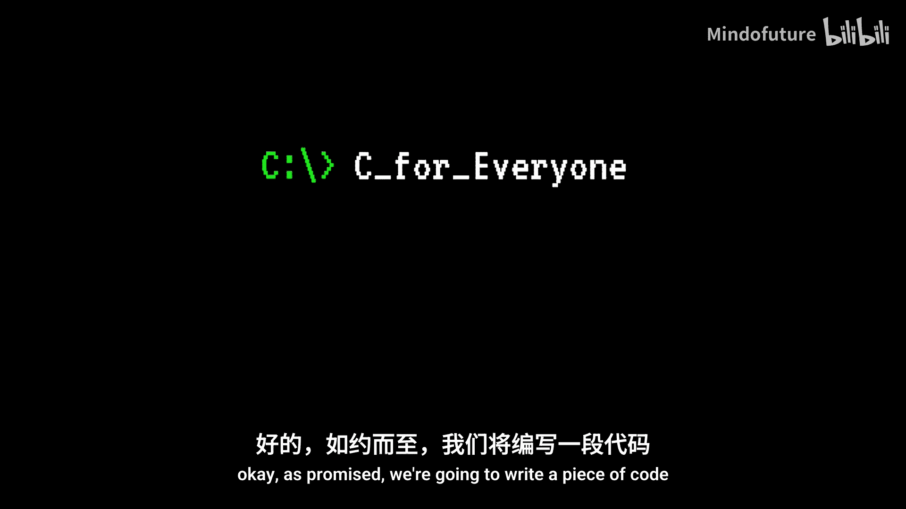
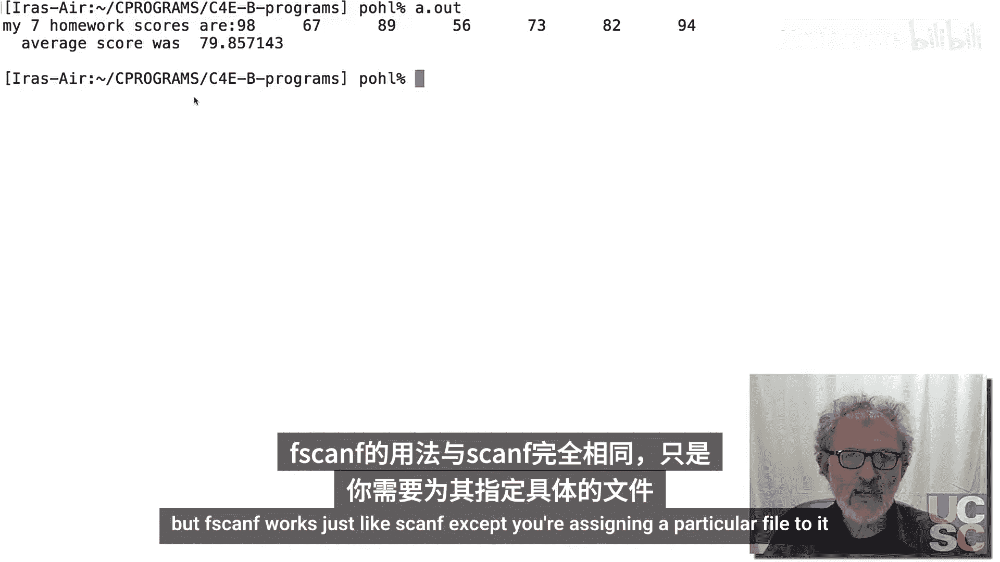

# 【加州大学】C语言结构化程序设计-｜-C-Structured-Programming-p20-P20_基本文件输入输出代码_04_01_02--BV1wYe7zWE1T_p20-

🎼2。

🎼，Okay， as promised， we're going to。Write a piece of code， it's already written。

 like we'll examine the code or'll dissect it。That uses a file that has homework scores。

 and we will get the average and we will use。F scan F。To read from that file。So。We call。

 I'm in a directory。Let me just show you I'm redoing it。The directory's name is slash users。

Poll C programs， C for EB programs。So a directory is， again， like a tree structure。

And you get down to where you're currently working and in where you're currently working。

 if you're using UniX， you can see the files that have been created。

 so let me again put them in the middle of the screen。

And these were a bunch of files so far I've been developing。For。

The structured programming part of seat for everyone。And you may have seen some of these used before。

 like the binary tree program or programs with the enumerated type for day。And。

Now we're going to look at the homework program。c， but also in this directory。Is。My HW。

Let's see what's in that。I'll use V， I'll just get it。Cats a command that will display。For UniX。

 what is in that file？And you can see it has。A series of seven numbers， 98， 6789，673。

 294 those are ostensibly my homework scores。Maybe for this course。

I've been keeping them electronically in this file。Now。

I want to be able to manipulate that data internally in the program， as we。

 as we showed in the previous segment， we would like to read them into。An array。

 and then once it's in an array， we have all the tools we need to manipulate that data。

So let's look at the program I wrote。ItCalled the homework probegue。

We're going to assume that we don't have more than 20 homework scores。

 so we could easily make this larger。We have a program for reading data， a program for printing data。

 and then a program for doing an average。Before I turn to that。

 let's look at what Maine is supposed to do。Maine has。呃。

An index I that'll be used for various looping。It has a。Integer size。

 which will initially be set to 20。呃。I was playing around with this data before。

 so I initialized it to a score of 100 with all other scores being zero。

 and here's what I had that I talked about before， a file pointer。So this is where we're going to。

 this IFP is what's going to be used with。My various routines that work on files。

And the first thing we have to do for a file is open it。So look what I do。

I say IFP is assigned F open。With the string， my HW， which means。That in my local directory。

 in the same directory that this code will exist in。I have to have a file of that name。

We'll talk later about how to have an absolute file name。 We saw it when I did a print。啊。

Where I did a location of where I was in my big directory tree and that was under users bowl。

 something， something， something， and finally C for B programs。And then the second string。

 which is the R， says open it to be read。So now what happens is my HW， if it is found。

 otherwise there'll be an error， if it's found， it'll be opened for reading。

And it'll be assigned to this。Input file pointer， the IFP。

 I that's just the choice of identifier name， so it's easy to remember。

Then I'm going to call the program。Read data。And read data， as you can imagine， is going to take。あ。

The my homework file。As pointed at by IFP。Read it into this data array and return with how many elements or。

 remember when we did this above， it was 7。Then I'm going to print out what those scores are。

And I'll use the print data， we'll see again， we'll go back up and look at how that code works。

 and then I'll print an average score。And I will compute the average with yet another。Routine。

 which looks at the data and the size of the data and computes an average， and then for good hygiene。

 I will close that file。Even though I don't really need to because。

At the end of this code and with only one file open。呃。The code itself。

If a return of zero would return that resource to the system。But it's just a good habit。

So let's go back up。Well this return is just simple， that's from our earlier work。

You read in an array of a given size if you have that available to you。

We compute average by starting at average being zero。

 and then we add all the elements of the array into average。

 and then we turn average over size as the average of that。So as we'll see。

 we have seven scores we're going to get。A precise average， so you won't get rounding errors。呃。

We won't get integer conversion errors and we'll get that as a double。And again， as I say。

 we will see that in a second。Here's our print data again， fairly easy to understand。

 We're just going through and。Printing。呃。Data 10 at a time。 Otherwise， we add a line。

 if there's more data， we don't want to overprint on a given line。 We don't want it to s， spill over。

And here's the thing that's somewhat novel。 We have a file pointer， in this case。

 we're calling a PTR。We are going to read stuff from that file into this array D。

And we're going to also find out how many elements there are in the file。

 So that's why there' is a pointer rather than in size。 It's。

 we need this to be able to change it for the external world。 So star size will start at 0。

 because we don't have any value set。 And then we'll call F scan on whatever this file is。 P R。

And then we'll use a conversion character to integer。

 and then we'll use our ampersand because we need just like anything else in scananf。We need to。

Get the address of this thing so that。It can be updated。And then D of the d reference size。

 which initially is0， is going to be read into by F scan F。

And then Fknf has the nice property of saying。If。This doesn't happen。And we can't accomplish this。

 then we return。A zero， otherwise we return one， which is。The values converted。

 So F scanf will have returned one for each value converted and then fail when we're at the end of that file。

And then we order increment size。So in the example we're given since our homework array has seven。

Elements， that'll turn out to be7， so let me exit this。Let me。I've already compiled it。

LetWe clear the screen。And now let me execute it。And sure enough。

 it says my seven homework scores are 98，67， 8956 to 94。The average of those was 79。857143。

 I used a width of 10。So that's why I have it all written out to that many digits。And then。I'm done。

 I've closed that file， okay。So you should be able to tinker with that program。

 you should be able to add other routines like find the minimum or maximum grade that should be easy。

 it doesn't require any fileo， but the major idea， the major takeaway is using F scan F and F open。

You can。呃。Readily use a file instead of。Standard N， which。Normally， scanf would use。

 but F scanNF works just like SccanF， except you're assigning a particular file to it。

