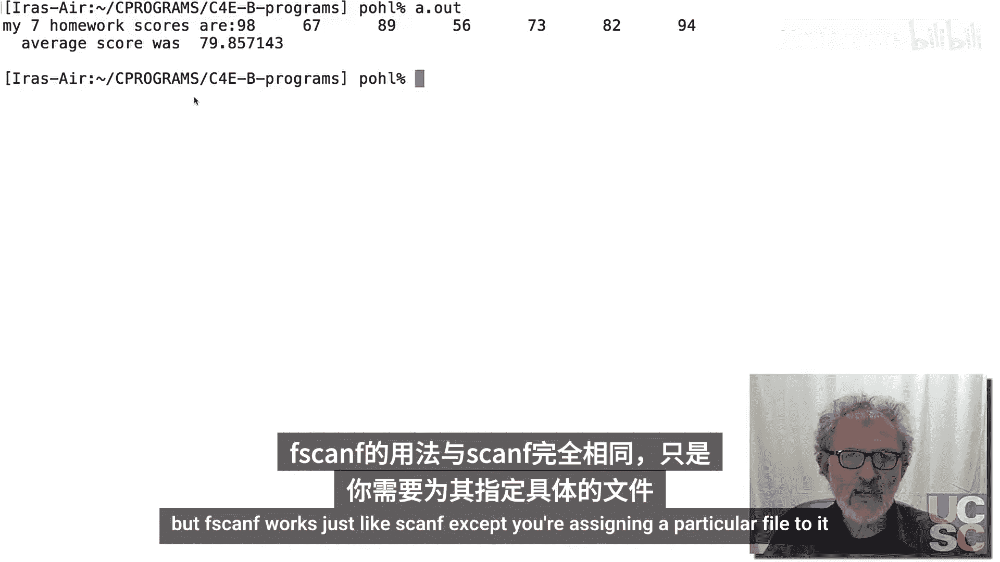

# C语言结构化程序设计：P20：基本文件输入输出代码


## 概述
在本节课中，我们将学习如何使用C语言进行基本的文件输入输出操作。我们将通过一个具体的示例程序，演示如何从文件中读取数据（例如家庭作业成绩），将其存储到数组中，并计算平均值。核心内容包括使用 `fopen` 打开文件、使用 `fscanf` 读取数据，以及如何组织代码以实现模块化。

---

## 代码结构与准备工作

上一节我们介绍了文件操作的基本概念，本节中我们来看看如何将这些概念应用到实际代码中。

首先，我们假设有一个名为 `myHW` 的文件，其中包含一系列家庭作业成绩。我们的程序将读取这些成绩，计算平均值，并输出结果。程序被设计为最多处理20个成绩。

以下是程序的主要组成部分：
*   一个用于读取数据的函数。
*   一个用于打印数据的函数。
*   一个用于计算平均值的函数。

## 主程序分析

让我们先查看主函数 `main` 的职责。它负责协调整个程序的流程。

主函数中定义了以下变量：
*   一个循环索引 `i`。
*   一个整数 `size`，初始值设为20，代表数组的最大容量。
*   一个数组 `data`，用于存储从文件读取的成绩。
*   一个文件指针 `ifp`，用于指向我们要操作的文件。

程序的第一步是打开文件。代码如下：
```c
ifp = fopen("myHW", "r");
```
这行代码尝试打开当前目录下名为 `myHW` 的文件，模式 `"r"` 表示以只读方式打开。如果文件打开成功，`ifp` 将指向该文件。

接着，程序调用 `read_data` 函数，将文件指针 `ifp`、数组 `data` 和变量 `size` 的地址传递给它。该函数将读取文件内容，填充数组，并通过 `size` 返回实际读取的成绩数量。

然后，程序调用 `print_data` 函数来显示读取到的所有成绩。

最后，程序调用 `compute_average` 函数来计算并打印平均成绩。作为良好的编程习惯，程序在结束前使用 `fclose(ifp)` 关闭了文件。

## 核心函数详解

### 计算平均值函数
`compute_average` 函数的逻辑很直接。它接收一个数组和其大小作为参数。

其工作原理是：
1.  初始化一个 `double` 类型的变量 `avg` 为0。
2.  遍历数组，将所有元素累加到 `avg` 中。
3.  将累加和除以元素数量，得到平均值。
公式表示为：**avg = (Σ data[i]) / size**

### 打印数据函数
`print_data` 函数负责格式化输出数组内容。

其逻辑是：
*   遍历数组，依次打印每个元素。
*   为了保持输出整洁，每打印10个成绩就换一次行。

### 读取数据函数
`read_data` 函数是本教程的核心，它演示了如何使用 `fscanf` 从文件读取数据。

函数接收一个文件指针 `ptr`、一个数组 `d` 和一个指向整数（`size`）的指针。`size` 需要以指针形式传递，以便函数能修改其值，向调用者返回实际读取的数据量。

函数内部，先将 `*size` 设为0。然后进入一个循环，在循环中调用：
```c
fscanf(ptr, "%d", &d[*size])
```
`fscanf` 的工作方式与 `scanf` 类似，但第一个参数指定了从哪个文件读取。`"%d"` 指示读取一个整数，`&d[*size]` 提供了存储该整数的内存地址。

`fscanf` 的返回值很重要：成功读取并转换一个数据时返回1，失败（如遇到文件结尾）时返回0。因此，循环条件 `while (fscanf(...) == 1)` 确保我们能持续读取数据，直到文件结束。

每成功读取一个数据，就将 `(*size)` 的值增加1。循环结束后，`*size` 的值就是文件中成绩的总数。

## 程序运行演示

现在，让我们在终端中编译并运行这个程序。假设 `myHW` 文件内容为：98, 67, 89, 56, 73, 29, 4。

程序运行后，输出结果如下：
```
我的7个家庭作业成绩是：98 67 89 56 73 29 4
平均成绩是：79.857143
```
输出显示，程序正确地读取了全部七个成绩，并计算出了精确的平均值。

## 总结
本节课中我们一起学习了C语言文件输入输出的基本操作。我们重点掌握了：
1.  使用 `fopen` 函数打开文件。
2.  使用 `fscanf` 函数从指定文件中读取格式化数据。
3.  通过函数参数传递文件指针和数组，实现模块化的数据读取、处理和输出。
4.  使用 `fclose` 关闭文件以释放资源。



这个程序框架具有很强的扩展性。基于它，你可以轻松地添加新功能，例如查找最高分或最低分，而这些操作不再涉及文件I/O，只需对内存中的数组进行处理即可。主要的收获在于理解如何利用 `fopen` 和 `fscanf` 将文件数据方便地读入程序，从而替代标准输入（`scanf`），实现数据的持久化处理。