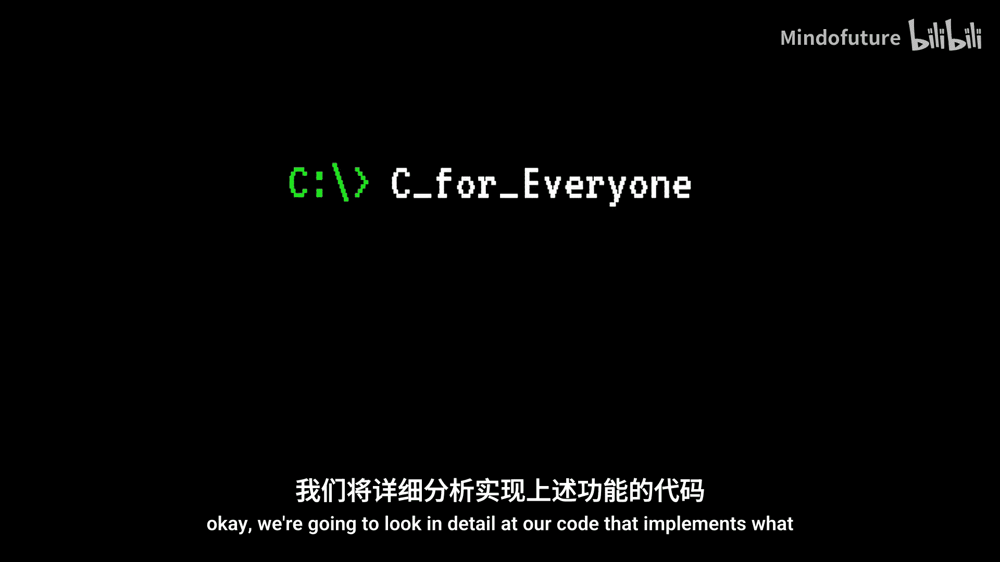
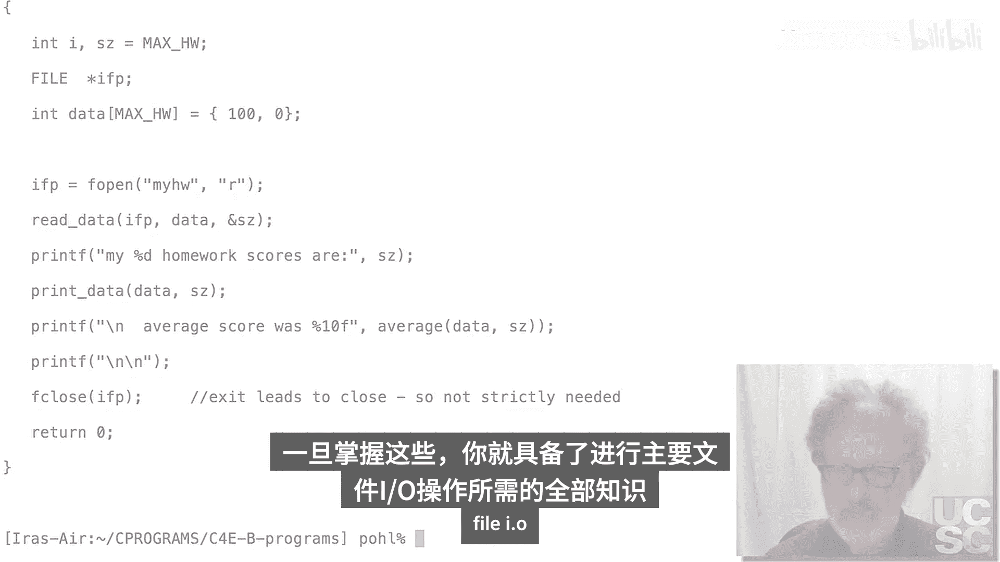

# 【加州大学】C语言结构化程序设计-｜-C-Structured-Programming-p21-P21_对文件进行双倍行距处理_04_01_03--BV1wYe7zWE1T_p21-

🎼2。

🎼，Okay， we're going to look in detail at a code that implements what we just described。

And we'll see some elements we haven't seen before。

We're going to need the standard library because we're going to use a function that allows us to exit the program called exit。

Similar to on aor。嗯。We're going to write some programs， for example。

 here's a print file program and look at it。 very simple。

 we're going to do a character by character print out。

We'll first make sure that we're at the beginning of the file， So we'll do a rewind。And then。While。

We can get a character。From the file， pointed at by the file pointer。

And it's not yet at the end of file。We put the character out to the screen， standard out。

So this is reading and writing one character time， reading from an input file。

 writing to a character file。I just want to show that it's very standard。

 this kind of while loop is very standard， so you should get used to writing it。

 it lets you process files one character at a time， which is frequently desirable。

 especially if you're dealing with text。Now， here's our。

Program that we're using to massage our input file and change it over to what we want for an output file and again。

 we're just doing something very simple， you can do lots of other things like can process numerical file and get averages。

You can look for。Special things inside the file and delete them where you could another interesting thing to try is you can do your own encryption of a file。

 So if you want to have your own security you can take an input file and encrypt it。

 make it an output file that's encrypted。Again。We want to be able to get arbitrary values in there。

 including the EOF value， so EOF remember is a minus one value。We're going to do a rewind。

 just in case， for some reason， we ended up at the somewhere along the way and。Processing the file。

 not at its beginning。Then we're going to get our character and again， tested against UnF。

 exactly like before。Now we're going to put the character into the output file， not into standard Al。

 It is very similar to what's up here， but it goes into the output file。あ。

I commented out what I was using for debugging， which was to put the HR C showing it on the screen as well。

And then if。The character is a new line。 I add a second new line。

So for every new line in the input file。I put out a second new line into the output file。

That's double spacing。So all there is to it。Here's our use of getting arguments from the command line。

 A C and R V。By the way， ArgV could also be。Char star star Av， that's very common。

 This is just alternative to using this notation。 Don't forget。

 an empty bracket is the same as a pointer。So this is also。Pointer to pointer to Arcv。

It would be an alternative。I have my input files， my output files。I want to make sure that the user。

Ass not only nextecutable。But also an input and output file。 So that means Arc C has to show up as 3。

 and if that isn't true， we're going to print this message， need executable input and output file。

 and then we'll call this exit program。I'm going to open the file， the input file to read。

 but I'm going to put in a plus， the plus really means that I can do more than read。

 I can do read and write。Turns out for。This particular example， I want that file not only to be read。

 I don't want it to be read only， I want to be writeriable because I'm going to print it out。

And there's a similar reason why I want right the right file。

 the output file to be more than just that because I'm going to also。

Read that file as well as write to it， so I'm making W+ is right and add reading to it。

Are equivalent in effect。But this shows what the principal use of the output file was versus the input file。

Then。I print F my file， which is percent S。As red， and I'm going to get S from R V。

 That's the input file name。And then I show what it is。 I print it。I print a double space。

 Then I massage it。 I do my double space。Then I print the output file。

Print a title for the output file that's the AV2 file name。

And then I print it in double space as well。So that's all there is to that。Then I do my hygiene。

 F clothes。Of both the input file and the output file。U。I have already compiled it。 Let's try it。

8 do out。啊。That's。See what happens here。So my， my H W file as red in was 98，67，89，56。 and then my。

HW2 file is double spaced。And is now。The same output， you can see the double spacing。

 so let's do with something where you could see the double spacing。Let me try homework program too。

I'll do a out。Homework。Broke。Xi。And I will。I will write it to something we'll call Dtu and let's see what happens here。

啊。Well。嗯。You can see。The original program did not have all this double spacing。

So you can see this is actually homework W2， the screen went by too fast， let's go back up。

Here was the unsingle space file。Then here was my D2 file double space。

 And you can see it worked perfectly。Very easily and quickly。And， in fact， if I want。

 that's now residing。In。That was created and is now residing in my local directory。So there it is。

 again， I just catted it， which is。Just says read it， CAD is a Unix instruction that effectively。

Just reads the screen what's in that file。All done。Again。

90% of what you're going to do if you write code that deals with input and output files is embedded in what we've just done。

🎼The idioms that you've just seen can be used repeatedly。 So you should study this carefully。

 Make sure you understand it， though it's a very simple application。 And once you have that。

 a grasp of that， you have all you need to do to do major file I O。

