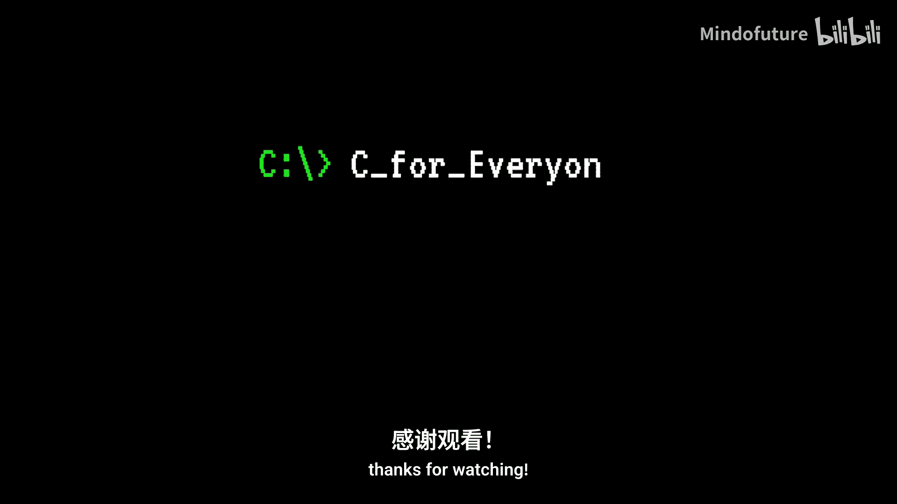

# 【加州大学】C语言结构化程序设计-｜-C-Structured-Programming-p22-P22_main、argc、argv-的使用_04_01_04--BV1wYe7zWE1T_p22-

🎼Yeah。

🎼，🎼The。Okay， file IO， of course， is very important， most serious。

Data processing involves large amounts of data generally stored in a file structure and typically now what you want to do for your output is also produce a file you don't want a lot of paper around and。

Generally。The type of a。Operation you have is take a file that's input。

Massage it and get an output file。 So for example， you might have a set of records and you want them alphabetized according to one of the members of a field。

 so you might take a file of that and then have them sorted alphabetically。嗯。So let's look at how。

Such a piece of code would work。Generally speaking， what you want is you want to do something like。

Take an input file process it， get an output file。 You want the input file and the output file to be what we call command line arguments。

 So you have something that you are going to massage your process。We'll take， for example。

 the idea of double spacing a file。So that'll be our process。And we'll want to say double space。

Input file name， output file name， and that will be our command。

So we have to have a way to have arguments on the command line that get executed by our compiled C code。

And we do have that。Generally speaking， we have used int main void。Or empty。No arguments。

But in Maine。As well can take two special arguments。An integer argument， AG C for the argument count。

And a series of strings that get stored in what might be called a vector。 And these are。嗯。What。

Typically， you would want as your input and output files in。What'll turn out to be V1 and V2。

So ArcC counts at how many things it see on the command line and one of the things it sees on the command line is the name of the executable。

So what we're going to end up with is some kind of double space executable and it'll process a name file one。

 which will have to be open for reading and then will produce a second file too。

 which will either already exist or be written in wherever you located typically by default your local file structure。

Now inside the code， we're going to do an F P equals F open Arg V for reading。

And then we're going to open the output file pointer。For writing， that's at a minimum。And then。

Process after we compile it and we'll be able to massage the input to the output。

Now there are going to be a few more details in there， we're going to use， for example。

 a rewind function that lets us get to the beginning of a file because sometimes when we massage a file。

 we get to a different place in it and we need to rewind it so that'll be an additional file function。

 we will use。And of course， for every F open， we will have F closed so that we have good file hygiene。

