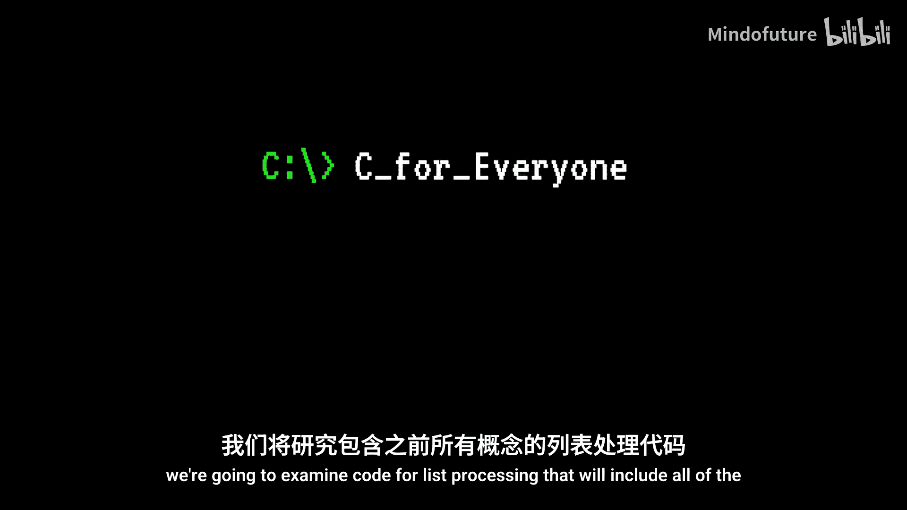
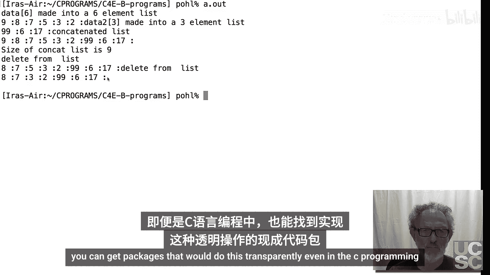

# 【加州大学】C语言结构化程序设计-｜-C-Structured-Programming-p23-P23_荣誉课程_带删除功能的列表代码_04_03_01--BV1wYe7zWE1T_p23-

🎼2。

🎼，We're going to examine code for list processing that'll include all of the previous ideas。

Now this segment is an honors segment。The course is intended to allow anybody to learn how to code。

But。What we're going to deal with is somewhat sophisticated。

So I don't expect everybody to manage this material。

But if you have an interest in continuing in my sequence and taking the C++ course and going on to more advanced project。

Then this kind of material is exactly what computer science students have to master。

So I would like everybody to take at least some look at the material。

 but to accomplish the objectives of the course to learn how to code properly。

 you don't need to know the details of what I'm presenting。Okay。So。Here we have。Our basic。

Type De for a list。Individual element in a list is a piece of data and then an X pointer。

One of our simplest operations on such an abstract data is tot testest whether it's empty。

 We test whether it's empty， whether。The pointer to the head of the list is null。

Noll is zero and null is the Sentinel。The indicator value for。

The end of a list for that list is empty。Now。Here is how we create an element of a list or an effect one element list。

We appeal to Malck， which is a way of grabbing appropriate size memory off。The heap。We。Make that。

The head of the list。あ。We've passed in the value of data， so we make that part of the struck。

Equal to the value of D。The past in value。 And then we have。For the single element list。

 our next pointer is now null， and we return the head of the list so that the external environment knows that we've created this one element list。

If we want to add to the front of a list。We first。Create a list that means basically creating the one element list we use or reuse our previous piece of code。

Then head。Points at。Next of H。And then。We return ahead。So whatever size list there are。

 this creates a single element and then links that element。Through this operation。2。

What will now be the new head， H was C old head。Here is a way of transforming one data structure to another。

 and that's frequently required when we're manipulating these abstract data types。So。

90% of the use of。Data is to use homogeneous data that largely is to use arrays which are random accessed。

Sts that tends to be the most efficient。 That's what you should really concentrate on learning。

 So if you're not an honor student or somebody who is going to get deeply into the subject， Yes。

 what you really have to master is a raise。Now， going from the array。To a list is taking。

The first element， D of 0， making it into a single element list。 And from there on， adding to front。

 So again， we're reusing code。So if our original code is correct， then the reuse code。

Well make an appropriate。Arbitrary size list。Converting a。Aray mapping an array data into a single。

Linear length list data。Again， a lot of what you can learn is through the use of the Iidioms。

 Here's a standard id for printing a list。 So you're not going to。Change anything in the list。

But then what's in the list？While you're not at the end of the list that's。Well， ahead it's not null。

Print that element。And then。Chain to the next element。

 so you just keep going on the list until you hit null。And each time， through。

You print whatever that data element is followed by a colon。

And we'll see that when we compile this program。Simmiile。Notice again。The sdium， while H is not null。

 we do a counter。 we go through null。 so both of these are very similar。

And much of the code in a linear link list can be used。Can be。Handled with this kind of。

Iiom or pattern。Now here gets to be our most sophisticated， most complicated。

Many of you can understand what I've done up to now here is something where。

It'll differentiate between those who have a deep understanding of what we're doing。

And as I said before， this is where it's an honors component。So let's look at this code。

 this code is going to delete。This element。The element before it is going to be pointed at by previous。

 but notice that it has two levels of indirection。 It's a pointer to a pointer。And then。

The head of the list。It's also a pointer to pointer now why is that？Well。

 one possibility is the element to be deleted is the head of the list element， first element。

Otherwise， it could be an internal element。In which case？

These pointers have to be modified in the external environment。 And remember， when we're using C。

 everything is called by value。 So the way you。Get the equivalent of。

Call by reference is to use pointers and indirect， but these were ready pointers。

 so you need a second level of indirect in order to be able to modify。These two pointer types。

 possibly。And then delete work simply if it's。The head of the list。Then we just move。

The head to the neck。 So that's the first element。 We just chop off the first element。Otherwise。

That means there's a previous element， so we move to the next。

And that becomes the element after next， and that's the new linkage。 and in either case。

 we free the element。And you could go back and see。

You could draw the little chart that I had in the previous video that showed how this deletion works diagrammatically。

Here's the deletion of it Who list。Again， we do a thing。I'm going to do this。Recursively。

 in each case， we start with the。Head to the list， if the heads and allll were done， otherwise。呃。

We want to。呃。Move down the list， call it recursively and free the current element。

Here's concatenation。I think this is explanatory again。呃。I'm going to omit the explanation。

 you should have this code available。We explained it briefly in our previous video。

And now let's test this stuff。So I have two arrays。 I have a data array， initially 2，3，5，7，8，9。

 and a smaller data of 2 array。 I didn't declare it to be size 3， though it is implicitly 176，99。

 So recognize that this will allocate three elements。呃。I create head 1 to be array to list of data。

 Head 2， to be array to list of data to 2。 I'm going to print both those lists。

 Then I'm going to concatenate them。 Then I'm going to print them again。Now I'm going to count them。

Then I'm going to do a deletion。I'm going to do a deletion。From the front of the list。

And notice in that deletion。呃。I'm using the head of the list and I'm deleting the first element of the list and notice these are passed in by address。

That's so that these things， head one can be modified internally。

And then I'm going to print the deleted list。And then I'm going to show you how that print。

 that would delete a first element。 This will delete an internal element。

 So I'm going to jump from ahead to a second element。

 do that deletion and then return these various values。 Let's try and see if that all works。

I think I already ready。Compile this。Well let me clear the screen and redo it。So what do we have？

We have 9，8，7，532。Then we have the three element list， 99，617。 Then we have the concatenated list。

Which is 98753299617。So far， so good。Six element list made from that array of six elements。

 three element list。9 element list concatenated。 The size。 We used count。 We get a size of 9。

 Now we do a deletion。 This deleted the first element。 So 9 fell off。So now we have 87，5， blah， blah。

 blah， eight element list。And this deleted an internal element just as we said。We jumped down too。

This was a previous element and that got us an internal element deleted properly。

 and then this was the result。Okay。So all of that。Had some very sophisticated elements in it， again。

For those of you in the honors segment or want to go on to more advanced courses。

 you definitely want to master of material。If you're just。

Learning basic coding and this is a little too sophisticated it ignored most modern programming languages provide this kind of ADT where you don't have to know internals like this so they get to be used transparently and indeed you can get packages that would do this transparently even in the C programming。

そ。