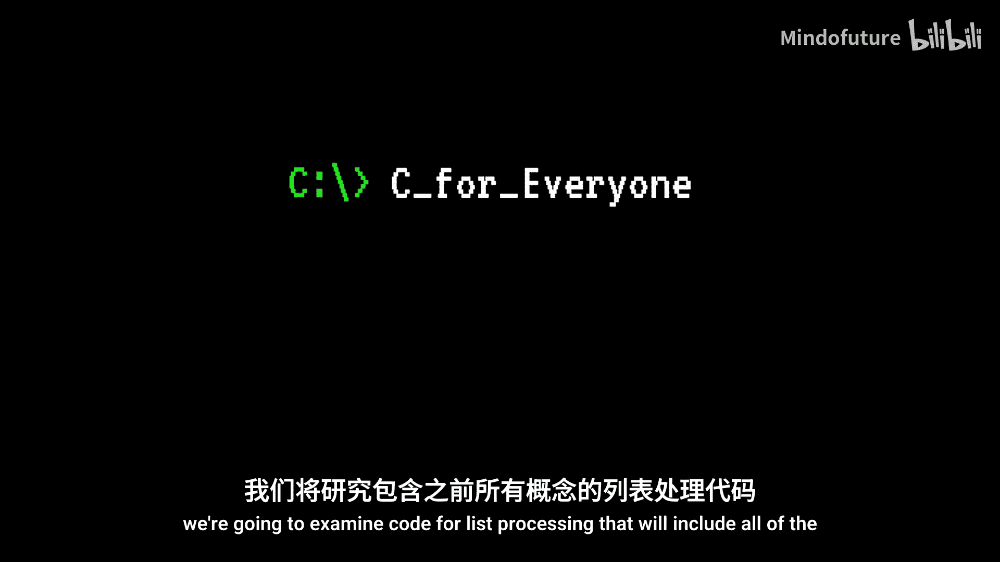
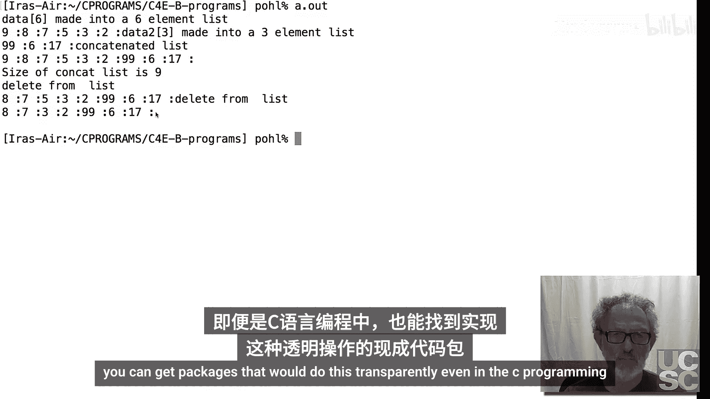

# C语言结构化程序设计：P23：荣誉课程 - 带删除功能的列表处理代码



在本节课中，我们将学习一个综合性的链表处理代码示例。该示例整合了之前课程中介绍的所有核心概念，包括链表的创建、遍历、转换、打印以及删除操作。本节内容属于荣誉课程部分，旨在为有兴趣深入学习计算机科学和后续C++课程的同学提供更高级的编程视角。对于初学者而言，理解其基本思想即可，掌握数组的使用仍然是当前阶段的首要目标。

## 链表基础结构定义

首先，我们定义链表的基本结构。链表中的每个元素包含一个数据域和一个指向下一个元素的指针。

```c
typedef struct node {
    int data;
    struct node* next;
} Node;
```

## 判断链表是否为空

判断链表是否为空是一个基础操作。我们通过检查指向链表头部的指针是否为 `NULL` 来实现。

```c
int is_empty(Node* head) {
    return head == NULL;
}
```

## 创建链表元素

要创建一个链表元素或一个单元素链表，我们需要使用 `malloc` 函数从堆中分配内存。

```c
Node* create_node(int data) {
    Node* new_node = (Node*)malloc(sizeof(Node));
    if (new_node != NULL) {
        new_node->data = data;
        new_node->next = NULL;
    }
    return new_node;
}
```

## 在链表头部添加元素

在链表头部添加元素涉及创建一个新节点，并将其链接到原链表的头部。

```c
Node* add_to_front(Node* head, int data) {
    Node* new_node = create_node(data);
    if (new_node != NULL) {
        new_node->next = head;
        head = new_node;
    }
    return head;
}
```

## 将数组转换为链表

将数组转换为链表是一个常见操作。其基本思想是遍历数组，并依次将每个元素添加到链表的头部。

```c
Node* array_to_list(int arr[], int size) {
    Node* head = NULL;
    for (int i = size - 1; i >= 0; i--) {
        head = add_to_front(head, arr[i]);
    }
    return head;
}
```

## 打印链表内容

打印链表内容的标准方法是遍历链表，直到遇到 `NULL` 指针为止。

```c
void print_list(Node* head) {
    Node* current = head;
    while (current != NULL) {
        printf("%d -> ", current->data);
        current = current->next;
    }
    printf("NULL\n");
}
```

## 从链表中删除元素

删除链表中的元素是本教程中最复杂的部分。它需要处理两种可能的情况：删除头节点或删除内部节点。为了能够修改调用函数中的头指针，我们需要使用指向指针的指针。

```c
void delete_node(Node** head_ref, Node* node_to_delete) {
    // 处理空链表或空节点的情况
    if (*head_ref == NULL || node_to_delete == NULL) {
        return;
    }

    // 如果要删除的节点是头节点
    if (*head_ref == node_to_delete) {
        *head_ref = node_to_delete->next;
        free(node_to_delete);
        return;
    }

    // 如果要删除的节点是内部节点，需要找到其前驱节点
    Node* current = *head_ref;
    while (current != NULL && current->next != node_to_delete) {
        current = current->next;
    }

    // 如果找到了前驱节点，则重新链接链表
    if (current != NULL) {
        current->next = node_to_delete->next;
        free(node_to_delete);
    }
}
```

## 递归删除整个链表

我们可以使用递归的方式优雅地删除整个链表。

```c
void delete_list(Node* head) {
    if (head == NULL) {
        return;
    }
    delete_list(head->next); // 递归删除剩余部分
    free(head); // 释放当前节点
}
```

## 链表拼接

链表拼接操作将第二个链表连接到第一个链表的末尾。

```c
Node* concatenate(Node* list1, Node* list2) {
    if (list1 == NULL) {
        return list2;
    }
    Node* current = list1;
    while (current->next != NULL) {
        current = current->next;
    }
    current->next = list2;
    return list1;
}
```

## 测试代码

以下是如何使用上述函数进行测试的示例。

```c
int main() {
    int data1[] = {2, 3, 5, 7, 8, 9};
    int data2[] = {176, 99}; // 编译器会自动推断数组大小为2

    Node* head1 = array_to_list(data1, 6);
    Node* head2 = array_to_list(data2, 2);

    printf("List 1: ");
    print_list(head1);
    printf("List 2: ");
    print_list(head2);

    head1 = concatenate(head1, head2);
    printf("Concatenated List: ");
    print_list(head1);

    // 删除头节点
    delete_node(&head1, head1);
    printf("After deleting head: ");
    print_list(head1);

    // 删除内部节点（例如第二个节点）
    if (head1 != NULL && head1->next != NULL) {
        delete_node(&head1, head1->next);
        printf("After deleting second node: ");
        print_list(head1);
    }

    delete_list(head1); // 清理内存
    return 0;
}
```

## 总结



本节课我们一起学习了链表数据结构的综合操作。我们从基础的结构定义开始，逐步实现了创建、遍历、转换、打印以及删除等核心功能。重点和难点在于理解并使用**指向指针的指针**来修改链表头，以及处理删除节点时的边界条件。虽然这部分内容属于荣誉课程，较为深入，但它揭示了底层数据管理的核心思想。对于日常编程，许多现代语言已经提供了封装好的链表实现。掌握这些原理将为你未来学习更高级的数据结构和算法打下坚实的基础。