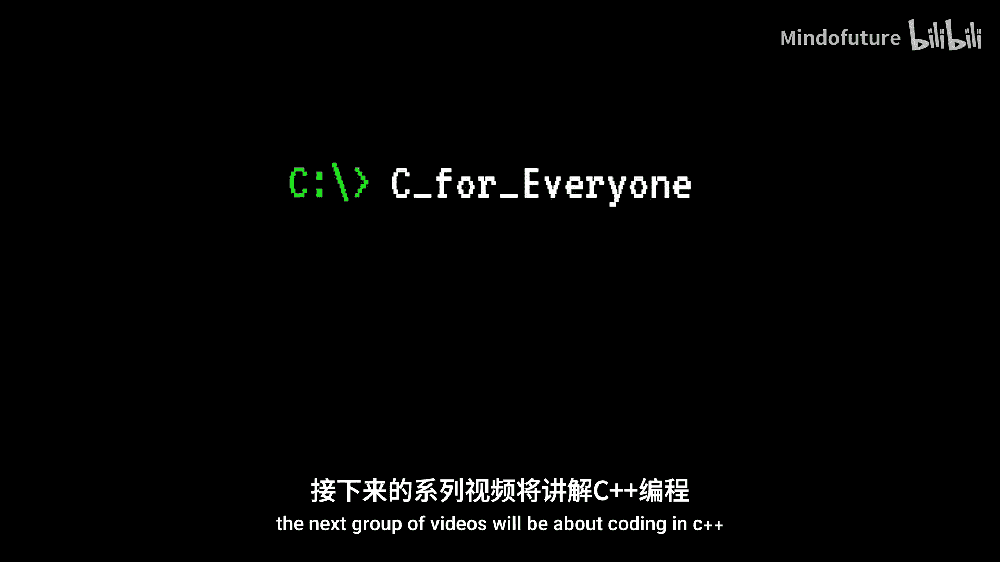

# 【加州大学】C语言结构化程序设计-｜-C-Structured-Programming-p24-P24_C++介绍_05_01_01--BV1wYe7zWE1T_p24-

🎼2。

🎼，The next group of videos will be about。Coding and C++。In some ways， C++ is a modern C。And。

There are many reasons to prefer it。To codinging and sea。One reason is that it is coding in C。

So you don't have to change very much and you get the benefit of certain modern changes that make for。

A more high level view of coding， which makes coding easier。

The other thing which many of you might be interested in is to go on to the next series of courses。

 which is C++ for C programmers。There are going to be two benefits。

 one is just that you'll get a quick and easy way to jump onto some of the neat features of C++。

And secondly， if you want to continue with these studies that I'm providing on Coursera。

This will ease your transition。So what's the good news in moving to C++？

C is essentially a subset of C++。It's not。A completele truism。

 there are a few things that are different so that if you were to run them in a C+ plus mode。

 they would either not work or have some different semantics than when run in a C mode。

 but by and large， most everything is the same。C++ says memory improvements that make programming easier。

Now。One reason C++ gets a bad rap。Is that it's extremely complex， it's a very。

 very large language when you include all of the libraries and constructs like templates。

And in most instances， you don't need a lot of that stuff。

 or you can use the very basic parts of that stuff readily， and yet it'll make your codinging easier。

 And we're going to see that in this introduction。A third thing is C++ compilers are often bundled with C compilers。

 so in the Gnu compiler system， instead of using GCC， you use G++。You would be running your code。

As if it was C++ code。Okay， one of the first things we're going to look at is that C makes input output easier than C++。

Output in C++ could look like the C out。呃。Two less than signs， which are in effect。A shift operation。

Quote C++ is an improved C semicolon。This ships this。String。To the screen。Notice， there's no。呃。

Binntf involved。 And it's sort of。Intuitive in the sense that take this and move it over here。

 see out being standard out。Technically， this operation， which is a shift operation。

 is overloaded to provide output behavior。Similarly， inputs easier， you do a C。

Shift in the other direction miles。 And this is telling you from your standard N， T your keyboard。

 If you enter something， it's going to become。Converted into miles appropriately。

 And there's no need again for formats or an ampersan sign。 So， again， it's。Intuitive。

I'm going to demonstrate that in some code almost immediately。

But let's first give kudos to how C++ was invented。

The brief industry is the history is that it was invented。At Bellways。

Where it came to fruition in 1985 by the computer scientist Br。Srewstrop。

He originally called a sea with classes， and he， as a Scandinavian student。

 was exposed to a language called Sim， which was the original language for dealing with this abstract data type。

 this piece of structure。Remember， a lot of what we're doing is providing structure to your coding。

 and structure helps。Structure encapsulates， structure prevents lower level errors。

So Simlo was the first real language with classes， he was enamored with it。

 but now he was an employee at BellAps， everything at Bell Laps was basically done with C。

 so he embedded classes in C。Combine them。What were the advantages that was free。

 Bell Las just provided things like the C and Uni system for free because it was a telephone company and was otherwise at that time。

 a monopoly。So that was one way it was doing good to society。Providing a lot of research for free。

It was based on see。 So people who already knew sea almost instantly could add whatever they thought was appropriate。

It was highly efficient。So a major contender language at the time that had classes was small talk。

 but small talk。Was。Very expensive to run， very time consuming。C compiled directly to native code。

 C had always been something that was efficient， small talk compiled to an interpretive code。

Now C++ is kept evolving。Most stable and what most people are now using is C+ plus 11 or in some cases even more advanced。

And that's the form of the language that we will discuss in C++ for C programmers。Okay。🎼Yeah。

