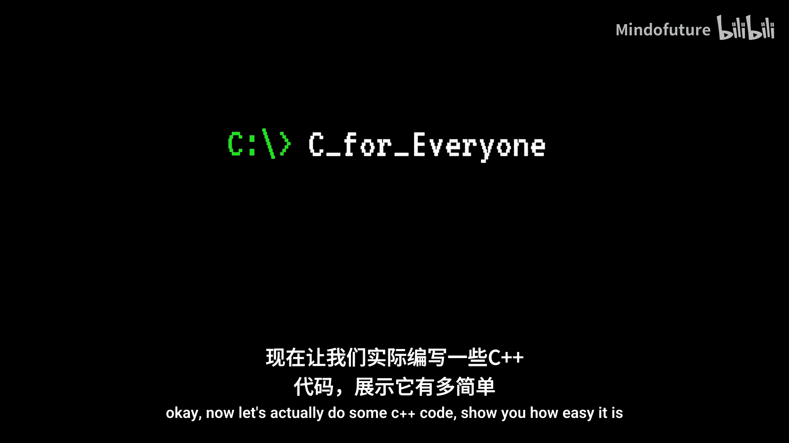

# 【加州大学】C语言结构化程序设计-｜-C-Structured-Programming-p25-P25_第一个C++程序示例_05_01_02--BV1wYe7zWE1T_p25-

🎼2。

🎼，Okay， now let's actually do some C++ code， show you how easy it is。呃。First off， C plus plus。

Introduce these rest of the line commons， and they are now very common in AnsCC see as well。So。

When you don't have。Slash star， star slash sometimes that。

Leads to an error if you leave off your star slash and these rest line comments are。

Easier to put in in all places。Now we'll see a different form of include。

 we'll see include IO stream and we don't have the dot H。 There are dot Hs available。

 but C++ understands these to come from the standard library an IO stream is where you find the IO that's adopted in C++ Now you can return to C standard IO。

So if you wanted， you could have said include C standard I O。

 and then you could use things like printf and Scff。

But that's not considered good form in the C++ community。呃。C plus plus has another form of naming。

 which you add on to your identifier names is's called a namespace。

 So it's another way you can encapsulate things。 So if you have a big chunk of library。

 that you want to use。 and that library is preferenced by S D。 then using namespace S D。

 lets you omit the S D， as you'll see， we're going to use things like see out and C in。

 and they really come from the standard library， the encapsulation of the standard library。

 So if we didn't include using namespace S D， we would have to。Over here， right？SDD， colon， colon。

Now we could。Do that as well， that didn't create a problem， but at this point that's redundant。

Get rid of it。It's here because I put that namespace Co and SDD What does that do for you Well let's say there are other libraries like ones coming from IBM。

 you could have using namespace colon and colon and IBM and so you can libraries could collaborate and their identifyentifier names wouldn't conflict。

Another thing we see in C plus fuss。Is。We have Kst。 Now， again。

 Kst is adopted in some of the newer forms， of C。And Ks means that。This。

Identifier could not have its value changed in this program。Again， it's a way to allow type checking。

 so this is constabletable， so the compiler uses type checking statically to watch out for errors。

Another thing which is an interesting improvement。Is to use the keyword and。

This is a key word in C++ in line。Which tells the compiler to attempt to optimize。A function。

And generally speaking， I won't get into it in detail for you。 this is just a beginning course， but。

When you have function call， you have a bunch of setup。That may not be needed。

 And instead of doing this all over， if you just take this little code segment and put it appropriately wherever it's being called。

 like convert over here as where it's being called and turn that into miles times empty K。

 you would save on what's called the function call。Now。

Some people no longer want to use this because to say a compiler would have an optimization flag and you could let the compiler more appropriately optimize。

But originally， C+ plus his intention was to avoid using sharp defines。

 because sharp defines are preprocessor ideas， and they are airful。And。

In line was an intention to take what used to be called macros and replace them with these optimized。

Functions， which then would be syntactically checkable and do appropriate things like。Probably， oh。

 there are things where there's conversions when you call these functions that wouldn't necessarily happen。

If it was a pure macro。Anyway， in line， as I say。It's not something you need to use。

 but it was at the time a small improvement。And then we have int main void。

 as before int miles equal 1。 Let me just say that in C plus plus。This definition， or declaration。

Doesn't have to occur just at the head of a block。 So another thing that you found with C plus plus was you could put things inside code。

 declarations inside code where they were nearest to where they were used。 Now。

 miles gets used immediately。 So it's。Necessary to put it at the head of the block。

The wild statement it has before， and here's your C out and your C。

Notice how much simpler and then we just say see out。Distance is， we call convert。

 which gets us a double。We then print。Komes。And then we have this endele。

 which effectively gets us a new line， it's another way to get a do line。

 we can get a new line back flashlash and or with endEel。

 and endL forces the buffer to be flushed to the screen and there's another endele。

So notice how these things。Basically concatenate again， fairly easy to use。Iio。

I think I compiled this already。Whoop， that's the wrong one。Go back and compile it。

So I'm going to use G plus plus。Miles to kilometers of CPP。 I don't know if you notice。

 but I was using a。And now I will execute that。Say as input distance in miles or 0 to terminate。

So if I do like three miles， I get 4。8。2，7。Km。S miles。I get 9。654 kilometers， 26 miles。

 which would be roughly a marathon， roughly 42 k。Let me terminate。Zero， of course。

 the distance is zero in kilometers as well。Okay， so that's the first program。

 it shows some of the power， it should immediately be something you could do with any of your C programs。

 one of the things I recommend is take a simple C program。

From that you've done for this class and just try and use some of these ideas and convert it。

