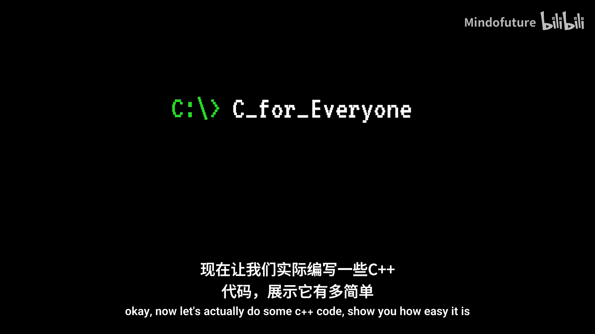

# C语言结构化程序设计：P25：第一个C++程序示例



## 概述
在本节课中，我们将学习如何编写一个简单的C++程序。我们将通过一个将英里转换为公里的示例程序，了解C++与C语言的一些基本区别，包括注释、头文件、命名空间、常量以及输入输出流的使用。

---

## C++代码示例与解析

上一节我们介绍了C++的背景，本节中我们来看看一个具体的C++程序示例，并解析其关键组成部分。

### 注释
C++引入了单行注释，这种形式现在在ANSI C中也很常见。与C语言中的`/* ... */`块注释相比，单行注释使用`//`，它更简洁，并且避免了因忘记关闭`*/`而导致的错误。

### 头文件包含
在C++中，我们使用不同的方式包含头文件。例如，我们使用`#include <iostream>`，并且通常不添加`.h`后缀。C++标准库中的头文件通常没有`.h`。虽然也存在带`.h`的版本，但`<iostream>`是C++标准库中用于输入输出的部分。

你仍然可以包含C标准库的头文件，例如`#include <cstdio>`，然后使用`printf`和`scanf`。但在C++社区中，这通常不被认为是良好的编程风格。

### 命名空间
C++引入了命名空间的概念，这是一种封装标识符名称的方式。使用`using namespace std;`可以让我们省略标准库中标识符前面的`std::`前缀。

例如，我们将使用`cout`和`cin`，它们实际上来自标准库。如果不使用`using namespace std;`，我们就必须写成`std::cout`和`std::cin`。命名空间允许不同库（例如来自IBM的库）协同工作，而不会发生标识符名称冲突。

### 常量与内联函数
C++中使用了`const`关键字来声明常量，这意味着该标识符的值在程序中不能被改变。这有助于编译器进行静态类型检查，防止错误。

另一个有趣的改进是使用`inline`关键字。它告诉编译器尝试优化一个函数。当调用一个函数时，会有一些开销。`inline`建议编译器将函数代码直接插入到调用处，从而节省函数调用的开销。

最初，C++引入`inline`是为了避免使用C语言中的`#define`宏，因为宏是预处理器的概念，容易出错。内联函数可以进行语法检查，并且在调用时可能发生类型转换，而纯宏则不会。不过，现在许多编译器都有优化选项，可以自动决定是否内联，因此`inline`关键字的使用不再像以前那样必要。

### 主函数与变量声明
和C语言一样，我们使用`int main(void)`作为程序入口。在C++中，变量的声明不必一定放在代码块的开始处。你可以将声明放在最接近使用该变量的地方，这可以提高代码的可读性。

### 输入输出流
C++使用`cin`和`cout`进行输入输出，这比C语言的`printf`和`scanf`更简洁直观。`endl`不仅输出换行符，还会刷新输出缓冲区。你也可以使用`\n`来换行。

---

## 程序代码与运行

以下是完整的C++程序代码，它将英里数转换为公里数：

```cpp
#include <iostream>
using namespace std;

const double KM_PER_MILE = 1.60934;

inline double milesToKm(double miles) {
    return miles * KM_PER_MILE;
}

int main(void) {
    int miles = 1;

    while (miles != 0) {
        cout << "Distance in miles (0 to terminate): ";
        cin >> miles;
        double km = milesToKm(miles);
        cout << "Distance is " << km << " kilometers." << endl;
    }

    return 0;
}
```

**编译与运行：**
1.  使用`g++`编译器进行编译：`g++ -o miles_to_km miles_to_km.cpp`
2.  运行生成的可执行文件：`./miles_to_km`

**程序运行示例：**
*   输入3英里，输出约为4.828公里。
*   输入6英里，输出约为9.654公里。
*   输入26英里（接近马拉松距离），输出约为41.842公里。
*   输入0即可终止程序。

---

## 总结
本节课中我们一起学习了如何编写第一个C++程序。我们了解了C++在注释、头文件、命名空间、常量声明、变量作用域以及输入输出流方面与C语言的区别。这个简单的英里转换程序展示了C++语法的一些基本优势，例如更清晰的I/O操作和更灵活的变量声明位置。


建议你尝试将自己编写的一个简单C语言程序，使用本节课介绍的C++特性进行改写，以加深理解。