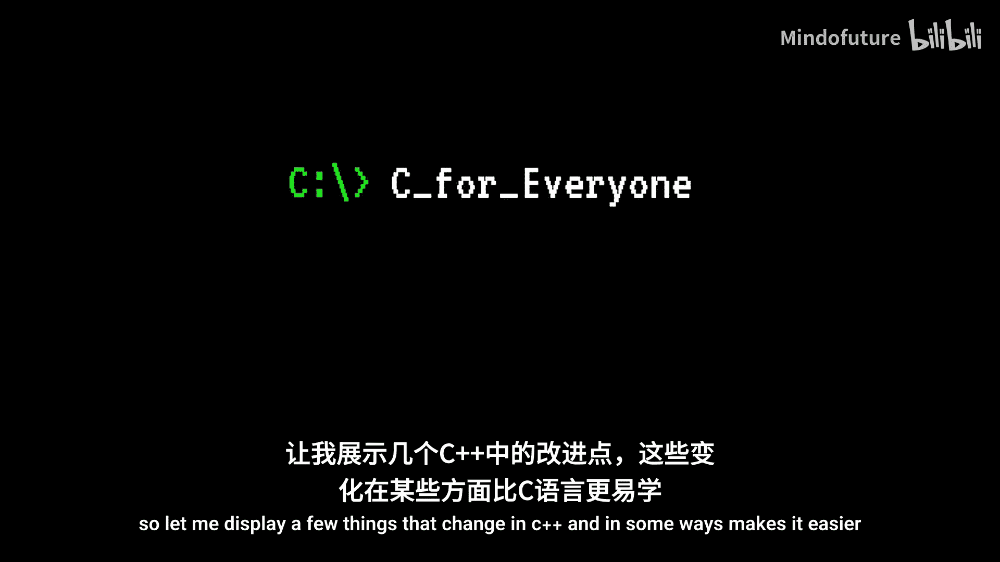

# 【加州大学】C语言结构化程序设计-｜-C-Structured-Programming-p26-P26_C++中易于掌握的特性_05_01_03--BV1wYe7zWE1T_p26-

🎼2。

🎼，So let me display a few things。Change in C++ and in some ways makes it easier to learn than C。

What we already saw was the use of IO streamam。You could call it the dropping of the dot H。

These are all parts of the。Standard Library。So there's a lot of extension to the standard library。

 it includes the old Sea library， typically when there's an old sea library。You'll see it。As C。

Math or C standard I O so there'll be a C prefacing the rest of the name that was similar to the name。

 the same as the name。For the sea community。And we've already seen this。

 I would call simpler and more intuitive IO， See out print message， C in sends a value to X。

 no need for。The stuff that ScanF does where it needs an ampersand of X。Rest of line comment。

 it's now in most C compilers， so some things have been adopted in the C compilers。

In line for optimization， though， in terms of modern。

Compilr technology probably don't really need to specify that if you want high optimization levels。

 you can specify them in the compiler with a special flag。

Here's something nifty for expression allows a local declaration。So you know。

 we're always in old sea。dececlaring things like hint I and J and K。

 And then later using them in four statements Here。

 we use them locally in the force statement by allowing。This expression to be a declaration。

 So we say int I is declared and is initialized to 0 I less than n auto increment I。

 And then inside here， I may be used， but I cannot be used outside of there。 that I。

Is scoped to this force statement。Another thing about declarations is they can occur anywhere in the code essentially。

So you can put a declaration， let's say there was executable code here。And then you needed。

A variable。Area， they declare it。And you use it and it's being declared near where it's being used。

And that。Many times age readability， though it's still quite okay to declare all of your variables at the head of the block with appropriate comments。

There's something we called inferred typing。And there's a redefinition of the keyword auto。

 so that differs。From what it meant and see and see it's really unused。But here。

We can say a declaration auto I signed three and because this three。Is a literal， that's an integer。

The compiler。嗯。Confire out that I should be declared an int or in this case。Auto x equal 3。0。

 The compiler will will declare that to be。A double。This is sometimes known asduct typing。

 it's available in languages like Python。If it。Quacks like a duck， looks like a duck。

It probably is a duck， so the compiler makes that determination for you。That's normally not。

That useful and in fact， in simple types， it's better to keep the normal type declaration。

But it turns out if you're going to use advanced parts of C++。

 there will be very complicated decorations and there allowing the compiler to infer it。

It's frequently helpful。Another big advantage that sometimes makes the language easier use is this substantial additional library is called the standard template library。

And in the Stan template library， it adds what are called many container classes。Things like。Ls。

And stacks。Occur there。 They're considered containers and especially important is something called a vector。

 which is a generalization of an array。 And along with the containers。

 there are many very efficient algorithms to。Either use those containers or frequently are just very useful in a lot of domains。

 so you don't have to recode them。So the container that I already said is most useful where you can probably get 80 or 90% of your value。

So remember Dr。 P's value rules， some things。Give you 90% of what you need to know。

 vector is one such thing。So vector is a powerful and flexible kind of array， it's an extension。

 it's a generalization of an efficient array， which means it can be indexed。

So you can randomly access the element， but it'll also turn out to have very simple ways to march through the whole array or even subparts of the array without even having to do normal indexing。

 so you won't necessarily get what we call off by one errors。

So we're going to also show some code using this。That code will look like vector of int instead of int A N。

 we would say vector of。Brackets int。 there will be a type in here。

 That's the type to be stored in that vector。 Then we give it a。Identifier your name。

So that's the vector name and then some initialization like this is telling it。

Set it up with elements。We'll shortly show code at demos why this improves over the ordinary kinds of raw arrays found in the C language。

