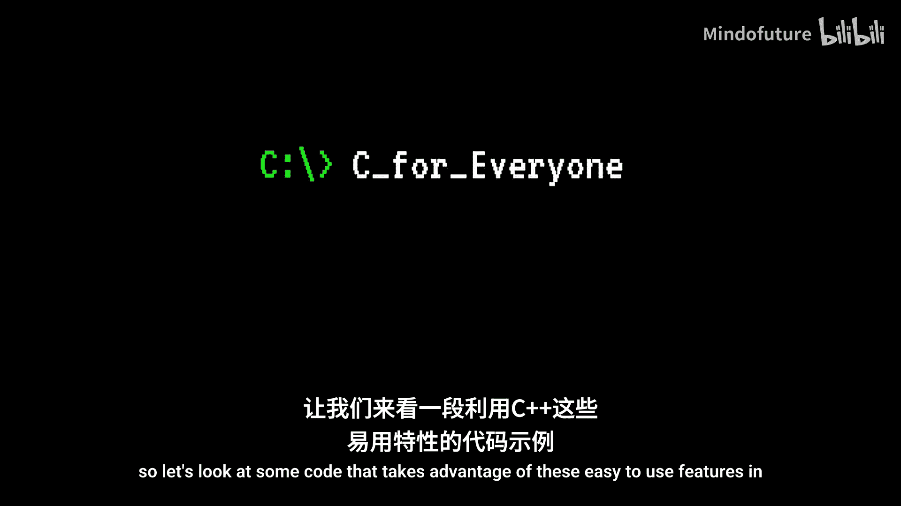

# 【加州大学】C语言结构化程序设计-｜-C-Structured-Programming-p27-P27_使用新特性的C++程序_05_01_04--BV1wYe7zWE1T_p27-

🎼2。

🎼，So let's look at some code that takes advantage of these easy to use features。In。C， plus， plus。

And we're going to use things like auto， internal declarations and being able to locally declare the iteration variable in a four。

This function is going to do an airer。啊。Calculation of factorial。

And notice one of the things that I'm calling this is long long。So indeed。

 there's an extension in C++ that says besides an ordinary int。

And a long int that got introduced in NCC。There is even something longer。

And the reason that that's important for this particular problem is if you tried to do a factorial calculation。

 it turns out for an ordinary int。This starts to what you call have integer overflow， I think。

Where F is something like 13。So that's a boundary point。 And here， by using long， long。

 we still have enough。Btes to represent something that is an integer that's that big。Again。

 we have a very。We're using the IO stream， so we're not using the。Standard I O from C。

We are making use of this namespace STD， so we don't have to say STD standard out or STD standard in。

 just the convenience。But you could just as well not have this， not have this using directive。

And then you would have to say STd see out。And you'd have to say STD， colon， colon， and Dell。

So this program uses some features， not in C。89。Which is the standard anC language widely available。

 widely in use。And notice here。We have four inti where the int eye is in this for loop。

So we allow this kind of local declaration that I is only available here。

 it couldn't be used after year。Notice this for。Here I use auto， I didn't need to。

 I would say I would prefer En I I'm just using auto to demonstrate thatduct typing will work。

So this will infer that I is to be an int。 It also knows that it's to be locally within this。

 and then we're going to print out a series of factorials。

 and we're going to use this very intuitive form of I O where we say C out。

 we get factorial of which is a string， Then we print the value I。And then is。

 and then we compute factorial and print it out and then we advance to a new line and then we'll end the program with it。

 that's all folks。So here we've used very easy features that changes really not very much in what you understand from C。

 but it does help。啊。Bright code。Correct code more easily。I think I've already compiled this。

And I will just execute it just to show you that it'll work。And， indeed。I forget if。You see。

 this is greater than。What do we have here， we have 47。479 million。 That's okay for I equals 12。

 But here we get to 6 billion， and 6 billion is larger than a standard int。

 So this will be interpreted。As some other kind of number。And will be wrong。 You can try it。

 Try to use factor in and try in print factorial of 13。 you'll see it won't be the switch is。

 in fact， accurate。And 14 and 15 as well， even though that's quite a large number and exceeds what would be normally single precision int。

Okay。Yeah。In the next video I'm going to show you。A little bit more of how convenient some of these things are。

 and I want to show you how to use a container class in the standard library。

 namely the vector container class。And。That's especially important for those of you who want to do this at the honors level to try out that material in advance to it。

 not so important for you if you're just going through this class to learn basic coding。

