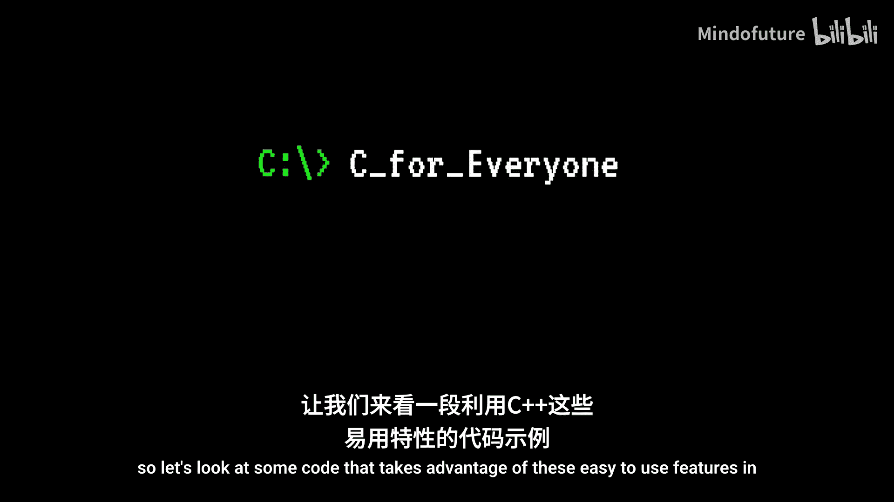

# C语言结构化程序设计：P27：使用新特性的C++程序



## 概述
在本节中，我们将学习如何利用C++语言中一些易于使用的新特性来编写程序。我们将重点关注`auto`关键字、内部声明以及在`for`循环中局部声明迭代变量的功能。通过一个计算阶乘的示例程序，我们将看到这些特性如何使代码更简洁、更易读。

---

## 利用C++新特性的代码示例

上一节我们介绍了C++相较于C语言的一些新概念，本节中我们来看看如何在实际代码中应用这些特性。

我们编写一个函数来计算阶乘。请注意，这里我们使用了`long long`类型。在C++中，除了普通的`int`和C语言中引入的`long int`之外，还有更长的整数类型。这对于阶乘计算尤为重要，因为使用普通`int`类型计算到13的阶乘时，就会发生整数溢出。使用`long long`类型可以确保我们有足够的字节来表示这么大的整数。

我们使用了IO流库（iostream），而不是C语言的标准I/O。同时，我们使用了`using namespace std;`指令，这样就不必在每个标准库对象前加上`std::`前缀，使代码更加简洁。当然，你也可以不使用这个指令，而是显式地写成`std::cout`和`std::endl`。

这个程序使用了一些C89标准（即广泛使用的C语言标准）中没有的特性。

以下是程序的核心代码部分：

```cpp
for (int i = 0; i < limit; ++i) {
    // 计算并输出 i 的阶乘
}
```

在这个`for`循环中，我们将变量`i`声明在循环内部。这意味着`i`的作用域仅限于这个循环，循环结束后无法再使用它。

接下来，我们看另一个使用了`auto`关键字的循环：

```cpp
for (auto i = 0; i < limit; ++i) {
    // 使用 auto 自动推断 i 的类型为 int
}
```

这里我使用了`auto`，虽然并非必需（我本可以明确写成`int i`），但这是为了演示自动类型推导的功能。编译器会推断出`i`是一个`int`类型，并且知道它的作用域仅限于这个循环内部。

然后，程序会打印出一系列阶乘值。我们使用了非常直观的I/O形式：

```cpp
std::cout << "factorial of " << i << " is " << factorial(i) << std::endl;
```

这行代码的意思是：输出字符串“factorial of”，接着输出变量`i`的值，再输出字符串“is”，然后输出`factorial(i)`的计算结果，最后换行。

程序执行完毕后就会结束。

## 新特性的优势

通过以上代码，我们使用了非常方便的特性。这些特性并没有改变你对C语言核心的理解，但它们确实有助于更轻松地编写正确的代码。

我已经编译并运行了这个程序。例如，计算12的阶乘结果是4.79亿，这还在`int`类型的正常范围内。但计算13的阶乘时，结果达到了60亿，这已经超过了标准`int`类型能表示的范围。如果使用`int`类型，这个值会被错误地解释。你可以尝试用`int`类型计算13的阶乘，会发现结果是不正确的。对于14和15的阶乘也是如此，尽管这些数字非常大，超出了普通单精度整型的表示范围。

---

## 后续内容预告

在下一个视频中，我将向你展示这些特性带来的更多便利。我将重点介绍如何使用标准库中的容器类，特别是`vector`容器类。这对于那些希望学习荣誉课程内容、提前尝试更高级材料的同学尤为重要。如果你只是在本课程中学习基础编程，这部分内容可能不那么重要，但它仍然是C++中一个非常强大和常用的工具。

---


## 总结
本节课中，我们一起学习了如何在C++程序中使用`auto`关键字、内部声明和局部循环变量等新特性。通过一个阶乘计算的实例，我们看到了这些特性如何提升代码的简洁性和可读性，并理解了使用足够大的数据类型（如`long long`）来防止计算溢出的重要性。这些知识为编写更健壮、更现代的C++代码奠定了基础。