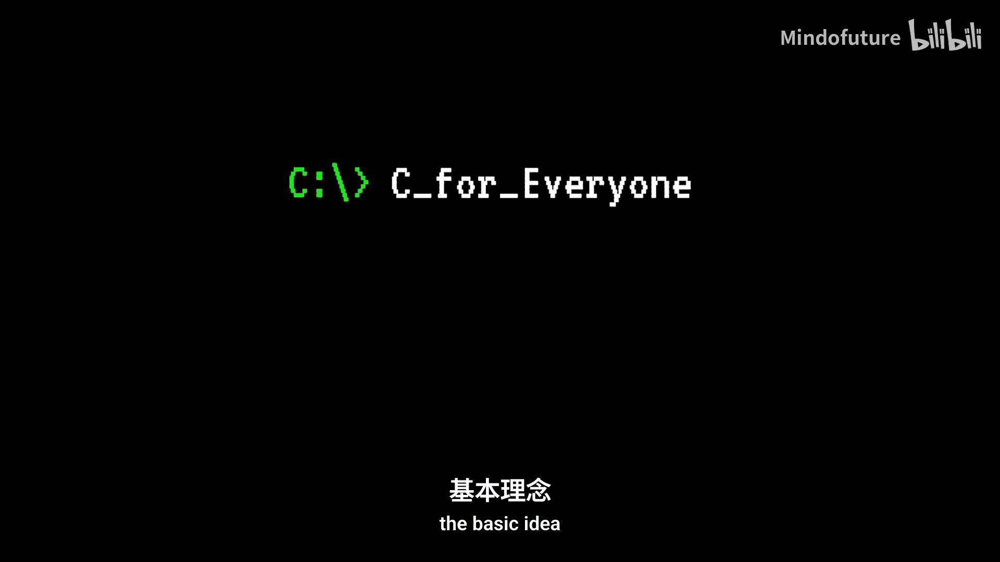
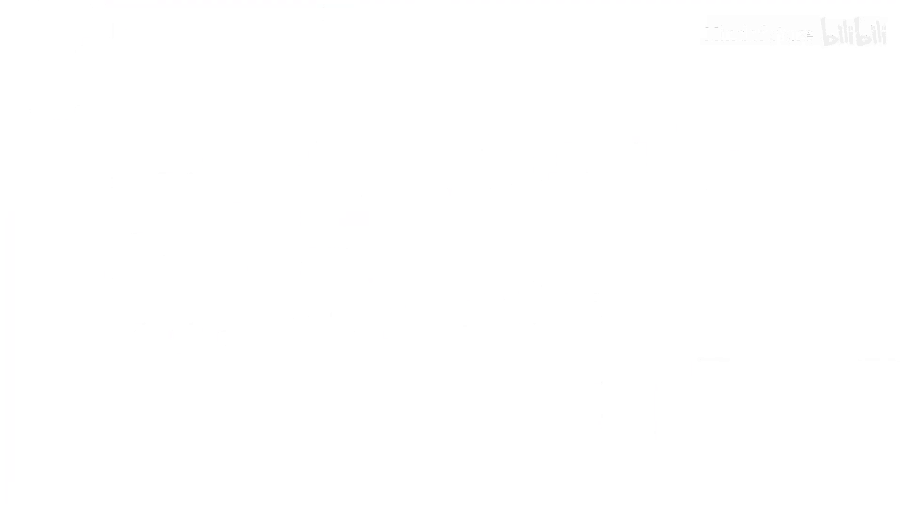

# 【加州大学】C语言结构化程序设计-｜-C-Structured-Programming-p28-P28_作为类的C++抽象数据类型_05_01_05--BV1wYe7zWE1T_p28-

🎼2。

🎼，The basic idea。That。Makes。C plus plus a modern language as opposed to C as an old style 1970s system implementation language is that C added classes。

AndClasse is a way to encapsulate an abstract data type。

 So we've been talking about abstract data types in C， and generally speaking。

 what we use is a struck to create an effect。A new type of data。

But the struck by itself doesn't have operations and the struck by itself。Is。Openly public。

 so it can be tampered with。One of the things that's important in modern programming is encapsulation。

An encapsulation allows you to hide stuff。So think about working on a car。

 there's stuff in the engine that only an authorized dealer can get at and otherwise。

It's not to be tampered with。And you might call it a black box。

 you still can use the car if you know how to operate it， so the same thing is true with a class。

So C+ plus。Takes the concept of struck。And edge to it。Ideas that let you do further encapsulation。

Now let's think of wanting a new type， let's call it a shape。So a shape is a noun。And in classical C。

 we would represent it with some kind of struck， and then we would write various functions that could perform actions on it。

 normally the functions would call on the struck through a pointer to struck。

So we could think of a shape and we could think of computing its area and we could think of drawing it on the screen and we could think of finding its position somewhere in the plane。

 those are various actions we conceive of of this type shape。

Can imagine that you're at a company that wants to develop， let's say architectural plans。

 and they want an elaborate way to automatically draw such plans and help the human architects so they could sit down and write such a package。

 such packages exist。So if we had shape。We would have different kinds of shapes。

 and they would have different ways to describe them。 And then again， as I said。Earlier。

 we would have actions on them。 Let's just take a little bit of a look at how that might get done in C plus Plus。

 Let's say we had the shape rectangle。 So we use class and set of struck。

Though struck is usable here。It's a subtle difference， but in modern C++ you use class。

 keyword class。And then you get to。Name the new type， we'll call it rectangle。

 and then you have an open brace just like withstructs。

 but then you have a keyword which is a privacy key word and that privacy here is public。

 which means everybody can use it。And then you have。Let's call the constructor。

 That's a special kind of function that allows you to build one of these objects。 It the idea。

Behind an endt。Ent is。A native type。 And so the compiler knows how to build an int is basically typically a4 byte representation inside memory。

Here rectangle is taking is allowing you to use previously defined types and then build this new type。

And here's an action on the type called。Area， the area requires returns， height times weight。

Excuse me， that shouldn't be weight， that should be width。And then why I have it is weight。And so。

With that correction， we have also private， typically。In modern languages。

 and this includes languages like Java and Python。You hide away the representation in this case。

 a height and a width。And we could consider other operations if we were to flesh this south。

 such as a drawing operation。And now in our main program， we might declare rectangle as R。

 and we give it things to initialize 2。5 type 2。0。We might have a。

AR variable that where we're going to compute area。 and then we could say A R equals。

 and we use the dot notation， which is the same notation that you use and see withstructs。

 And now what happens is on this rectangle。 don't forget R is a rectangle area is computed and secretly areas is this thing with a height and a width of 2。

5 times2。 So this AR should end up with the double value 5。Okay。

 that's the essential idea that Bjor Strewstrip added to the C language to change it into a modern language in which。

You can easily extend the data types by using this idea of class and the idea of having member methods。

 So not only like in a ordinary C struck， you had member data fields。

 Now you also have member functions or sometimes in。啊。Modern。OO speak， they're called methods。

🎼And we'll see that in a second， in code。

