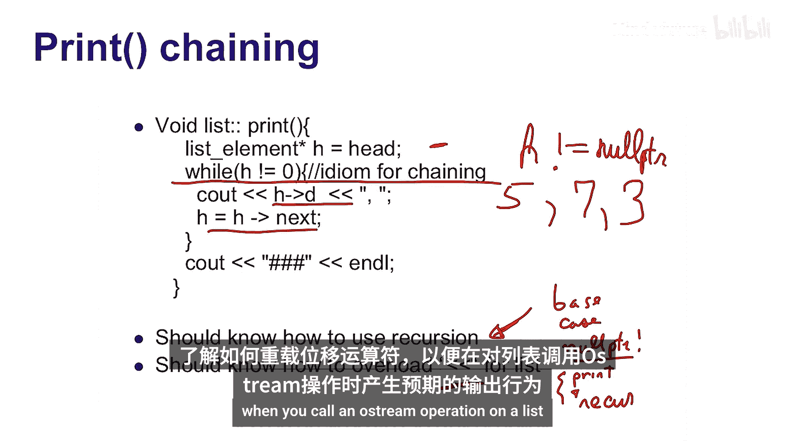
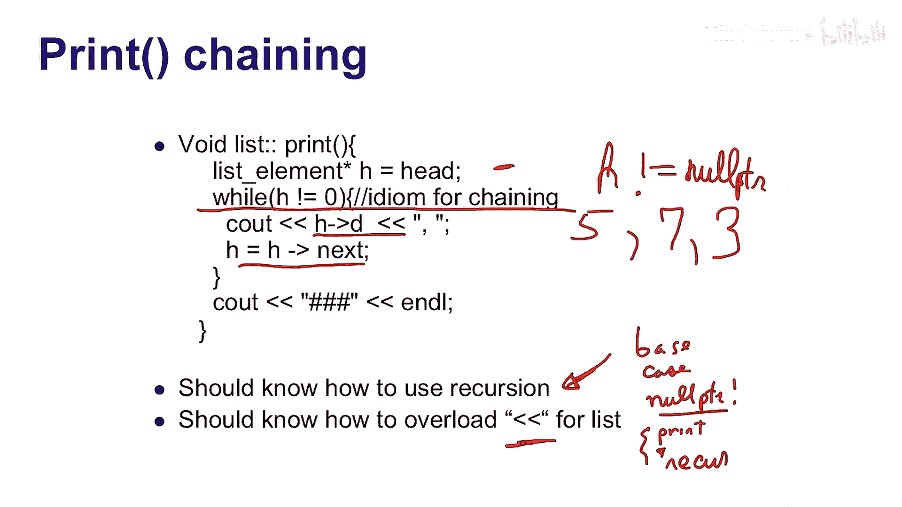
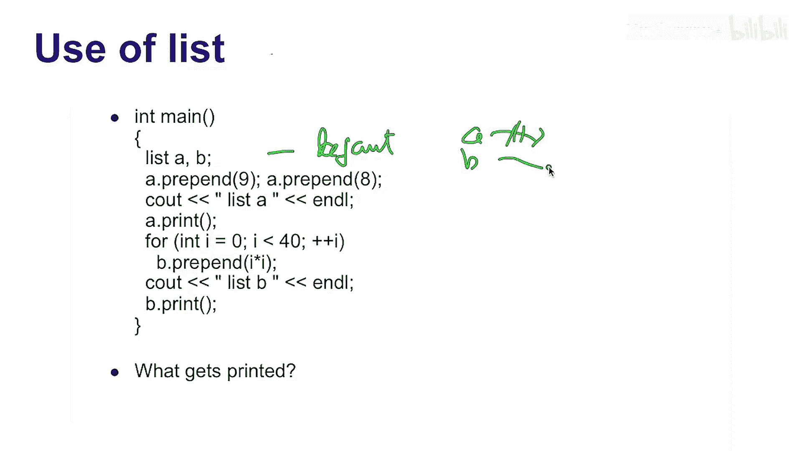
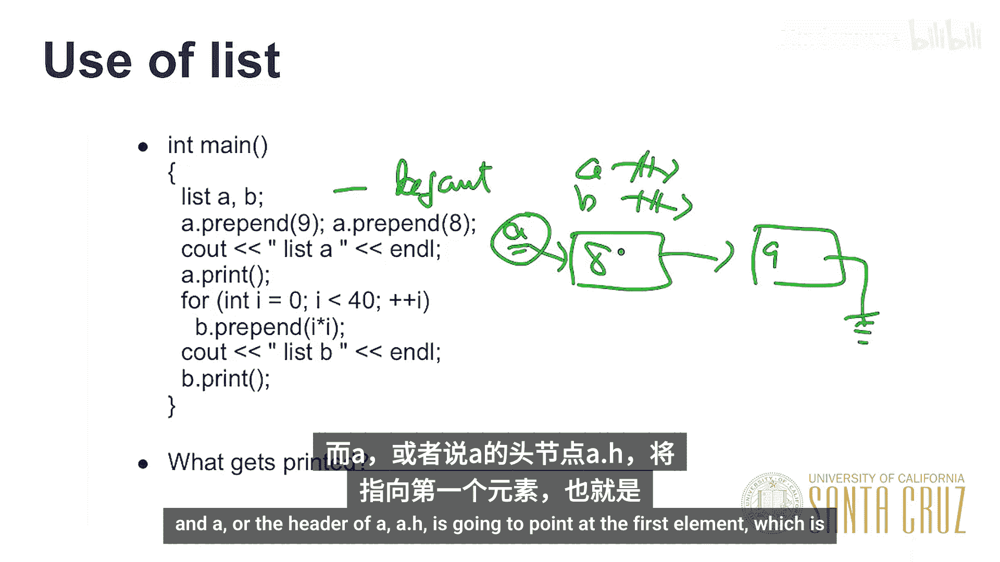
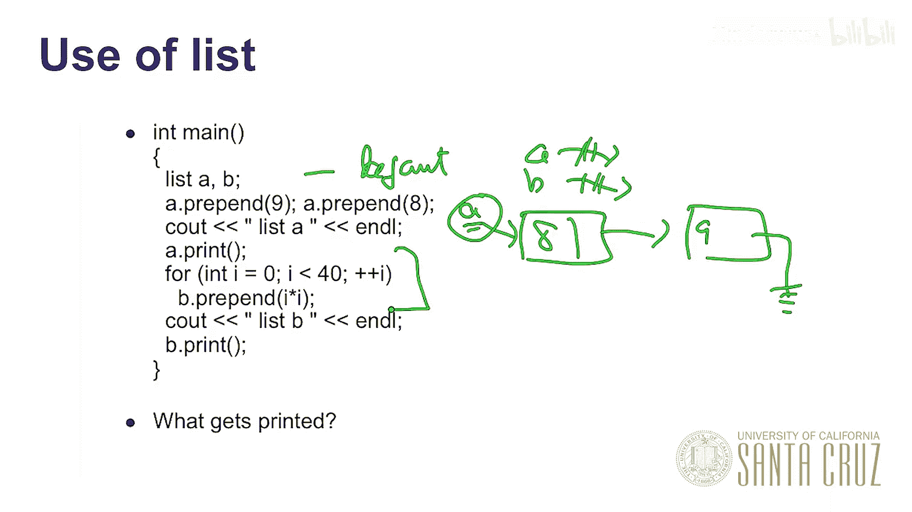
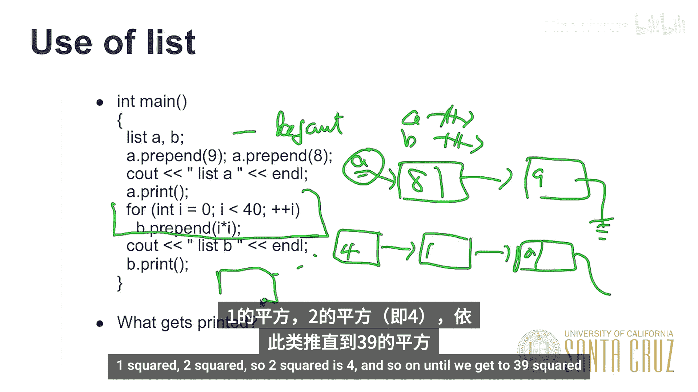
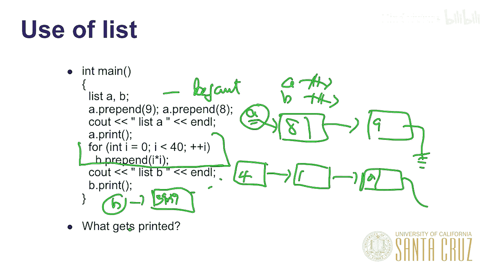
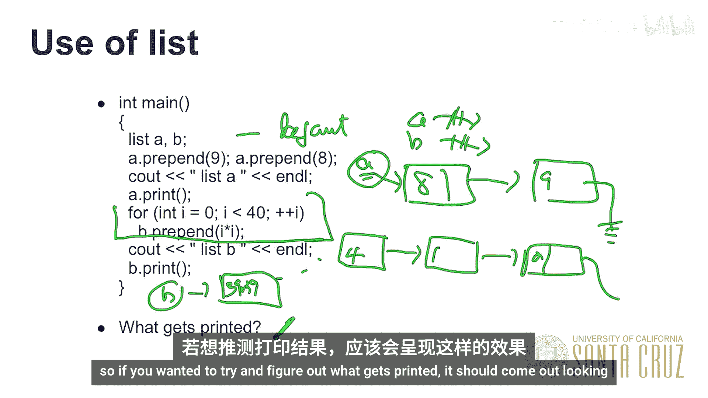
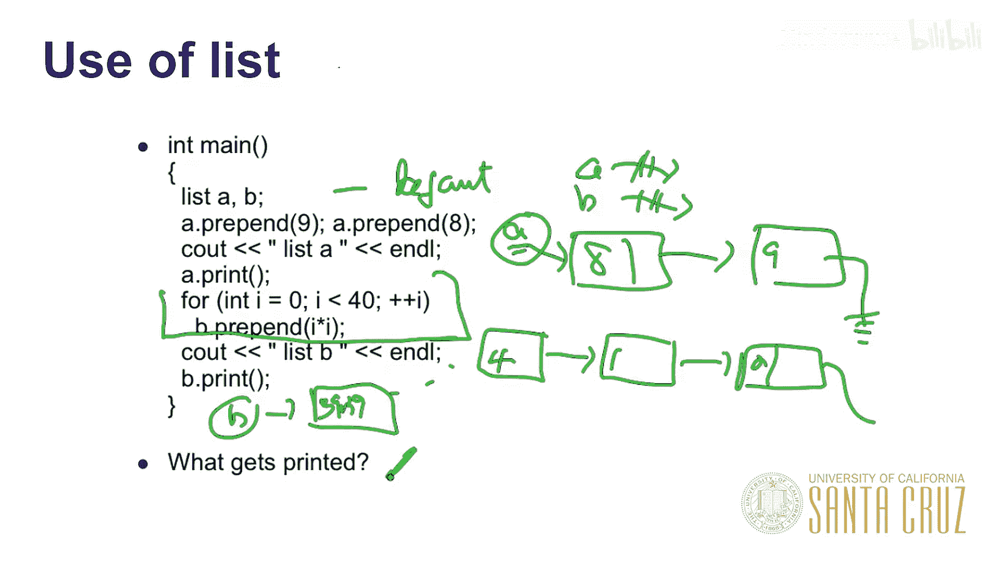
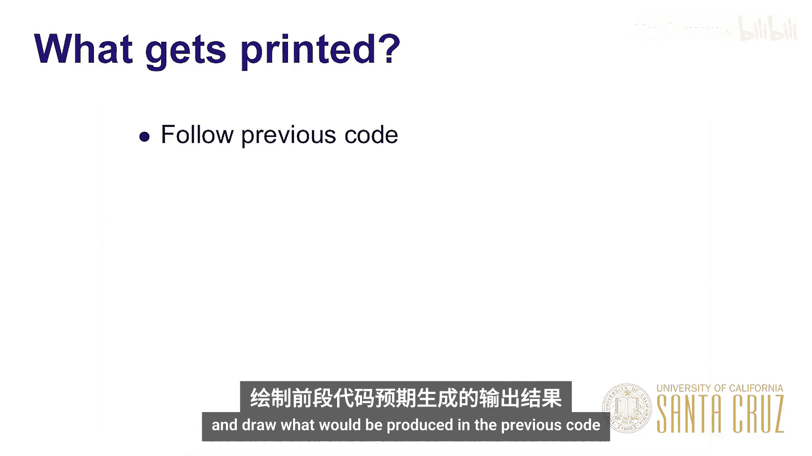

# 【加州大学】C++编程-｜-C-Plus-Plus-A-p28-P28_3-8-打印链式调用_03_01_09--BV1p2ejzREUQ_p28-

Okay， let's look at print， so print is again， an idiomatic or conventional kind of operation that occurs over and over in list processing。

 and it's when you want to do chaining throughout throughout the list。

Here are some of the things to keep in mind。The first thing you want to do。Is。This sets your。

Your chain to the beginning。 So this is going to be an iteration。

 iteration is going to start at the head。And then this is the critical idiom。And once again。

 I want to show it。With。What you might do with a C plus plus 11 compiler。And as you chain。

You're going to print out this value， a comma base， so if we do the thing we just had done。

We would print five at this point with a comma， then we'd advance the header。To the next element。

And we would print。呃。Forget whether that was three or seven， but let's say it was seven。And then。

We'd go again， we'd test on seeing whether we had the null pointer。And finally three。

 and then H equals h of next that would hit the nut pointer， we do the null pointer test。

 and we'd be out of the loop。So you can see by setting。A loop。Where。

You're using the null pointer as a Sinel， the null pointer being where you're at the end of the list。

And the header as the beginning of the list。And then some processing。

 you can go through the list as a container。In order。En time where there's Z elements to the list。

And it's very efficient。 So if you have to search a whole list and perform operations on a whole list。

啊。You don't lose anything over and above what would be indexing through an array。Now。

What you should know how to do。I'm not going to show it here。Is this kind of。Processing。

Can also be done with a recursive routine。The idea and the recursion would be the base case of the recursion。

If you recall a recursion， you need a base case。The base case would be。Check for the null pointer。

It's a null pointer you would exit if it wasn't a null pointer。Print whatever is being pointed at。

And then advance a cursor， So the general case is print in advance。So you print and recur。

Amassing the cursor。And you also should。Know how to overload your bit shift operator to produce the expected output behavior when you call an Ostream operation。

On the list。Those are things you can practice。

Now that we have this list， let's just see a very simple use of it。Deeclaration。Default。As we know。

 the default will make A and B。Be an no pointer。

So that's what's happening with these defaults， we're invoking the default constructors。

 which basically。呃。Or。Creation of null pointers。Now we do a prepen。And then we do further prepa。And。

If we were to follow the logic at the end of this prepen。We are gonna have8 and nine。9。

It's going be grounded。An A or the。The header of a a dot H is going to point at the first element。

 which is now the element storing8。

And we can go。And do an additional。We could print that， printing that we would see eight common9。

 and then here we're doing a loop where we're doing a whole bunch of free pens。

And here we're preending to be。 and notice that we're doing the prepenence of values that are squared。

So we're getting from zero up to。39 squared。 So we're going to see something that will end up looking like 0。

1 squared。Two squared so two squared is4。And so on， until we get to 39 squared。

And that'll be， the header will be B， and that'll get printed。

So if you wanted to try and figure out what gets printed。It should come out looking like that。

Whoop。Well， I've given you pretty much the answer。But you should still。

Do a little testing and see how how。You could make sure。

What what would be produced and draw what would be produced in the previous code。

