# 【加州大学】C++编程-｜-C-Plus-Plus-A-p29-P29_3-9-更精细的列表_03_01_10--BV1p2ejzREUQ_p29-

Okay。So now let's try to develop a more elaborate list。

When you you go to use the same kinds of data structures in the standard template library。

 you're going to see。A lot of additional member functions methods。

Because that's going to because this is so much in common use。You the people who develop it。

 the library programmers， professional library developers。

They want to give you a significant amount of functionality， there's no reason to force you。

If everybody is going to have a need to， it should be in the standard library。

So what characteristics are you going to find in things that might be in the standard library？

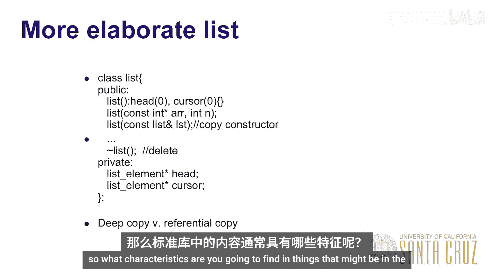

It's very typical to find lots of constructors。

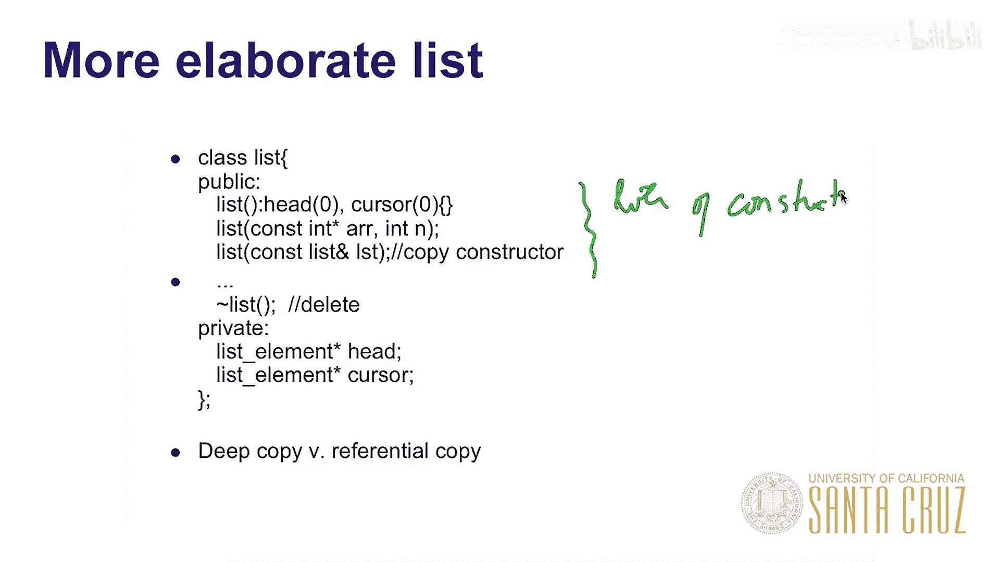

So。That constructor we almost always find is a default constructor。

Another constructor we almost always find is a copy constructor。

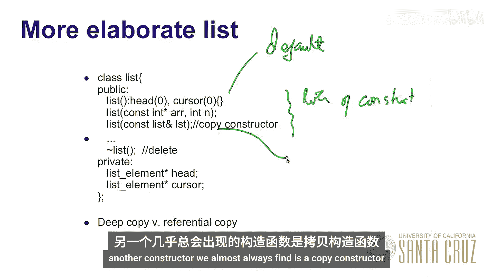

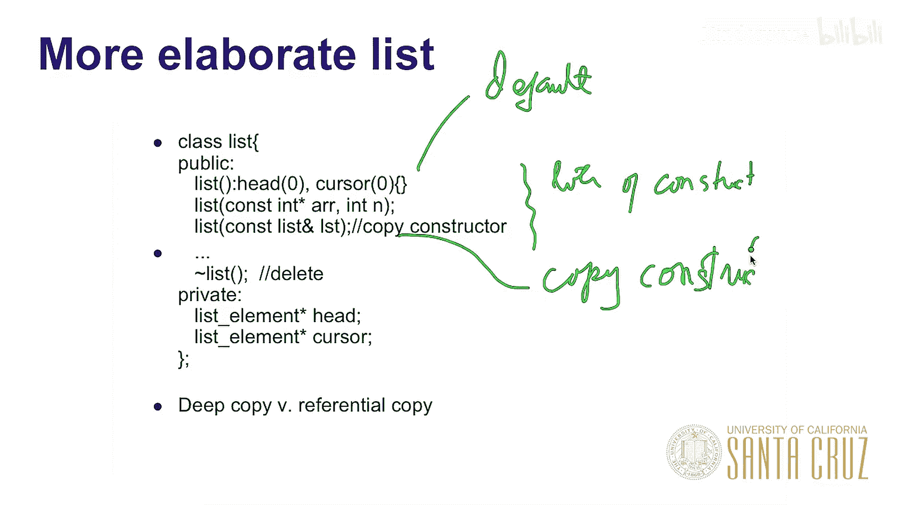

When I get to advanced topics。I'm also going to show。

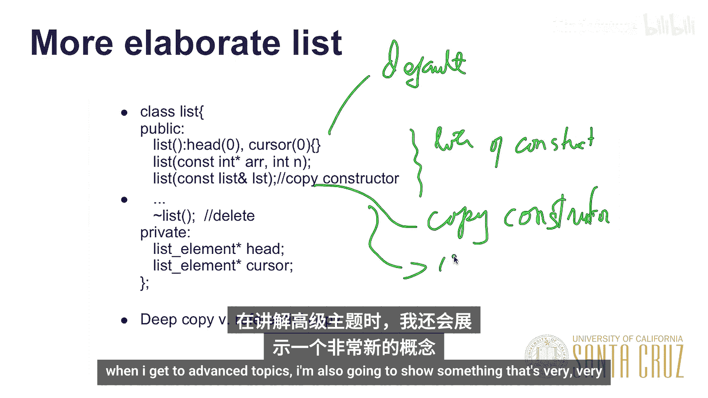

Something that's very， very new， which is called a Mo constructor。So for those of you who will。

Have access to a C+ plus 11 compiler。er。It's very worth reading on the Wikipedia about Mo constructive。

 and that's a very advanced topic。Quite new。And not necessary for the basic programmers。

 so we're going to leave that alone till。Much later in the course。

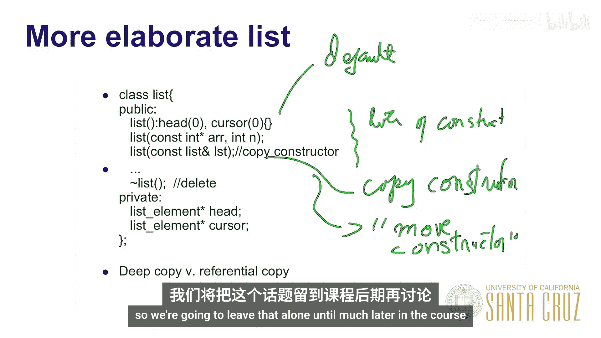

And then here's another constructor that's useful because frequently。

 we want to move material from one kind of container to another。 So if we had a simple array。

As shown here， and the reason it's constant is because。

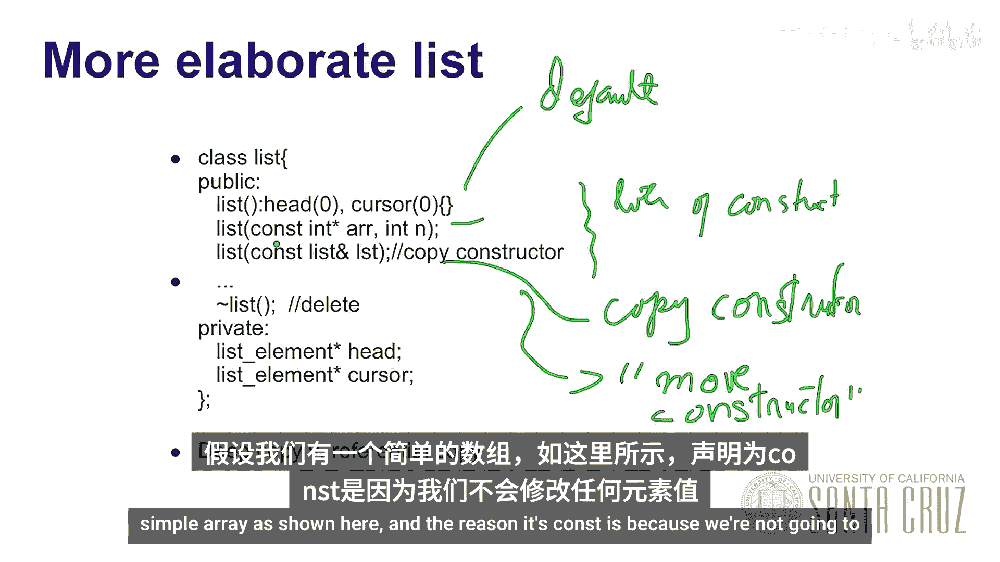

We're not going to。Mutate any of the element values， and we have a size of that array。

 and we want to take something of that size and create a list out of it。So that's another。

This is something that lets us。Transfer。Data。From another container。And then。

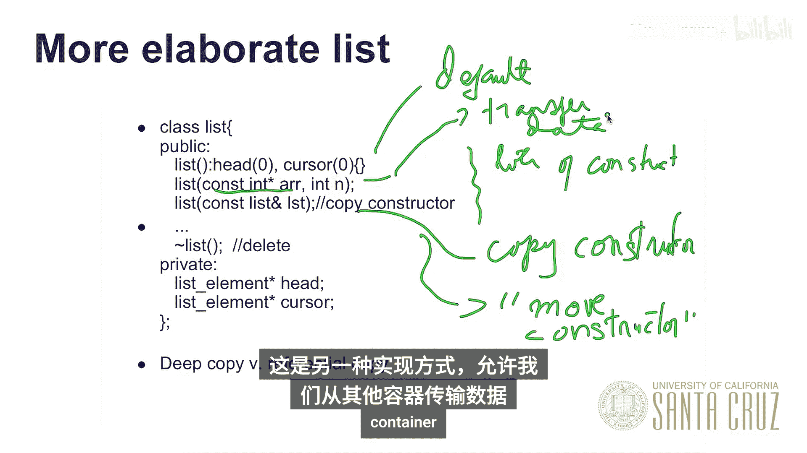

Good citizenship， good citizenship requires that。We have a destructor。And again。

 remember what a destruct looks like。 It always has this little tvis symbol。 and then。

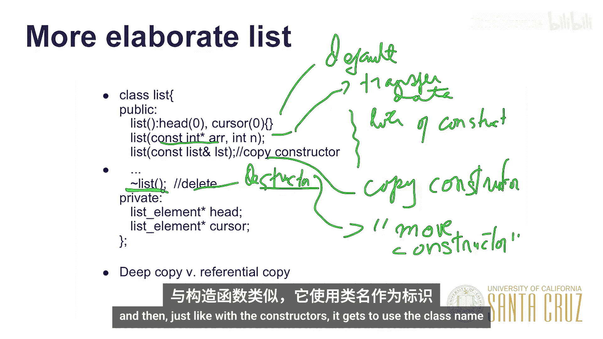

Just like with the constructors， it gets to use the class name。

Now we're going to talk about two kinds of copying。

And that's going to also give us some real sense of how to make。

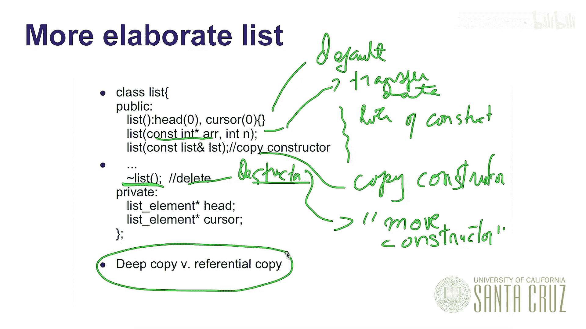

For complex aggregates， how to worry about trade offs。Robustness versus efficiency。

 so we're going to also on the next portion of this lecture。

Talk a lot about deep versus referential copying。

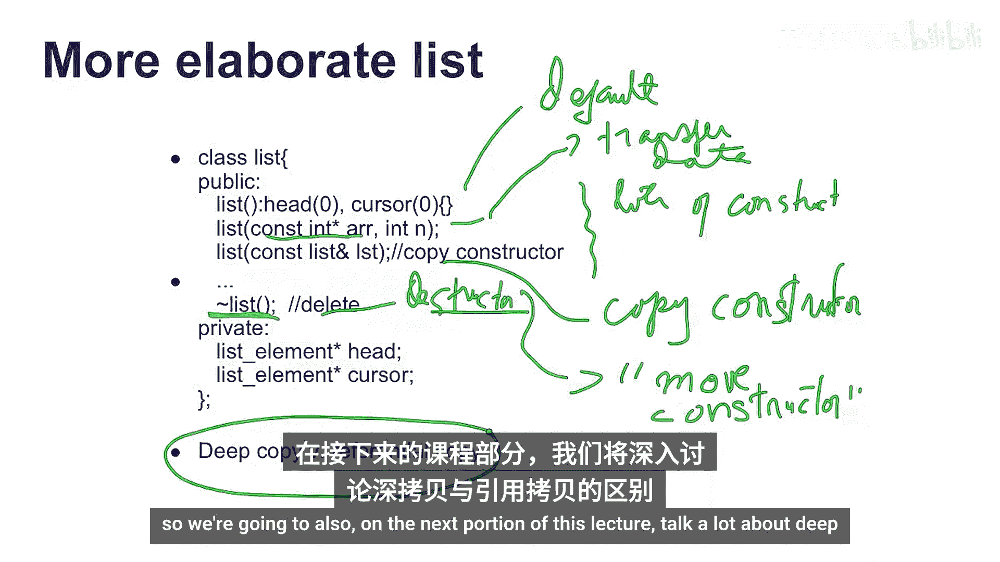

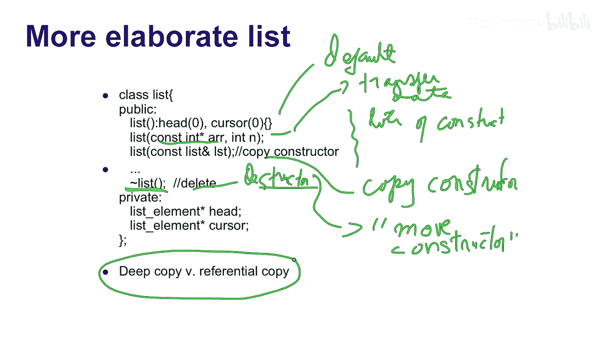