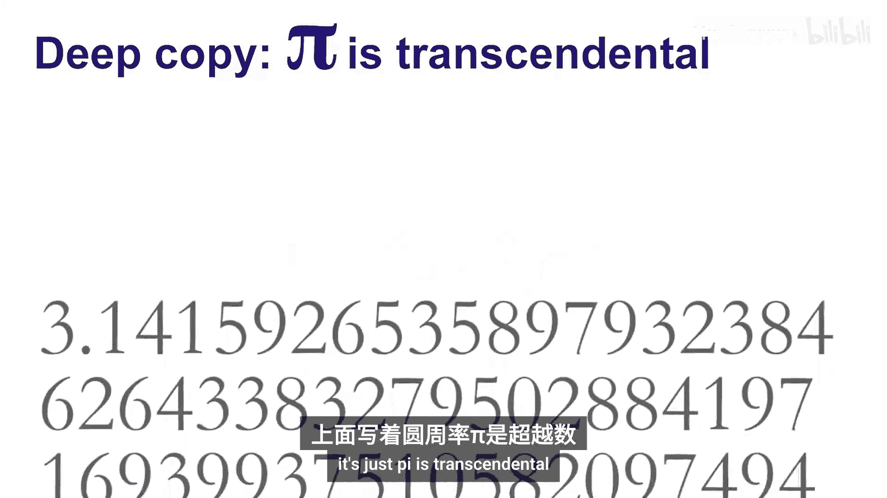
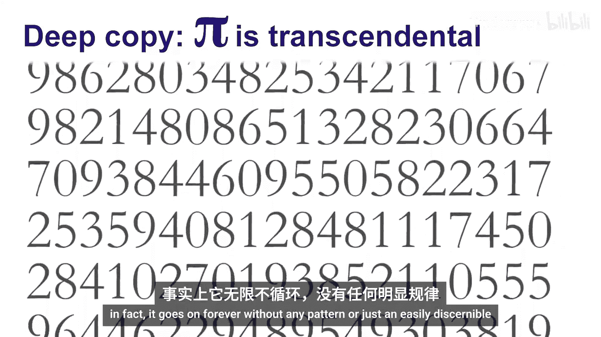
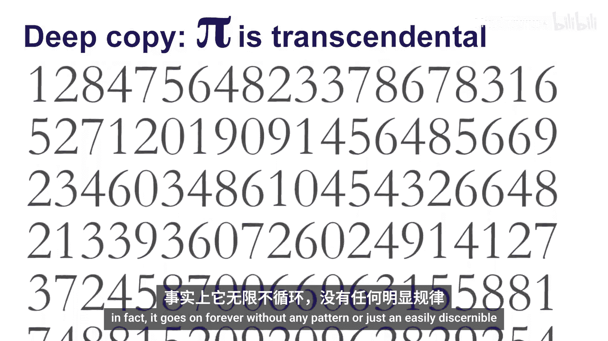
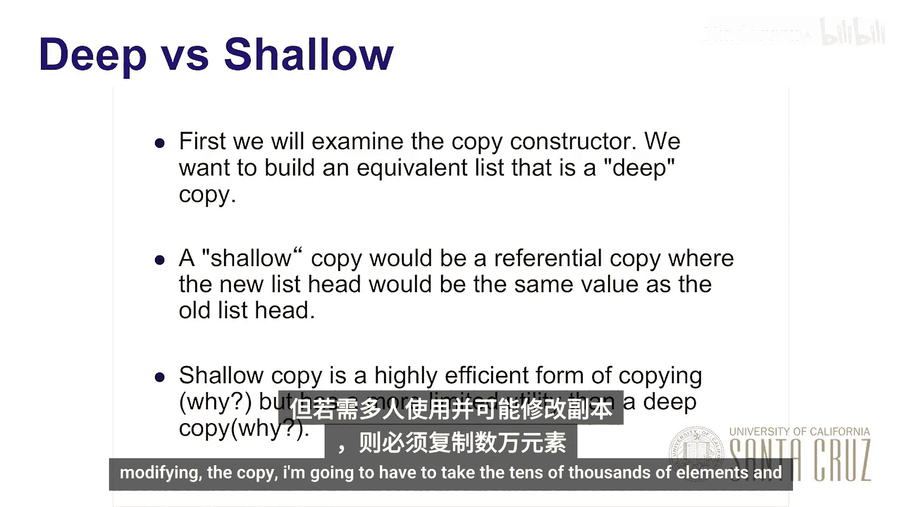
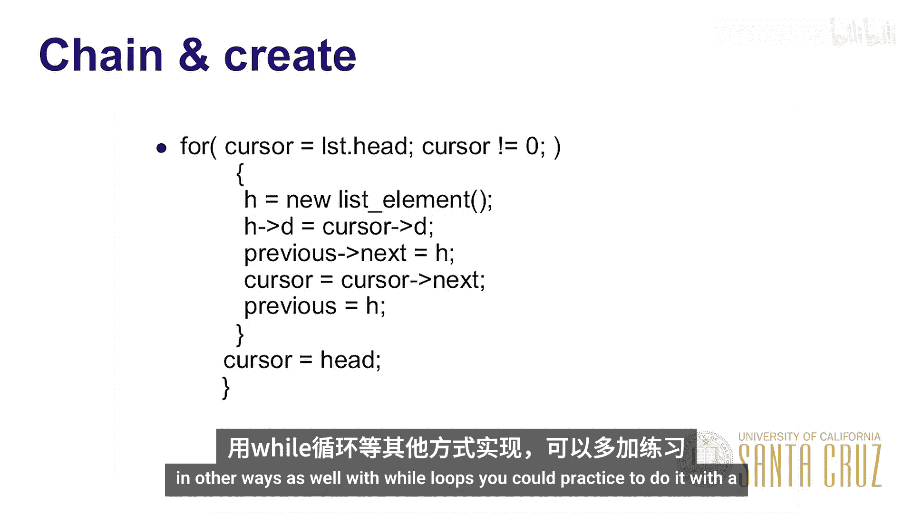

# 【加州大学】C++编程-｜-C-Plus-Plus-A-p30-P30_3-10-深拷贝与浅拷贝_03_01_11--BV1p2ejzREUQ_p30-

Okay， so we're going to discuss a really important topic。Which is the topic of how to effectively。

Copy things。And the two。Major forms of copying that we find in。Computation are what are called deep。

Versus referential or shallow。Deep， well， we have a slide here。 It's just pie is transcendental。

 That's an effect of deep notion， in fact， it's。

Goes on forever without any pattern or just easily discernible pattern mathematicians。

Now， for centuries， I've looked for ways to study and understand the patterns behind by。

So that's a relatively deep notion。You'll compare it to what I might call shallow， you know。

 mom just throws in a lot of apples， makes a very tasty pie。Shallow can be good too。

 so I'm not trying to say that deep is better than shallow， There are different things going on。

Now。Think about the day that you were actually using the library as a library with physical books。

The library kept the encyclopedia Briittannica in the library and then allowed users to come in。

And use that library， why， well， it's very expensive to reproduce the Encyclopia Briitannica。

So since it's a super expensive resource， they kept。One resource。

And allowed people to go and use it in a way that they couldn't mutilate it， damage it。

 they tried to。You know， keep it pristine。And many people could use it， after all。

 there are a whole bunch of volumes。They could。However many volumes， that would be。

 however many simultaneous users you could have because they'd be affecting different parts or reading different parts of that one copy。

On the other hand。If I had enough money or resources， and I needed。

 let's say the article on Alan Turing。Y。An encyclopedia Briittannica entry， I might go in。

And make a deep copy by a deep copy。 I mean， I might xerox it。 I might reproduce that copy。 Now。

 I have my own copy。 And so with my own copy。I can。Underline it。

 make notations without affecting the original copy， which had to be kept pristine。So。

With a deep copy， we have something expensive where we， in effect， manufacture a second version。

With a shallow copy， we have multiple users who sort of， if you want， remember in the list example。

 we had cursors so everybody can have a cursor into the encyclopedia Britannica。

 use it at different points because none of them are going to be making changes。So deep copy。

 shallow copy questions are questions of utilization， cost。And modification。Now。

In the remaining part of today's lecture， we're going to talk about deep copies。

 so the deep copy is the safest。I can turn over a new copy。

 I can manufacture yet another digital version of what you need。

 and you can go off and use it in whatever way shape or form to your heart's content。

 because your use of it， even if you modify it isn't going to affect my use of it。So that's。

The high level view。Now when we're doing copies。What we want to look at is the copy constructor。

 so it's going to be the copy constructor。That， in effect。

 will determine whether we have a shallow or referential copy。So in the notion of a referential copy。

 if you think of a list。And let's say， I produced a big list。

Maybe it has tens of thousands of list elements。And I want to now use it in two different。

Two different。Wes。Well。As long as I'm not going to modify it。

I could make the shallow copy by creating yet another pointer to that list and navigating the list with two separate。

 if you want， cursors or pointers。And yet， both。coopies。The pseudo copy。

 the copy where we have a further pointer to it。It's very cheap to do really the referential copy is just。

The need there is just a single pointer。Which is a simple variable， typically4 bytes and。

An address value。However， if I'm going to require that several people use it and they may be modifying the copy。

I'm going to have to take the tens of thousands of elements and reproduce them。

 and then the copy constructor is going to have to be something that goes to the heap。And。

Remember that idiom where we marched along with that while loop in the print。So earlier。

 we looked at the print method so you could go back to it。 you would see while I'd march along。

 and for each element in the new list， I would create an element for each element required in the new list。

 I would go back and copy the element in the O list。So here's such a copy constructor。嗯。Again。

Its a simple case。嗯。Where everything is just null， so it's really easy to copy a null list。

Very simple and again， you can see the copying is going to be proportional to the size of the list。

And。Once again， I'll just。Remind you that if you have a C+ plus 11 compiler。

 also nu pointer at appropriate initialization。And here is the equivalent of this could also be done with a while。

So we have a cursor， a list head， while the cursor is not equal to zero， we chain and create。

So we're going to need something with a new here， I'm going to let you write in the code for it。

And that's going to be。Again。Deep copy。Because for whatever this list is。The existing list。

Existing head。The new list head two is just going to march along。There's going to be a cursor here。

 it's going to copy each element in turn。March along until it's done。Here's the internal code。呃。

We create the new list element， we do a link， we keep moving。

And that inner loop will let us create the entire list。So again。

This just fills out the code for the copy constructor。

 you can follow it along and you should test it。Make sure you understand it。And you could do it。

In other ways as well， with while loops， you could practice to do with a while loop。

 you could practice to do it with a recursive format。

