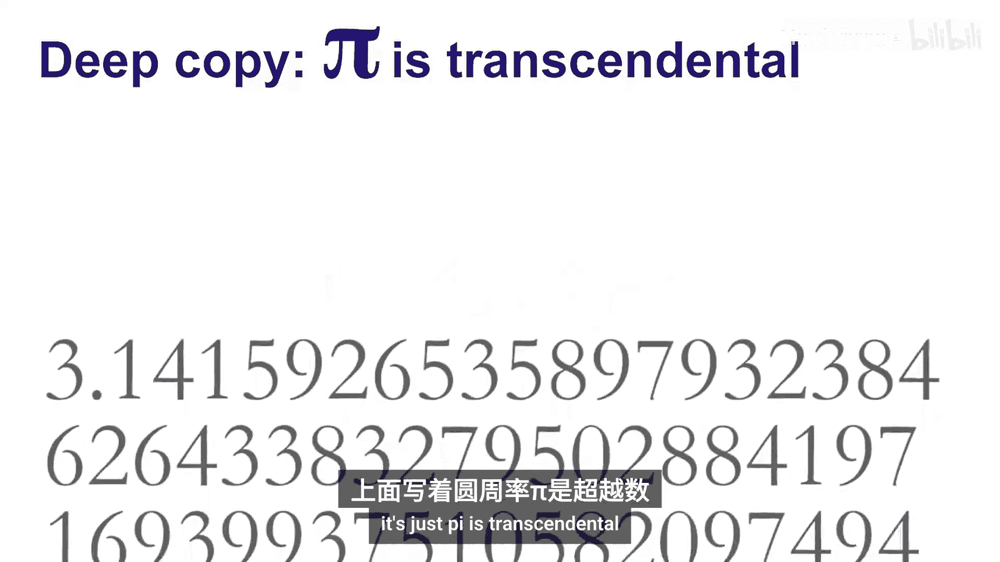
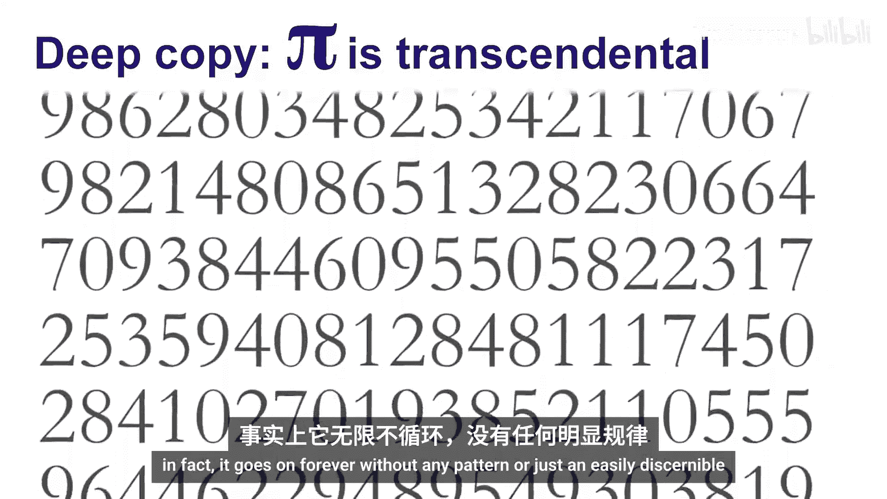
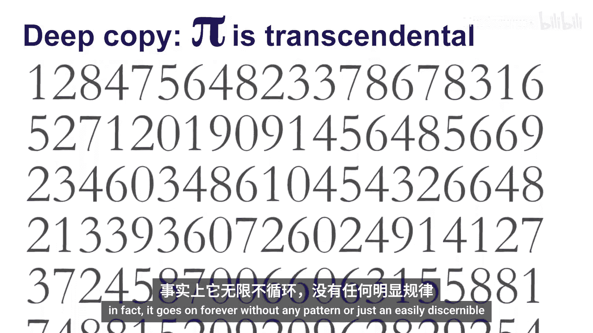
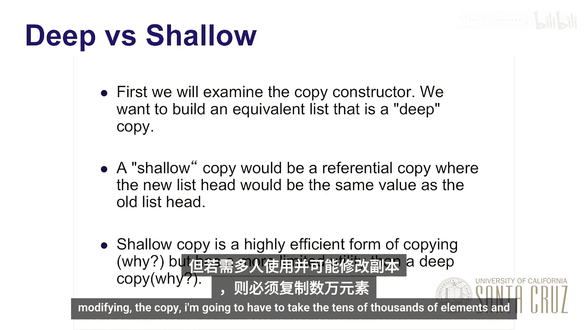
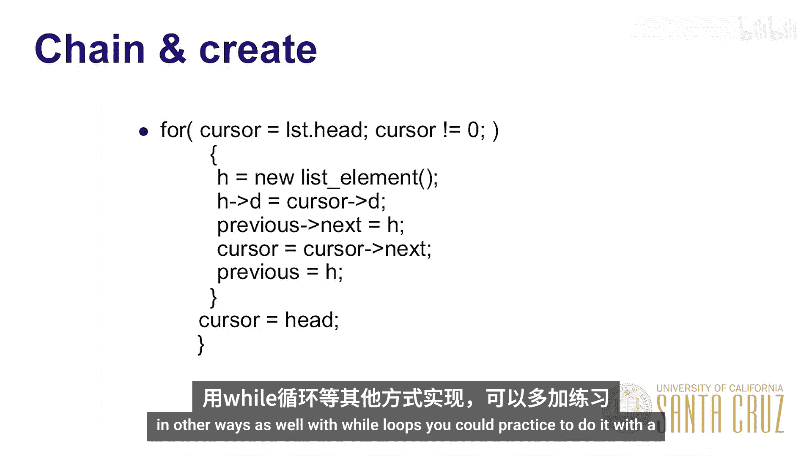

# C++编程：P30：深拷贝与浅拷贝

在本节课中，我们将要学习C++中一个非常重要的概念：对象的拷贝。具体来说，我们将探讨两种主要的拷贝方式——深拷贝与浅拷贝（或称引用拷贝），理解它们的区别、适用场景以及如何通过拷贝构造函数来实现它们。





## 拷贝的概念



上一节我们介绍了拷贝的重要性，本节中我们来看看拷贝的两种主要形式。

在计算中，我们发现的两种主要拷贝形式被称为深拷贝与引用拷贝（或浅拷贝）。


深拷贝是一个相对深刻的概念。我们可以将其与我称之为浅拷贝的概念进行比较。浅拷贝也可以是好的，我并不是说深拷贝比浅拷贝更好，它们是不同的东西。

## 现实世界的类比

为了更好地理解，让我们思考一下过去在实体图书馆使用《大英百科全书》的日子。

图书馆将《大英百科全书》保存在馆内，并允许用户前来使用。这是因为复制《大英百科全书》非常昂贵。由于它是一种超级昂贵的资源，图书馆只保留一份资源，并允许人们以不损坏、不破坏的方式使用它，试图保持其原始状态。许多人可以同时使用它，毕竟它有很多卷。只要他们使用不同的部分，就可以同时有多个用户，因为他们影响或阅读的是那一份拷贝的不同部分。

另一方面，如果我有足够的资金或资源，并且我需要——比如说——关于艾伦·图灵的条目，我可能会通过深拷贝来获取。我的意思是，我可能会复印它。我可能会复制那份拷贝。现在，我有了自己的拷贝。有了我自己的拷贝，我就可以在上面划线、做笔记，而不会影响必须保持原始状态的原版拷贝。

因此，对于深拷贝，我们拥有一个昂贵的过程，我们实际上是制造了第二个版本。对于浅拷贝，我们有多个用户，他们可以共享对同一资源的引用。在列表的例子中，我们就有游标，所以每个人都可以有一个指向《大英百科全书》的游标，在不同的点使用它，因为他们都不会进行修改。

所以，深拷贝与浅拷贝的问题是使用、成本和修改的问题。

## 深拷贝详解

在本次讲座的剩余部分，我们将讨论深拷贝。

深拷贝是最安全的。我可以提供一个全新的拷贝，我可以制造另一个你需要的数字版本，然后你可以随心所欲地以任何方式使用它，因为你对它的使用，即使你修改了它，也不会影响我对它的使用。这是高层次的视角。

现在，当我们进行拷贝时，我们需要关注的是拷贝构造函数。拷贝构造函数将决定我们进行的是浅拷贝（引用拷贝）还是深拷贝。

在引用拷贝的概念中，假设我们有一个列表。假设我创建了一个很大的列表，也许它包含数万个列表元素。现在我想在两个不同的地方使用它。只要我不打算修改它，我可以通过创建另一个指向该列表的指针来进行浅拷贝，并用两个独立的游标或指针来遍历列表。然而，这两个“拷贝”（伪拷贝，即我们拥有另一个指向它的指针）共享同一份数据。进行引用拷贝的成本非常低，实际上它只需要一个指针，这通常是一个4字节的简单变量和一个地址值。

但是，如果我要求几个人使用它，并且他们可能会修改各自的拷贝，那么我就必须复制那数万个元素并重新生成它们。这时，拷贝构造函数就必须涉及堆内存操作。

还记得我们在打印方法中使用的那个`while`循环惯用法吗？之前我们看过打印方法，你可以回顾一下。你会看到我们使用`while`循环遍历，对于新列表中的每个元素，我们都会为旧列表中所需的每个元素创建一个新元素。这就是一个拷贝构造函数的例子。

## 实现深拷贝的拷贝构造函数



以下是这样一个拷贝构造函数的示例。首先是一个简单的情况，即列表为空，复制一个空列表非常简单。

```cpp
// 假设的链表节点结构
struct ListNode {
    int data;
    ListNode* next;
    // ... 其他成员
};

// 拷贝构造函数示例（深拷贝）
LinkedList::LinkedList(const LinkedList& other) {
    if (other.head == nullptr) {
        head = nullptr;
        return;
    }
    // 复制第一个节点
    head = new ListNode;
    head->data = other.head->data;
    ListNode* current = head;
    ListNode* otherCurrent = other.head->next;
    // 循环复制剩余节点
    while (otherCurrent != nullptr) {
        current->next = new ListNode;
        current = current->next;
        current->data = otherCurrent->data;
        otherCurrent = otherCurrent->next;
    }
    current->next = nullptr; // 设置尾节点
}
```

你可以看到，拷贝的代价与列表的大小成正比。再次提醒，如果你有C++11编译器，也可以在适当的地方使用`nullptr`进行初始化。

这也可以用`while`循环等价实现。我们有一个游标，一个列表头。当游标不等于`nullptr`时，我们链接并创建新节点。我们需要使用`new`操作符。我将让你来填写具体的代码。这同样是深拷贝。因为对于这个列表，现有的列表头，新的列表头`head2`将只是遍历原列表。这里会有一个游标，它将依次复制每个元素，直到完成。

以下是内部代码的框架：

```cpp
ListNode* cursor = other.head;
ListNode* newHead = nullptr;
ListNode* tail = nullptr;

while (cursor != nullptr) {
    ListNode* newNode = new ListNode; // 创建新节点
    newNode->data = cursor->data;     // 复制数据
    newNode->next = nullptr;

    if (newHead == nullptr) {
        newHead = newNode; // 如果是第一个节点，设为头节点
        tail = newNode;
    } else {
        tail->next = newNode; // 链接到链表尾部
        tail = newNode;
    }
    cursor = cursor->next; // 移动到原列表的下一个节点
}
head = newHead; // 将新链表的头赋值给当前对象的head
```

这个内部循环让我们创建了整个列表。所以，这仅仅是填充了拷贝构造函数的代码，你可以跟着它走一遍，并且应该测试它以确保理解。你也可以用其他方式实现，比如用`while`循环练习，或者用递归形式练习。

## 总结



本节课中我们一起学习了C++中的深拷贝与浅拷贝。我们了解到，**浅拷贝（引用拷贝）** 仅复制指针或引用，多个对象共享同一份底层数据，成本低但存在修改冲突的风险。而**深拷贝**会复制所有底层数据，创建一个完全独立的新对象，成本高但安全，修改不会相互影响。拷贝构造函数是实现这两种拷贝行为的关键。选择哪种方式取决于具体需求：是否需要独立修改数据，以及对性能的要求。理解并正确实现拷贝对于管理内存和避免程序错误至关重要。