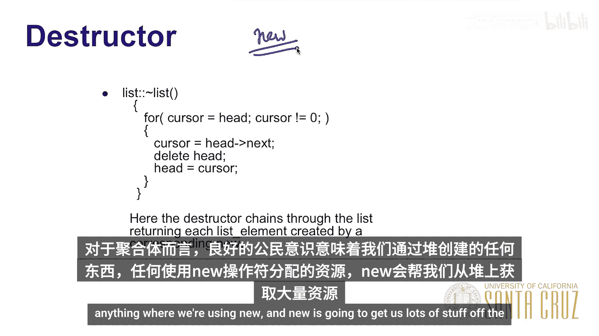
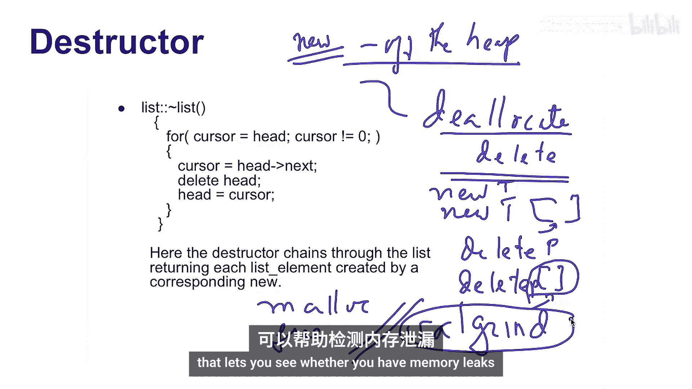
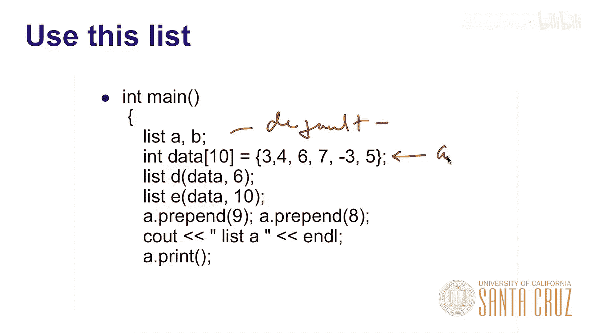
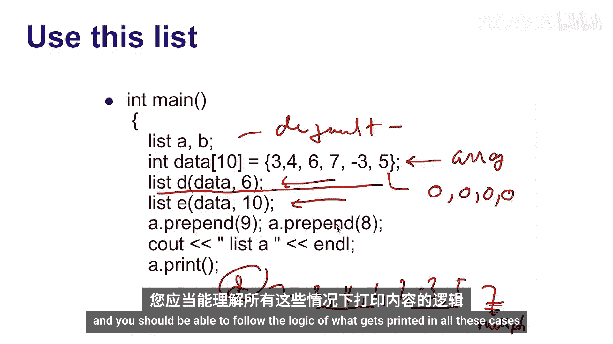
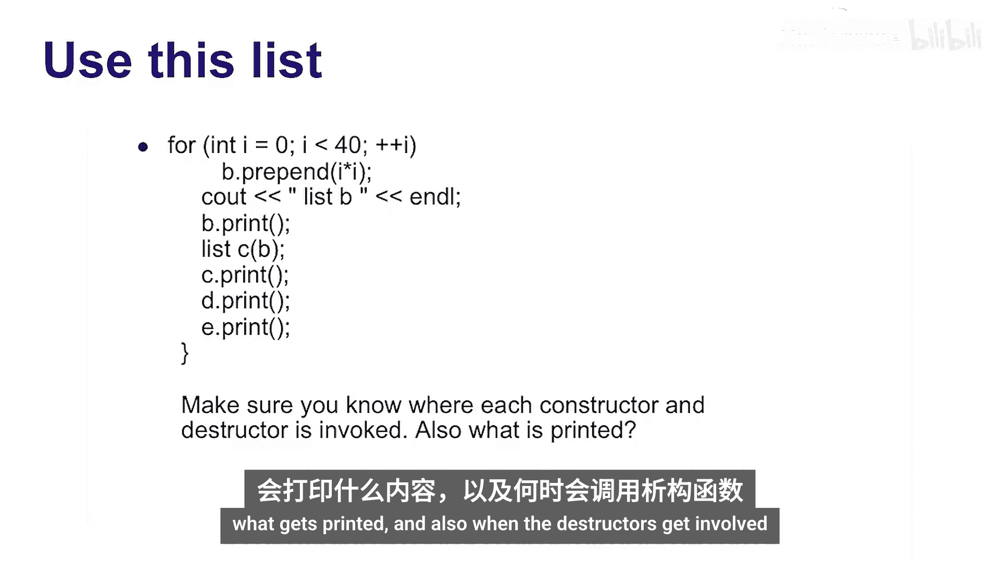

# 【加州大学】C++编程-｜-C-Plus-Plus-A-p31-P31_3-11-析构函数_03_01_12--BV1p2ejzREUQ_p31-

Now， when we have these aggregates， we talked about good citizenship and good citizenship for the aggregates means。

ThatAnyth we create off the heap。Anything where we're using new？And。

new is gonna get us lots of stuff off the heap。

We also want to deallocate。The nice thing about C plus plus。

ALi different than the allocation deallocation model in C。If you recall。

 everybody heres a C programmer。There， yourlocs were your allocations were malic。

And your delocs were free。Here。We use new and the allocation is delete。And。Basically， we have。New。

And new。Of something。K of a type or new of a type w。An array of elements of that type。

 and then we have the corresponding deletes。You can either delete。

We could either delete P or we can delete P of。Of vector allocation。

 the system will do the right thing in either case， so it's very convenient。

And so there's really no excuse to have a memory leak。By the way。

For those of you who tend to use UniX and Linux。Is a very good open source。Programmed。

That lets you see whether you have memory leaks and I very much recommend。

That you use this program if it's available for you and make sure that the program is reporting that you have no member of the Excel that will also。

Vasly improve your practice， because the more you think about your allocation and delocation and have。

An appropriate model of what's going on， the more careful you're going to be。

In doing your C++ programming。Let's use this。Again。This will call your default constructor。

Here's an ordinary array。

We're calling that constructor in the more elaborate class list where we take。あ。Data。And。

Convert it over to our list。So in this conversion。We would expect to see something like。3，4。6，7，-3，5。

No pointer。That's your sixth element。Singly linked list。In this conversion for E， this is the。

The D list， the E list has 10 elements。But we don't see 10 values。

Remember what happens when you have an initializer like this。

 the remaining values are actually zeros。And here on the a list， we do a couple of prepens。

 and then we start printing out and you should be able to。

Follow the logic of what gets printed in all these cases。 So you should be able to know。

What gets printed and also。When did the structuress get invoked？

