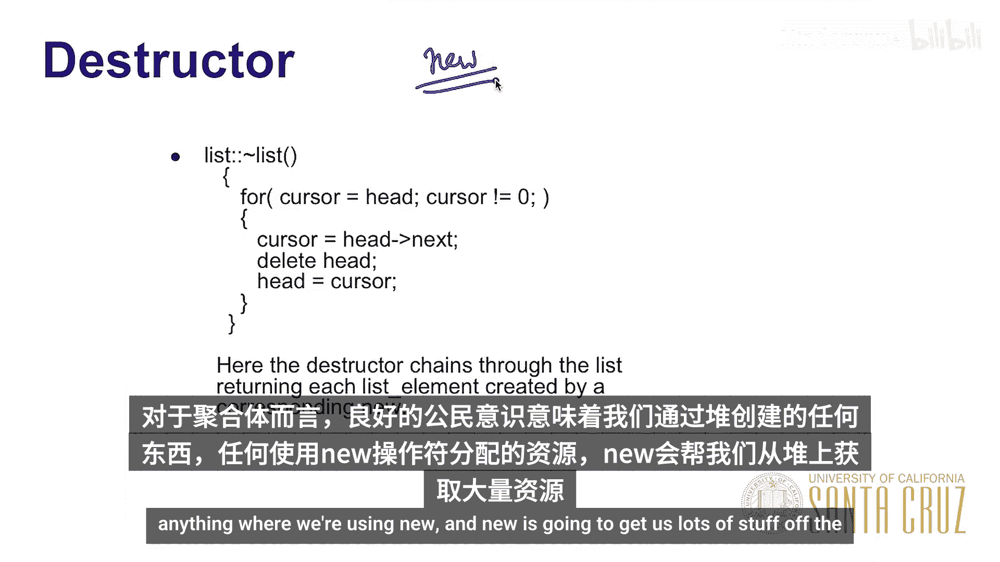
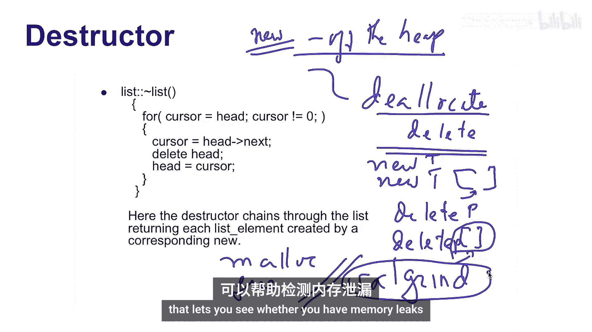
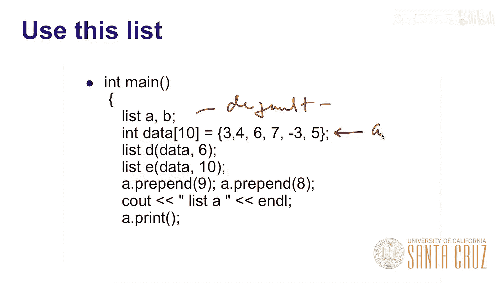
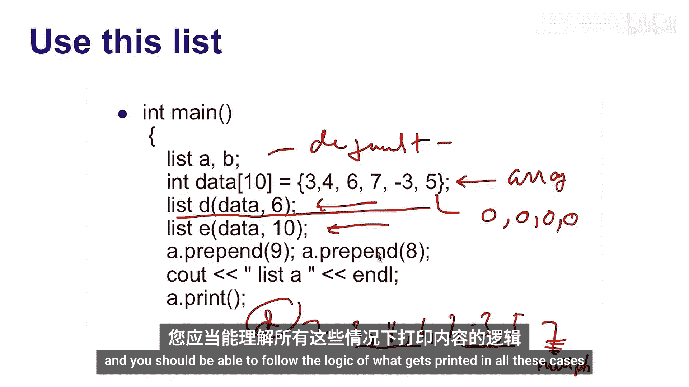
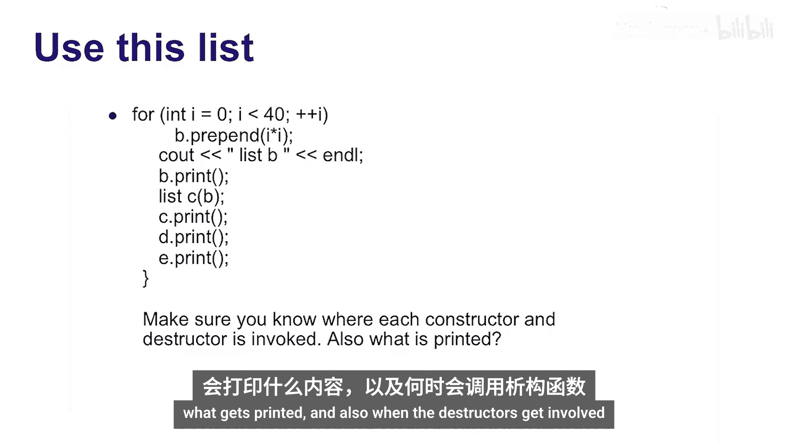

# C++编程：P31：析构函数与内存管理

在本节课中，我们将学习C++中关于内存管理的重要概念，特别是析构函数的作用，以及如何使用`new`和`delete`运算符来避免内存泄漏。我们还将通过一个链表类的例子，来观察构造函数和析构函数在实际程序中的调用时机。

## 聚合对象与良好实践

上一节我们介绍了构造函数，本节中我们来看看与对象生命周期结束时相关的析构函数。当我们处理聚合对象时，良好的编程实践至关重要。

对于聚合对象而言，良好的实践意味着：任何我们从堆上创建的东西，任何使用`new`运算符分配的内存，我们都必须负责释放。

`new`运算符会从堆上为我们分配大量内存。

我们也需要相应地释放这些内存。C++的一个优点是，它的分配/释放模型与C语言不同。

如果你熟悉C语言编程，你会记得在C中，分配内存使用`malloc`，释放内存使用`free`。

在C++中，我们使用`new`进行分配，使用`delete`进行释放。基本上，我们有：
*   `new` + 类型：例如 `new Type`
*   `new` + 类型数组：例如 `new Type[n]`

以及对应的释放操作：
*   对于单个对象：`delete p;`
*   对于数组：`delete [] p;`

系统会在两种情况下正确处理，因此非常方便。所以，实际上没有理由造成内存泄漏。

顺便提一下，对于习惯使用Unix和Linux的开发者，有一个非常好的开源程序叫做`valgrind`。

我强烈建议你使用这个程序（如果它适用于你的环境），并确保它报告你的程序没有内存泄漏。这也会极大地提升你的编程实践水平，因为你越关注分配和释放，并对其运行机制有恰当的理解，你在进行C++编程时就会越谨慎。

## 示例：链表类的构造与析构

让我们使用下面的代码示例。这段代码会调用你的默认构造函数。

这里有一个普通的数组：

我们在这个更复杂的链表类中调用构造函数，它接收数据并将其转换到我们的链表中。

在这个转换过程中，我们期望看到类似 `3, 4, 6, 7, -3, 5` 的输出。注意，没有指针，那是你的第六个元素。这是一个单链表。

在这个转换中，对于列表E，它有10个元素。但我们看不到10个值。

记住当你使用这样的初始化列表时会发生什么：剩余的值实际上会被初始化为零。

对于列表A，我们进行了几次`prepend`（前插）操作，然后开始打印输出。你应该能够：

跟得上所有这些情况下打印输出的逻辑。因此，你应该能够知道会打印出什么，以及：

析构函数在何时被调用。

## 总结

本节课中我们一起学习了C++内存管理的核心。我们了解了使用`new`和`delete`进行堆内存分配与释放的配对关系，这是避免内存泄漏的关键。通过一个链表类的实例，我们观察了构造函数如何构建对象，并强调了析构函数在对象生命周期结束时释放资源的重要性。记住，良好的编程习惯包括总是为你`new`分配的内存配对相应的`delete`，并利用工具如`valgrind`来验证程序没有内存泄漏。