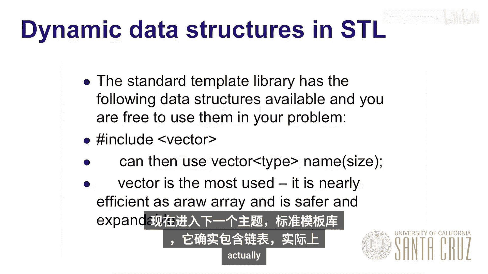
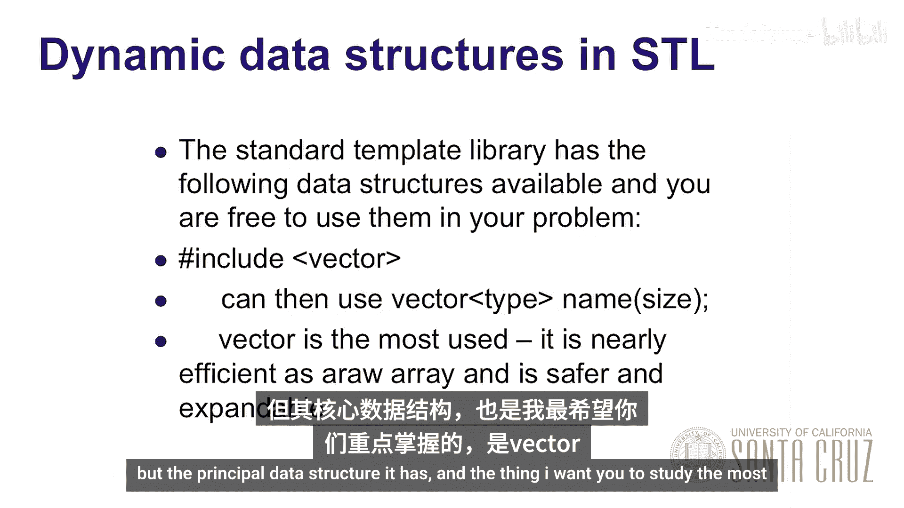
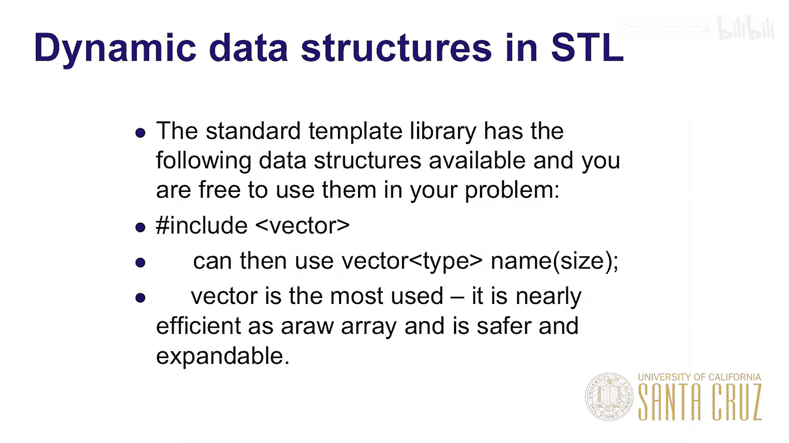
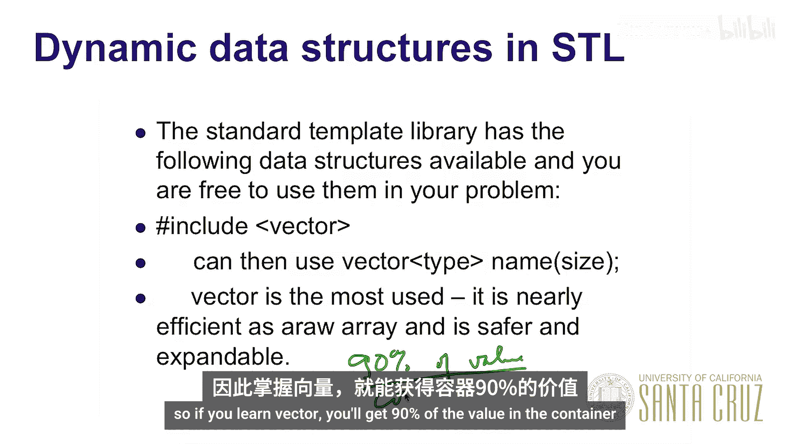
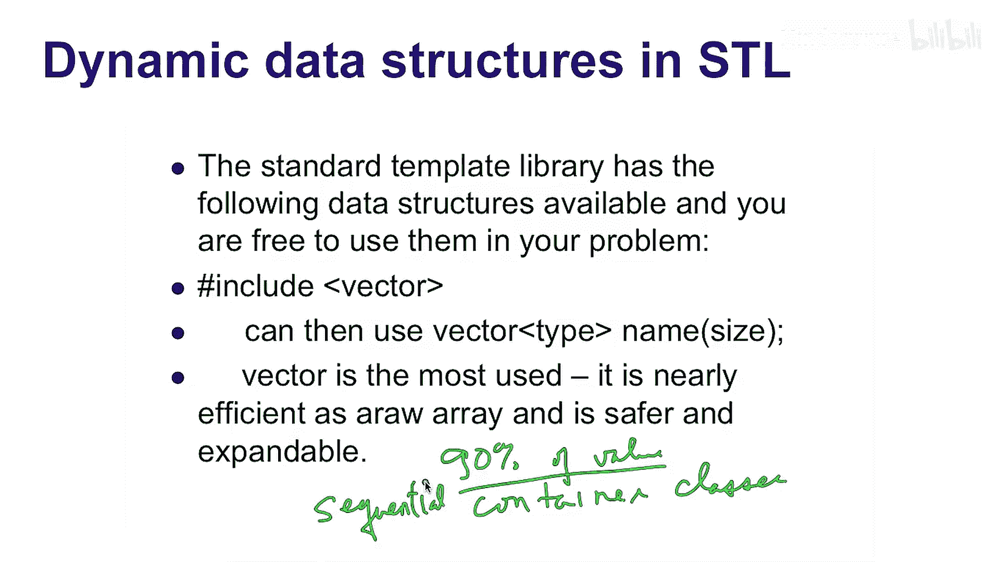
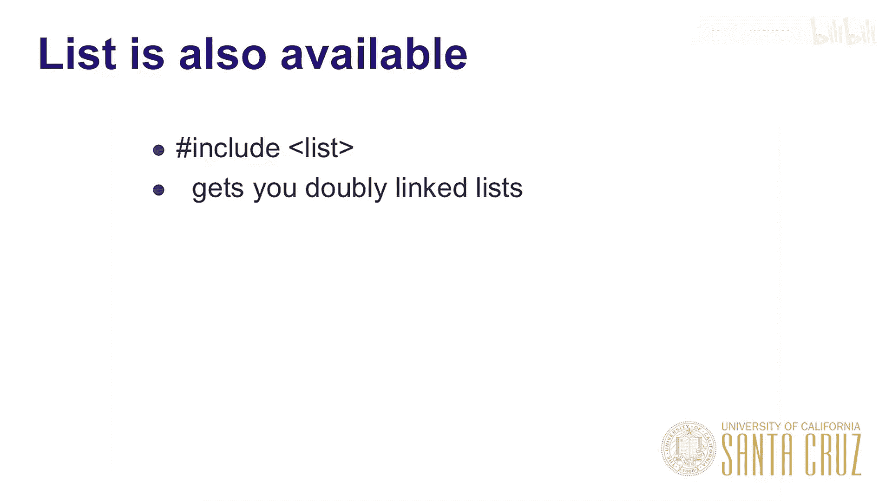
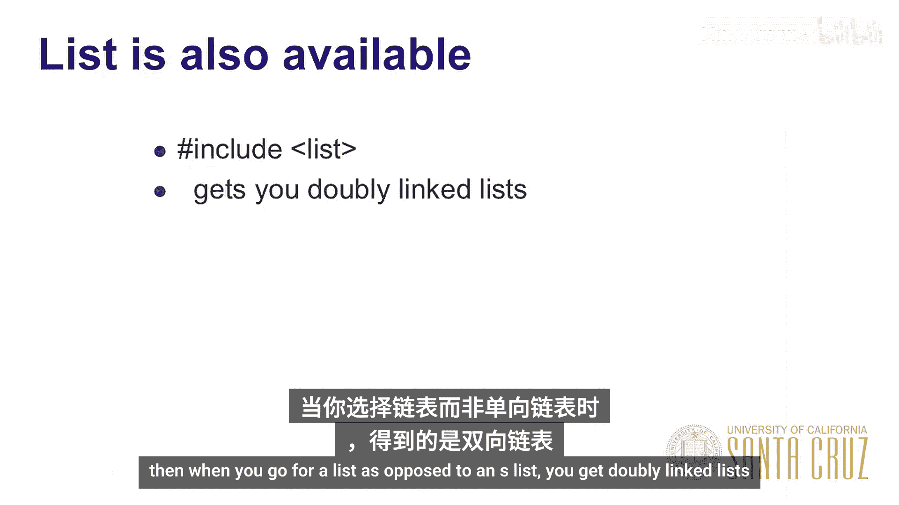
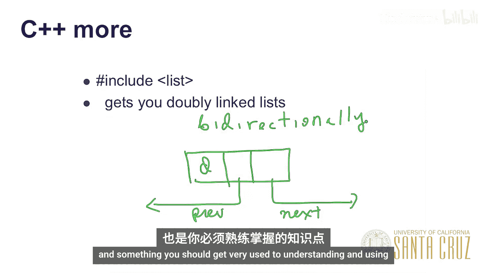
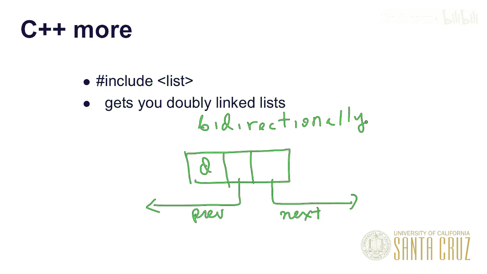
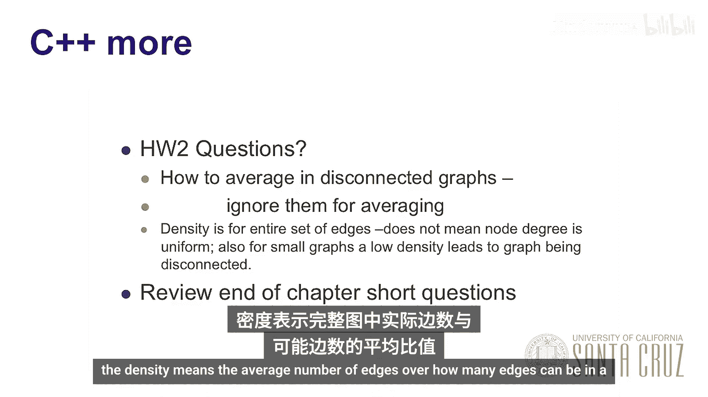

# 【加州大学】C++编程-｜-C-Plus-Plus-A-p32-P32_3-12-STL中的动态数据结构_03_01_13--BV1p2ejzREUQ_p32-

You have a list。There are a number of things you can do with that list structure。

You should really understand how it works， you should understand when deletion occurs。

You can try to create。Ls on the fly off the heap。You can new list。

 and then you have to principally delete list， or when the lists go out of scope。

 then the des are automatically invoked。If you want。

 you can put into the de some prints so that you can actually see when things are invoked。

 that's very useful if the whole concept is new to you。

I recommend playing with that a lot and then the other thing that would be very useful recall that I ask that everybody here have a background in basic computer science and data structures so all of you with that background should readily be able to convert that Sly linked list to a doubly linked list okay so now in this next topic。

The standard template library， which indeed has lists。Actually。

 the the most it actually now in C plus plus 11 has both a sling。

 singly linked list and a doubly linked list。

But the principal data structure it has and the thing I want you to study the most is vector。

Vectctor is the most used type。 vectorctor， again， from my perspective。

 is where you get 90% of your value。So if you learn vector。

You'll get 90% of the value in the container。

And understanding container classes。Or as I should say， sequential container classes。

So normally in C， we did everything with these very raw native arrays， native arrays。

 they were very primitive， really， remember C was a systems implementation language。

 it wasn't to be used for a lot of data processing， so Richie。

Did not put a lot of effort into making arrays convenient to use。 So array was really just a pointer。

 and then a pointer。Was provided with some allocated memory。

 The allocated memory could come off the heap through a cac or a mallc。

 or the allocated memory could come off the heap through a specific stack based declaration where there was。

An integer constant amount of memory known on stack entry。So。It was a very simple scheme。

Because he didn't require it as system implementation language， but that's far too limited。

And to error prone for doing very complicated。啊。Data rich computation。

So one of the first and most successful kinds of containers is。

An abstraction of an array in which you not only have。The ability to dynamically size the array。

You have ways of making sure you don't get any kind of indexing errors because you also can know where the beginning and end of the vector is。

And so。When recommendation？To becoming a real C++ programmer is abandon your use。

Of basic C arrays and turn all of that processing into vector。There's also a list。

 a list is another sequential array。Then when you go for a list as opposed to an S list。

 you get doubly linked lists and the doubly linked list look like the code we just looked at except。

You would have a data element。You would have a previous pointer。And you'd have an next pointer。

And this lets navigation go bi directionally， so this could be navigated bi directionally。

And that makes a lot of algorithms more convenient。

Because sometimes you want to stop and then you want to back up and you don't want to have to always be starting at the beginning of an array。

 excuse me， the beginning of a list。So the list is very good。

For operations like insertion and deletion， it's not so good。When you have to get to。

Nth element that's somewhere deep in the list， because that's an order n computation。

 They're a vector， which is an order1 computation， which is very efficient to look up the nth element。

 dominate。 So vectors tend to dominate in the general world of data processing because you have this ability to random access but lists have very important uses where you need to not only expand。

 but possibly shrink。And insert。 and your， and you have a fair amount of insertion and deletion。

 And then the balance is tipped。 The efficiency balance is tipped from vector to list。

 and more complex operations， truthfully will use。Both types of these container classes。

 so that's again。Available in STL and something you should get very used to。

Understanding and using。Okay。

呃。If you're out there on a forum， you may want to discuss some of how we。A。A working on homework two。

 remember homework two is to do a dixts algorithm on shortest pass in which you generate your graphs at random。

And the graphs are not only generated at random， but they have a density。

 the density means the average number。

Edges over how many edges can be in a complete graph。 So in a complete graph of。Size n。

 you can have n-1 ordinary。Edges out of any node。 And if you wanted a density of 10%。

 you would have 10% of that。 So if you had 101 nodes，10% would be you would have。

10 edges on average for each node。 and that would be。A parameter into our。Graph generating。Algorithm。

That we're using to test Dyketra's algorithm。