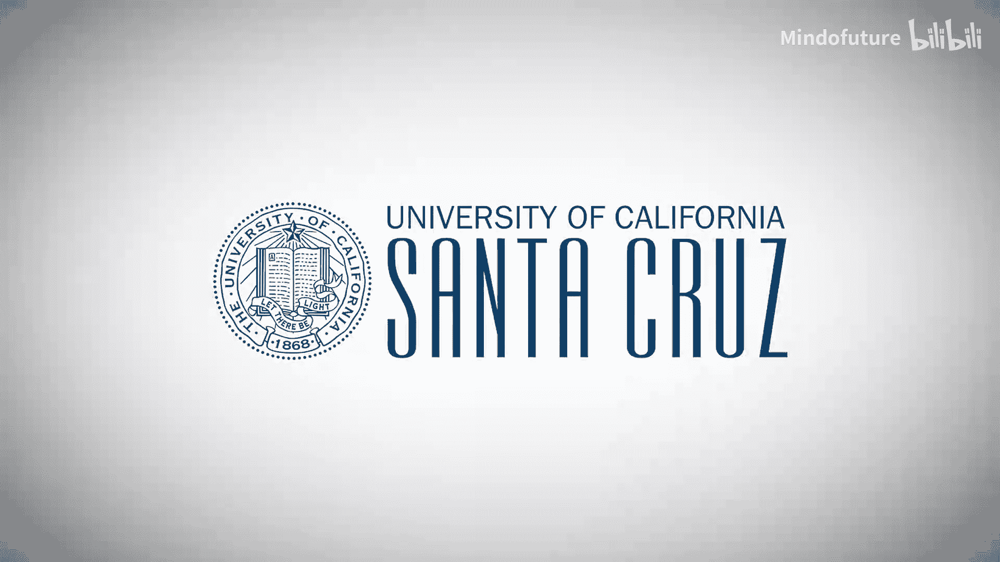
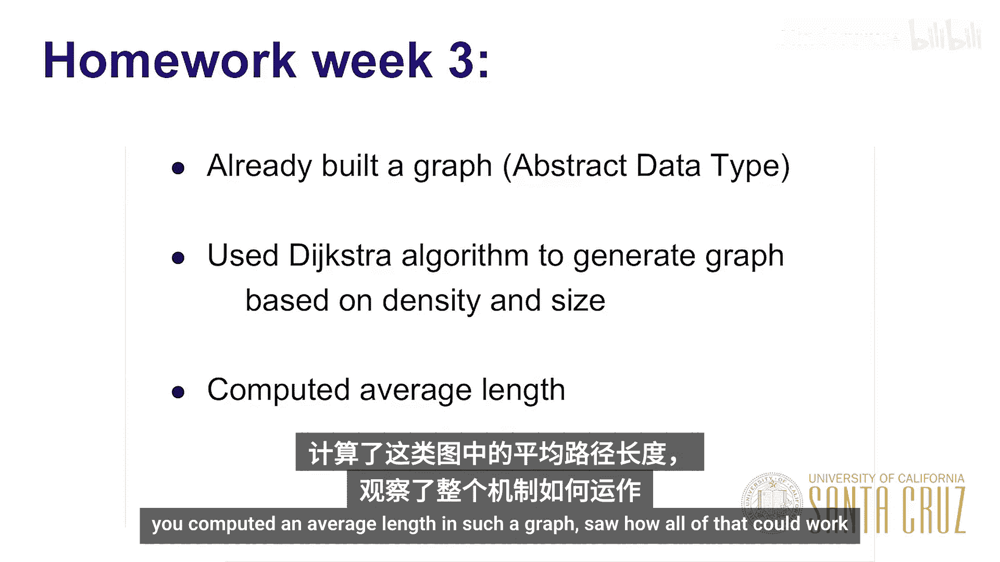
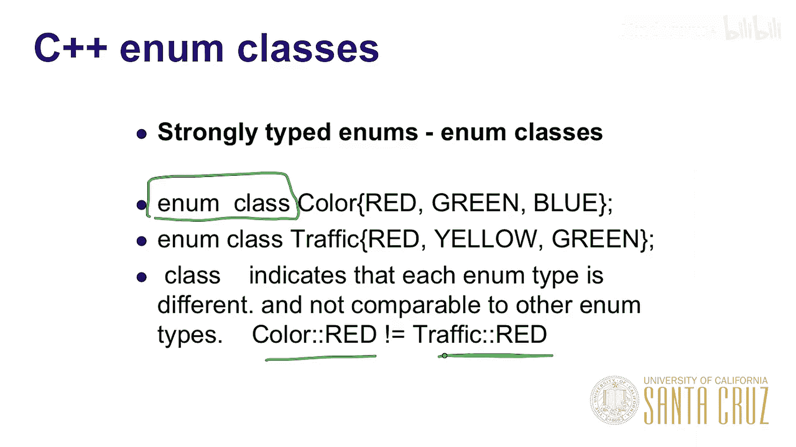

# 【加州大学】C++编程-｜-C-Plus-Plus-A-p33-P33_4-1-最小生成树（MST）_04_01_02--BV1p2ejzREUQ_p33-

。🎼う。🎼，So we're on。A new topic。Everybody should have completed the Dytras algorithm， which was。

Second assignment and really our first major assignment。

So you should have a fair familiarity without a process。Graphs， the notion of turning a graph。

Into a class structure。An abstract data type。She's getting a lot of benefit from using graphs which are。

Very， very useful throughout algorithms， computer science study again。Hopefully， for most of you。

 all of this is review。 so we're using material。 you should have ready。Learned and isn't novel。

 but if it isn't review or you've forgot a lot of it， there are excellent articles。

 especially in the Wikipedia on all these algorithms on the basic graph theory。

 including the algorithmic graph theory behind things like Dytras algorithm today's algorithm which we're going to talk about and will be the basis for the next homeworkmark assignment。

 so it builds on Dyketras， so in some sense it should be easier because now you' past the jitters。

 you've gotten。You're programming legs in terms of this complicated aggregate。

 and you're just going to add a new algorithm。And whole course is structured to build algorithm by algorithm towards。

AtThe end of the course， we're hoping you're going to all be able to implement this very interesting game hex。

 which can also be。Represented largely as a graph。So today， the main topic is minimum spanning trees。

Basis for homework3， and we're also going to study again， object orientation。

 how important object orientation is when we use a language like C plus plus what are the ideas we bring to the table to do good C plus plus program C plus plus is way more than an object gardened language。

 it's。Got multiple tools in its in its bag， and it has。The ability to do generic programming。

 It has the ability actually to do functional programming in terms of C plus plus 11。

 So it's multi paradigmatic。 C plus plus is multi paradigmatic。But。A really great strength。

 And the thing that。Has it replacing C was the shift from ordinary imperative programming。

 That was C to encapsulation based on the object oriented paradigm。 And we'll see that with。

Very simple， but。Very useful example called class point。So homework three。

You've already built the graph abstract data type。AYou。Hopefully you got the Dtra algorithm to work。

 you've got it to work on。Automatically generated graph based on densities and size。

You computed an average length。In such a graph。

Soaw how all of that could work。And we're going to add this。Next major algorithm， again。

 extremely useful minimum spanning tree comes up in many。

 many areas of computer science and electrical engineering。In some sense。

 it's maybe at the heart of the internet， the way the internet works。

One wants to have a minimum spanning tree so that from particular folkgi， you can get your messages。

 packets， whatever alto。Arbitrary other folk guy。Minimum spanning tree， a definition。So again。

 we're going to have a graph in which an edge has some arbitrary positive cost an edge。So。

 we might have。An edge from a。The be。Let's say cost7。

And we have a whole graph built of edges with costs。First off。

 we have to know what a spanning tree is。A spanning tree is just a set of edges。That， in effect。

 is a tree。 Remember， we in computer science frequently use things called binary trees， binary trees。

Would be spanning trees of graphs， if the graph。Had inside it a binary tree。

 So a spanning tree is a set of edges within the graph that correct。

 but connects all the nose of the graph。And where there is no cycles。

So an immediate implication of that is。We have a graph of n nodes。A spanning tree is a tree。With。N-1。

Edges。Now， I'm also going to in this homework problem。

Assume that edges in the spanning tree can have different colors。 It's going to make it a little。

More sophisticated。 and I'll add to some of the。Ideas in how you learn C++ programming it'll enable you to use an enum type or a class enum type。

啊。That。TheCl enum type is yet another novel idea in C++ 11。So if you have a C+ plus 11 compiler。

 we may talk a little bit about a class enum type as opposed to the earlier pureanum type。

 which remains。A。And so we're going to assume that an edge。It can be red， It can be red edges。

There can be blue edges。There can be green edges。And we might。

 when we specify our minimum spanning tree problem， decide on， well。

 do we want a minimum spanning tree in which all the edges are green， green。And MT。

Or maybe we would have。Blue。😔，And red。And an MSD。So for the same graph in which there were colors。

 we could have multiple answers to the minimum spanning trees， as they say。

 it just makes the problem。A。A little bit non standardard。

Not as easy to copy the code off the internet。Adds a little flavor to it and actually it'll be a flavor that will be useful in many later and more complicated venues。

So first， let's take a little quiz。If we have an enumerated type， here's a simple。

 enumerated type color。 This is different than， as I say， C plus plus 11 will have。

A class enumerated type。Why were the colors capitalized？The enumerators have internal values。

 in this case， what would be the value of green。And if we wanted， this is a new type。So again。

 object orientation is all about adding types to the basic native types in a way that。

iss compatible with the basic native types and fulfills the expectation of the C++ community and the expectation in the C++ community is that the IO。

 the what you might call pseudo operators， the operators，Aopted to， in this case。

 the Bishift operators adapted so that they do IO。啊。Can be overloaded。

 how would we overload to print red， So take a few minutes。And see how you'd answer those questions。

Well， first off， the reason that we use capital is just。Our community convention。

So whenever we have things that we think of as constants。This even goes back to the old sea style。

 where。When we didn't have enumerators， we just did this using macros。

So the minute we see in our C code， some big all caps。Identifier， we think， a。

 that must be some kind of。Standard constant。In this case。The values go sequentially， 0，1 and 2。

 so green ends up2。And then。If we were to。immplement the code for overloading the operator。

Recall that it has a certain idiomatic format。We're always going to call by reference this complex construct。

 the O stream。We call the new type that we want to overload。And then， we're going to。Return。

W do we return here。Everybody should know。That that should be return of。

Why is that again so that we can properly use C out？Something。And that， in effect。

These are expressions that evaluate to the same o stream so that you can。Use that。Output repeatedly。

Here's some new novel stuff。Fresh from the new standard。

There are what we call strongly typed enumerators and noome classes。

We're going to see why we need them。Let's say in the old style， I could have had a noome。Color。

An enum traffic。And then I'd have two specific。Uses of red as enumerators。

And they could actually get confused because they weren't strongly typed。They're， in essence。

 some kind of。Integer。And they would be comparable if I wanted to。However。

 when I turned them into this newly。Strongly typed and new。And that happens by。

Instead of just calling them a nuum， calling them a nu class， so it looks somewhat the same。

Except now I have class。Now， the two enumerators are distinct， they're not comparable， they're not。

 they have type distinction， since they have type distinction。They're much safer in code。

 We can't get into trouble with conversion opportunities， for example。

