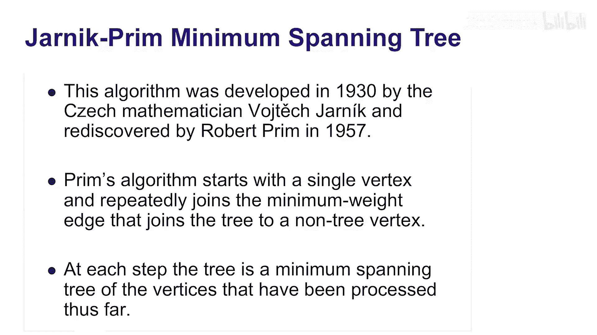
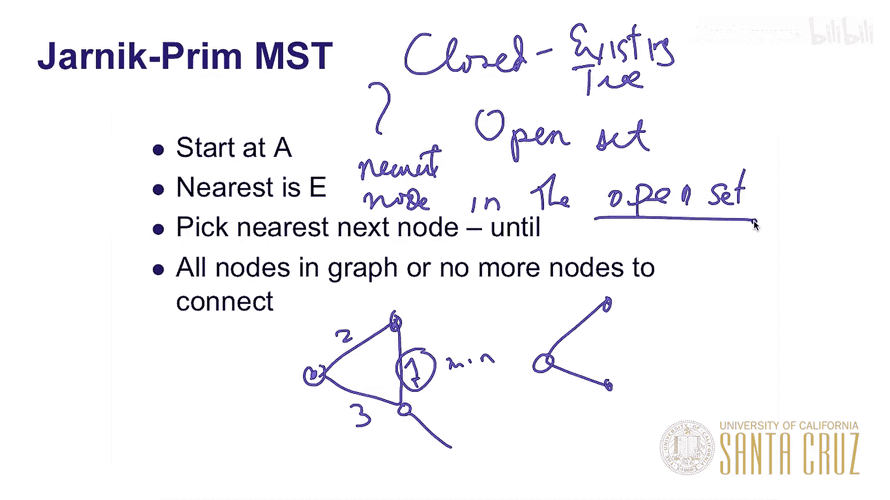
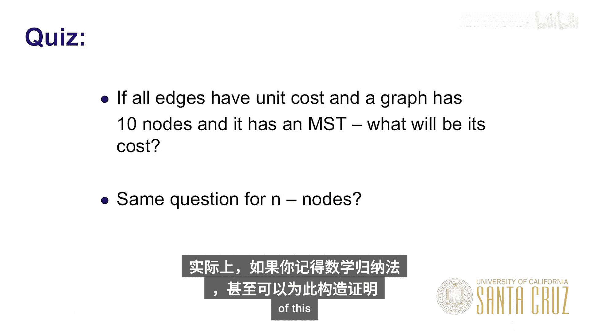
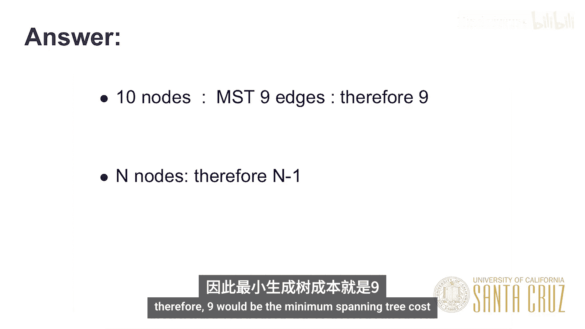

# 【加州大学】C++编程-｜-C-Plus-Plus-A-p34-P34_4-2-Jarnik-Prim最小生成树_04_01_03--BV1p2ejzREUQ_p34-

New topic。We're going to discuss in detail。The minimum spanning tree algorithm。

So the minimum spanning tree algorithm。Was actually discovered。

This is found out later because it was fairly obscure。 There was Czech mathematician named Yarnick。

And he wrote a paper where in effect， had this algorithm in 1930。But。

Engineers and computer scientists attribute the first algorithm that uses this method。To Pri。

 who published and rediscovered the algorithm in 1957。

We're going to compare this algorithm to a competitor algorithm。That was also discovered。

Roughly in the same time by the discrete mathematician， computer scientist， Kresll。

So I'm going to explain both algorithms。You'll get a chance to either implement one or both。

 They're not completely。Equient， they're equivalent in the sense that they will give you the right answer。

But in some circumstance， one could be more efficient than the other。

 but one doesn't dominate the other completely。 And so it's actually useful to have both implemented。

Prims algorithm。Starts with a single vertex。 You could imagine that you pick vertex A。

 or if you're using a C like notation， you have vertex0， you would start with a single vertex。

Look for something that was a minimum weight edge out of that word vertex。

And place it in and build your tree。So you would start by saying， let's say we go to node0。

Look for the minimum weighted edge out of node0。 What if there is no edge out of node 0。

No edge out of no zero。 Then there's no way for no zero to be connected to the rest of the ground。

If there's no connection to the rest of the graph， we don't have a minimum spanning tree。

 We have what's called a disjoint， or a disconnected graph。

So you should keep that in mind when you write your algorithm in some instances。

graphs that you'll be looking at will not have a minimum spanning tree。

 and they need to report that somehow。 They need to report that with。

Some other kind of standard value， like some very large maximum integer or a sentinel value。

 maybe it would be negative to indicate that it was that the graph is disconnected or not a number value at any case。

 it is possible， you have a graph doesn't have to be connected， if it's not connected。

 it won't have a spanning tree if it is connected， namely。

 any vertex can reach any other vertex or any node can reach any other node。

Then there will be a spanning tree。 and if there's a spanning tree。

 there has to be a minimum spanning tree。So Prim builds the spanning tree。One node at a time。

 connecting the node。To the existing tree。 So it builds the tree from an existing single component tree。

 That's going to be the difference between prim and crsll。 Later on。

 we'll see with cresll that it builds thepanning tree potentially by creating a forest。

 And then as the forest grows out， the forest connects up。 And then you end up with one component。

I think the prim algorithm in some ways is maybe conceptually a little simpler。

Okay， so let's quickly go through。How primm is going to pick off edges？

I'm going to just draw them conceptually and then keep track of their value。

 So if the start edge is a， the start node is a。There are basically two places to get to EF。Ys。

The one with the shorter distance。So that means I'm going to go from a to E and as we go。

 we're building a spanning tree， so we might think of that spanning tree as the existing or closed set。

 much like we built a。Shortest path tree in Dyktra。And so we have the existing AE close set。

And we're looking for what we can reach。So that started with a value of2。

 and the thing we can reach now is we can go to G， which is4， we can go to D， which is6。

 we can go to I， which is4， we can go to F， which is2 that two is the best。So let's pick that up。

It gives us a second value of two。And now， we have。We've added。Effn here。

F gives us some other possibilities， that possibility is F the i which is 5。But the best of these。

Is one of the fours we can tie break。And we can add that four。The Eaji。And now， we have。

A new possibility that's actually the lowest value， which is three。So we would go along G to H。

We'd add H into our。Built up tree。H is3。 We can see that we're picking things off in what's called a greedy manner。

I want to point that out， this is like diyketra， it's one of these categories of greedy algorithms。

Now we have G to D H to D， which is5， but the best is。One of the things we saw earlier， H to I。

 which is4。And that lets us have an eye to D， which is also for。And now we're done。

 We have six edges。We have a full spanning tree。And because we did it in this greedy manner。

Here are all its individual costs， and if we add them up， we get 4，8，11，15，19。

So the total minimum span tree cost。The prim method leads us to a spanning tree of 19。

So repeating for Pri。We started A。We look for what's。

The least value edge out of a that turned out to be， or we could call it the nearest edge。

 that turned out to be E。And then we keep going from what we built as the set of nodes that are already connected。

 We pick the next node that's not connected to the existing tree。

And we pick the smallest edge there until we have n minus1 edges。 and then that's our result。

Or until we don't have， we don't have the ability to select anymore。

 And and the graph is disconnected so we can't have a disconnected situation。

And you can see from how we've structured it that there's no way we can get loops。

 We never look back into the preexisting set of nodes that we have already linked。

 So that we that means that we'll see in Crreesco， we have to also figure out a way to avoid loops。

 we don't want to， even though there might be a small arc。 we don't want to end up with a situation。

Where if we picked。You know， something that was two here and something that was three here。

 and then we can go on from here or here， but this thing was one， for example。

 and let's say this was a minimum。We don't pick this one， because these two guys。We're ready。

We already had that， so we don't look back into any。Of the existing tree。

So we just have to keep track of where we haven't yet gone。

 what are the nodes where we haven't yet gone。 if we remember the ditra thing。

 you might call that the open set。The close set might be。Existing tree。

 So we're building a tree is an existing tree。And we have to look at nearest。Noode。

That's in the open set， that's another way to think of print。

K。So now you've seen how to do Prim， we've seen it on。

AGra that should let you be able to do an arbitrary graph。

Let me give you a little quiz just to check your insight on the algorithm。So for example。

We could have。Every edge have unit cost， the same cost。

And if there was such a graph where every edge was cost one。And it had 10 notes。

 and there was indeed a spanning tree。What would the minimum spanning tree cost be？Okay。

 hopefully you should be able to。Get that。And now you should be able to generalize it。

 So what's the same question if we have an arbitrary size graph N。The graph has N nodes。

 is connected。Has unit cost。What would its spanning tree cost be。So think about that。Indeeded。

 if you。Remember your mathematical induction， you could even make a proof out of this。

So anything that would have。A connected graph。We would need nine edges in the 10 noses， therefore。

 nine would be the minimum spanning tree cost。

And then in general， if we had end those。A spanning tree would have to have n1 edges。

 and therefore its cost would have to be n minus-1。

