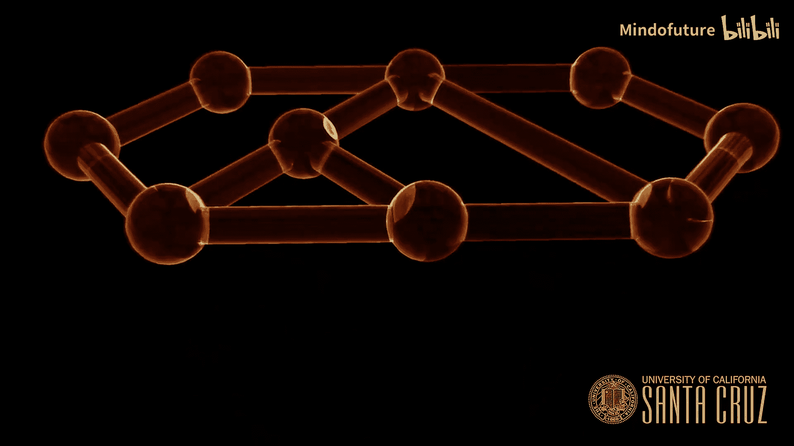
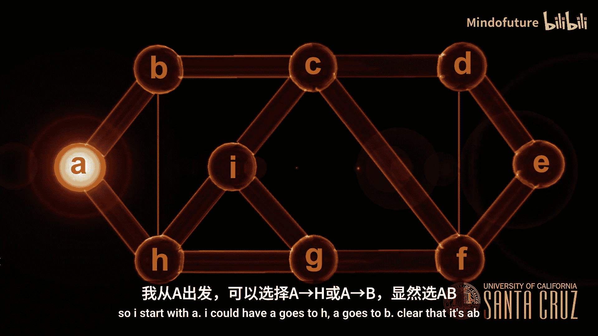
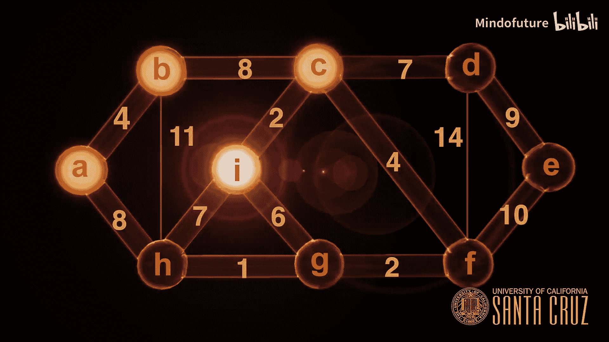
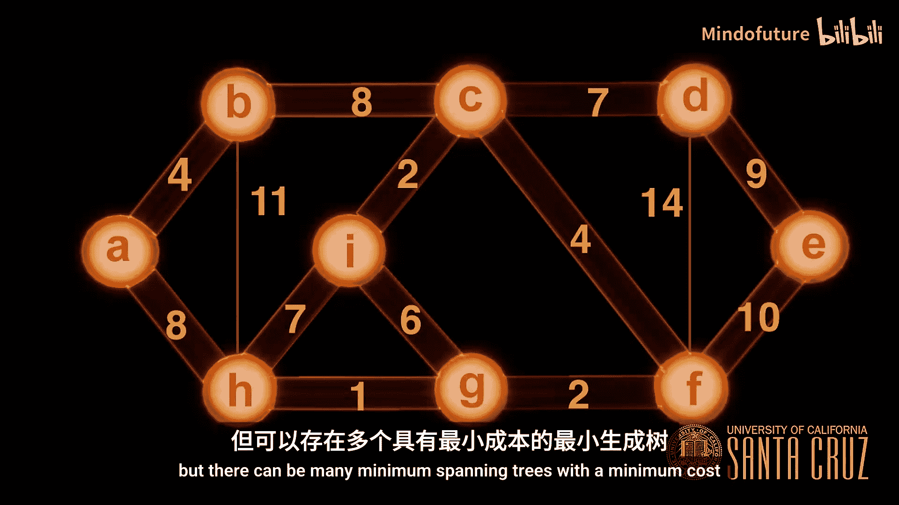
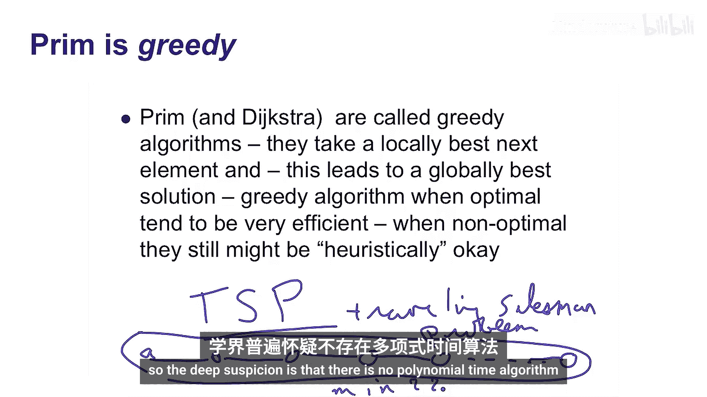

# 【加州大学】C++编程-｜-C-Plus-Plus-A-p35-P35_4-3-Jarnik-Prim最小生成树_再探_04_01_04--BV1p2ejzREUQ_p35-

嗯。Let's just apply。Prim， one more time。I need you to be very solid on this。This is。

The last homework in the。In this first half of the class， which is is sort of。

Where there'll be a natural break before we in the second half of the course， take up game playing。

So。In order to program this properly， you should always be able to hand simulate without hand simulation。

 you're not going to be able to think of your own code。

 think of its correctness and implement it properly。So we'll do this one as well。

 let's do prim on it。I'm going to start with A again。

By the way。Is it necessary to start with A could I have started with G or C？Think about that。

So I start with A。

I could have a goes to H， A goes to B。Clear that it's A B。That's a four。Now we have the mini tree AB。

We can go to C， we can go to H， that's 11， that's 8。We could we have two eights。

So we have the possibility of a tie break。Let's do that one， that is the one that we've already done。

 but notice we could have tiebreaked and gone A to H。Maybe I'll do H to H after。

And see that we get the same result。Now we have the possibility of an eight， a two， a seven， a four。

Two is the best。We do it too。

Now I have the possibility of a four a seven。The previous possibilities four is next。

Now I have a seven， another two。Two is clearly the best。Now， I have a 10。

One is obviously now possible。 That's the best。So we're always keeping track of in the open set。

What is our next， What are set of choices，7 is now the best。And the only thing in the open set is E。

And we can get the E from F with 10 and from D with 9。So nine is the best。And now we're done。

Let's that up。That's 12，14，18。Cantdi。28。37。So Prim has given us 37。Notice。

We don't necessarily always get the same one。 We could have at the point that we got A to B。

 We could have gone to H。 Let's make sure we get the same thing。 Som I'm going to redo this。

For again， was required。Now I go to H。That gives us an eight。Now， I can do a one。This is one。

Now I can do it too。Gives us a two。Now I can do a four。Gives4。Now， I can do it， too。Give us two。

Now the best is a seven。And now I do at 9。So that gives us the right number of edges and the same set of clause as before noticeice it gives us。

AS different minimum spanning tree。 nobody said the minimum spanning tree has to be unique。

Just means that the cost has to be unique， but there can be。

Many minimum spanning trees with a minimum cost， okay。

Here's pseudocode for print。Many places to find the pseudocode。Frequently。

 pseudocode like this comes from the Wikipedia and。Your programming。

And you shouldn't just be sitting at a terminal。And just banging away code， you should be。

Writing at a high level what you need。And pseudocode is a good way to start。

 have some kind of fairly careful pseudocode that is。Rily translatable。Into direct C++ code。

So we have a graph G with edges E， the edges are represented in the form of pairs。V1 to V2。 we are。

 by the way， using。Undirected graphs， we've been using undirected graphs throughout the class。

 if you want an interesting alternative is to write all the codes so that it can also work with directed graphs。

Don't recall that an undirected graph effectively when。I'llJust show you。In a directed graph。

 you generally say。Vertex 1 is connected in this direction to vertex 2 in an undirected graph。

You don't have an arrow。 And instead， that would be the equivalent of。Two directed edges。

 So for every edge that was going in one direction。

 there would be an edge going in the other direction in the directed representation。

 undirected representation， we don't draw the arrows in the real world。

 it means every street in your street map is a two way street。

And then we have this basic loop where we're searching for the next smallest distance。

 and as long as there's the next smallest distance， we add it until we're done with。

 that's the size of the needed number of edges。So after we've established the graph。

And set up the fact that we have an empty。Minimum spanning tree， we start picking。Distances。

And because it's pseudocode， we're not actually showing this， but we have to。

We're going to have to include something that gets us as short as edge。

 We may want to maintain this as a data structure。 Sometimes we could。Have a priority cue。

 If some of you know this idea。Of edges。 And pick off the next。Smallest edge。

 So we need some way to get at the next smallest edge。And then we add those in。

 and update and keep going。Until we're done finding。As I say this is just。呃。

A characterization of prim and pseudocode。Prim and Dyktra are called greedy。

 greedy algorithms are something that work efficiently because they generally have a very simple concept like pick something locally that's best。

And greedy algorithms， if they work， are very good because by picking the best thing locally。

 you generally have a very cheap computation。And yet knowing that by proof。

That that gets you the global minimum or maximum。 Lets you have what's called a very highly efficient way。

 There are lots of greedy algorithms that don't guarantee。that。You get a global optimum， for example。

 we won't study it here。More interesting and difficult and still。

What you might call unsolved problem is the traveling salesman problem。

The traveling salesman problem is almost like the minimum spanning tree problem except that。

You must produce a spanning tree in a graph。That's linear。What I mean by a linear spanning tree。

I'd say you started with A。The tree structure is going to end up looking like this。

With the final node。Here。And if I just go to a next node and a next node and a next node that hasn't been visited。

In this form， and I find， and I choose a minimum。There is no guarantee that the overall path。

 the overall linear tree， is a minimum。Indeed， what's well known is that can fail。

So this is a very efficient algorithm， but it only finds an approximation。

A euristic approximation to the traveling salesman problem。

The traveling salesman problem is an NP complete problem。

So the deep suspicion is that there is no polynomial time algorithm。

On a normal computer that can always solve the traveling salesman problems。

 So it remains very interesting to try and design things that are。That work very well。

 that are both efficient and either give you an optimum or near optimum。Solution。

 so that's a problem I've studied， for example， in my own research。

 maybe some of you will want to do that as something optional。

