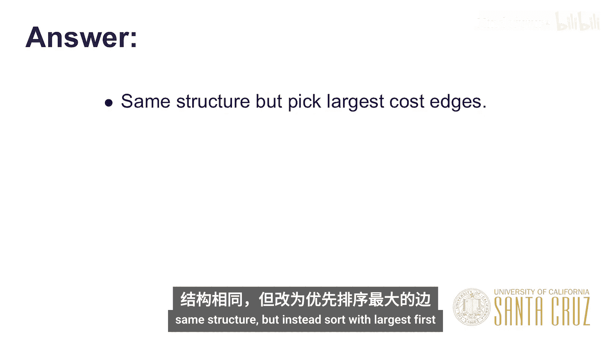

# 【加州大学】C++编程-｜-C-Plus-Plus-A-p36-P36_4-4-Kruskal算法_04_01_05--BV1p2ejzREUQ_p36-

Now let's turn the next segment to the Ksco version。So we'll also talk about at a high level。

What is it that Crusll does and how it differs from Pri？

So Crsco doesn't necessarily compute a single component。Prim computed a single component。

 and the greedy idea was take the next small edge that adds to that greedy existing component。

 Crosscull instead creates a forest， which are a set of trees。

So each vertex can be thought of to start off as a forest of end node， they're not yet connected。

And then when you add an edge。You take two of the trees in the forest and you turn them into。

A single component。And so you're adding。Shortest edges you can sort of。Vi。

That the crescal algorithm can take the set of edges。That are in the graph。And sort them。

Smallest first。Now， if you had the sortest all the edges of the graph。

 the graph can have n squared edges， you have a sorting problem there。N squared。

You would end up with something like an n squared log n computation to get the edges sorted as to length。

Now you have a sorted list of edges， why not be able to take the first n minus one edges？

And create that as your minimum spanning tree。Think about that。That would get you a minimum。

 so it's clear that those would be the smallest and minus-1 edges in the graph。

The reason it wouldn't necessarily give you a spanning tree is some of those edges may create loops。

So you wouldn't get new edges as you would， you don't get a new node put into the closed set。

 as you do in print。So。You're forced in the crscal pseudocode to check whether you've created an internal loopt so you can take the next shortest edge。

Stick it into the existing crsco forest。If it doesn't create a loop。

 you're fine and you go and get the next shortest edge。But you must check if it。

If that next edge is inside a preexisting crustsco。Component。Then you have to discard it and move on。

Okay， so that's the algorithm。Let's apply it。Here's yet another spanning tree。

 and this time we're going to do crscle。So we would start off and we know that。AD。Is value 5。

C e is value5。呃。D F。It's value6。A B。Is value 7。E is7。EF is 8。BC is eight。u。BD is 9。E G is 9。Fg is 11。

And D E is 15。So this is our sorted list of edges。Well， we have no problem。

 all of the nodes are disconnected at this point。And so we know we can add this。

 and now we have our first crustsco component， AD。And let me write out the fact that that's a five there。

Now we go back to the list， notice the next thing we're going to select the CE。Right。

 different than prim。Prim didn't work that way， Prim would have to select DF。

It connects up to this component。Kresco picks the next in the west， snaing off these in the west。

That's a component that has nothing to do with a preexisting component。Now Df is next。So that's six。

Remember to get all my values。AB 7。Each time in my mind， Im checking whether I have。

The edge is sitting in a crust skull component， it's not。BE is 7。E F is 8。Notice。I can't draw E。

Why can't I draw EF that's the next smallest。Because it would create a path。

We use a different color for。I use red。Z loop。So that can't be used。So that's thrown out。

 you see is thrown out。The next one is BD。BD is thrown out。E G is okay。And we're done。That's it。

So we have a minimum spanning tree。Dealing with Crreesco， which built it。As a forest。We have 16， 23。

 30， 39。M T。39。And I said， if we wanted to try this。

 let's do it very quickly and with prim and see the difference。

I couldI'll start with an A let me get。That' a5。Now there's a six。There's7。Its 7。There's a5。

And there's a9。Her crresco。SoPm would work by building out the component。

 but would get us the exact same tree necessarily， I think and that would be the same minimum spanning tree as well。

Quz。How would you change this algorithm to find a maximum spanning tree？

Maybe you want to build a tree in which everything is the most costly。 That'd be a little unusual。

 so that's not normally how the problem is stated。Okay， let's look for a solution。Same structure。

But instead， sort with largest first。

So you can see the logic of largest first， if there was a spanning tree。

 you'd get a largest spanning tree。Again， it would have to be a tree structure it would give you your largest values。

