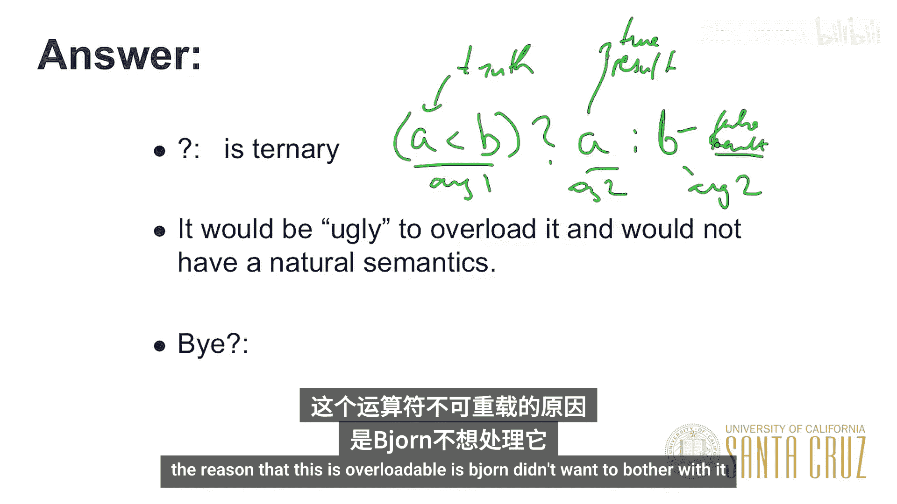

# 【加州大学】C++编程-｜-C-Plus-Plus-A-p37-P37_4-5-重载和函数选择_04_01_06--BV1p2ejzREUQ_p37-

K， next topic。We're going to get back to some core C++ ideas。

So we've outlined the methods you need for the homework。

You can either use primm or crustscal or do both， compare them if you have energy in time。

You're going to add that to your preexisting homework。Where you've already done graph algorithms。

Try and refine whatever you learned from before。 maybe your graph structure。

Will be more elegant now that you've learned more C plus plus， you can rebuild even your basic。呃。

Graph class。But in any case， the new problem is to do a crsical or。Our prim minimum spanning tree。

And now we want to introduce further ideas。From C plus plus。

 the critical ideas we want is a very neat idea。 It's something that。Hasn't been put into Java。

 for example。啊。There are arguments over whether it's a good idea， but in lots of arenas。

 it's a very valuable idea and that's called operator overloading。

 that's where we provide new meaning to existing C++ operators。

And we've already used this as a very rich idea in the IO community in the IO package where we have operator overloading of the left bit shift for doing output。

And we're going to show how important yet another idea is that we haven't seen yet in C++es。

 which is using friend functions， especially when we want to provide operator overloading。Okay。

 high level principle。User defined types should be indistinguishable from native types。

Operator overloading is a mechanism that allows us and conversion that those are mechanisms that allow us to implement this principle。

What do I mean by that？In the native language， if I have two ins。We all know what a+ B means。

But let's say I decide to add。From a library or whatever。A rational number。For those of you。有。

Don't remember your high school math。rationational is just the number represented by two integers。

 Q divided by p， so two/ thirds is irrational， three/ quarters is irrational。

 seven/11s is irrational。Pie is not irrational。 Remember that notion the other day of pie being transcendental。

 It can't be represented precisely by。There are ways to represent pie， there's a nearby rational。

 for example， 7， 20 seconds is a fairly good。Approxiation to pie。When you have two small integers。

And you can approximate pie as closely as you want birational， but you can't make it exact。Anyway。

 if I all of a sudden had some kind of package for doing rational arithmetic。

 I might also want to be able to have C plus D。Because mathematicians can add rationals。Yeah。Again。

 if you remember your grade school work， they probably told you how to do this kind of addition。

 So your rational overloading of the plus operator would lead you to provide。

The algorithm for doing rational arithmetic。But rationals can。Be used much like integers and doubles。

 so you might also expect that you should be able to do a plus C where a was a normal int and C was irrational。

And have a resulting conversion。And convert the A to irrational。

So now your rational is this new thing。This new class that you've invented。Gets used。

As conveniently as a native type， that's part of the OOP principle。 when you add a type。

You want to add a type in a way that it's consistent with preexisting types in the C++ world。

So we're going to add a type， we're going to add the type point。Points are very simple type。

Here's a point。 We're going to think of a point as。A pair in a two dimensional world， X and Y。

Maybe that's the point。1， comma，1。As with Good O0， we're going to hide representation。

So the actual underlying representation will be a pair of doubles。So we can also have。The point。0。5。

0。5。Really， we should be thinking of that as 1。0，1。0。So we're going to use doubles。

We're going to have a bunch of constructors。Here's the constructor。

That's a constructor of one argument， which basically takes。

An argument makes it the x value and leaves the y value a 0。A point here。

Is going to like if I want to have a point。Whose value。Is initialized with three。

 I'm going to end up with the 0。3 comma 0。Through this constructor。

This is going to be important because this is。Also， what we call a conversion constructor。

So here's a point S。We can think of it as。Having value 0， zero。

Define that class properly with a default。And now we have a double 3。5。And we say assign to S D。Now。

 D。He is double。And we don't have a logic for assigning a double， so there needs to be a conversion。

So D needs to be converted to the 0。3。5 comma 0。Once it's converted。Then we can have the assignment。

Now， if we wanted to make that clearer， we could do it via an explicit assignment。But actually。

 this works as well。Why does it work， Because C plus plus allows for implicit conversion。In fact。

I'm going to go back to the previous slide because I'm going to show you something。

That you can keep in mind if you didn't want that behavior。You would have to add the keyword。

Explicit。An explicit in a way， turns off。Implicit conversion opportunity。

There's lots of times that you don't really want that to happen。

Adding conversion opportunities in this language。IIt's very sensitive because conversions allow signatures to be matched。

 They allow expressions to be evaluated， and you don't want that to happen inadvertently。Now。

 what about converting a point to double？Well we know how to convert double to point。

 the way we convert double to point is we write a conversion constructor。So the argument。

 the double argument becomes。An argument of value to instantiate some of the underlying data。

In point。But we can't write a conversion constructor in the native。Class， double。

 double is a native type。You could think of it as having its own code somewhere in the world。

 it's really just built into the compiler。But there isn't a way to inform the compiler that I want to change the rules about double。

So because there's no access to that code。So C++ does provide an alternative。

 and you see the alternative here。You can inside。The class point。So， again。We see that We have。

Scope resolution to point。By providing operator double。The type to be converted to。We allow a point。

To be converted to a double now， whether that makes sense， whether that's a good idea。

Probably only should be used。Where it's natural to the semantics of that type。

 what do I mean by natural to the semantics of that type？

With somebody who is used to a draftsman who is using two dimensional objects。

Two dimensional coordinates points。If you told him that I wanted to convert a point to a double。

 would he know what you meant， He doesn't know what you mean。

If he doesn't know that you intend to use。The distance， the vector is from the origin。

 which is basically what we're doing here。Then it's a bad idea。

Then you should probably provide something。That's explicit。

 like the length of a point from the origin。 you should have a named type。

So these conversion opportunities can easily lead to obscure programming。

And they frequently should be very heavily justified and the justification should come。

From the domain。In which the type is used。But。It's available。Zou。

Now you can have what might be called an narrowing conversion。

 and you could turn a point into a double， you could turn a point similarly into anything else。

By providing it with whatever this type name is。A type。And some semantics。To convert to that type。

Then you have conversion opportunity。Pretty powerful stuff。Oh。

 we've already talked a little bit about that。 I've already pointed this out again， C plus plus 11。

 Some of the earlier compilers already implemented this allowed an explicit keyword。

 once people started doings rampant。Operator overloading and conversion。

It was soon discovered that things were happening subtly， that nobody expected。

 and so the explicit keyword got introduced so that that could be turned off。

 that opportunity could be turned off。Now。Remember that。In C plus plus one of the big changes from C。

Is you have function overloading， right？So in C， if we wanted the sum of an integer array。

 we had to call it sum of int array。If we wanted the sum of a double array。

 we had to give it a different name。 We had to distinguish the name。

 even when the code read the same。C++ provides a number of ways to keep the name for something that where we're doing conceptually the same work。

Using the same code， the two principal methods are ordinary overloading of functions。

 so we can call both the。Adding of。A rays of ints in the adding of arrays of doubles or even the adding of arrays of rational sum。

And then they get discriminated by their signature。I may just。RightIf so， if I want it， I could say。

Zobo。Sam。😔，咋宝。Ze。Int。Sam。And。The code would probably look the same。I can even do this with templates。

And the compiler has to have a way among the meanings available to it to choose which meaning。

Otherwise， it becomes ambiguous so you can， as a compiler error message。

 get the fact that the compiler is confused。Now， the compiler has a very complex and detailed way it has preferred。

Selection。So exact match， exact match is always preferred。Is passed in a set of arguments。

And it looks at their type and it says， oh， I have exactly code for those types， then it picks that。

 no problem。 Everybody understands that。But now we have all these promotions available。So again。

 just like with square root， remember， square root is in the standard library in the math library。

Square root will work on an integer， even though it's intended to work on doubles。 Why。

 Because the integer will be promoted automatically silently to a double。So again。

 what happens is in overloading standard promotions， which are the safest kinds of promotions。

Are preferred over anything else。And so。If there's a signature and it requires a standard promotion and there's no exact match。

 then this would be tried。The next in line are standard type conversions， including the emotionss。

Then there are users to find conversions， much like those。The conversion we defined on point。

And then there's a match to see if there's an ellipsis signature。And that's the worst。Now。

 if you're following any of this in my text， there's description of it page 198 to 200 with a detailed example using rational numbers。

 but it can be very complicated。 And you can see where you have all these additional use it to find conversion opportunities that you have to be very。

 very careful， hence the introduction of explicit to avoid silently ending up。

With execution of code that was unintended。Friends， next big topic。

 We have these things called friends functions。 There's a couple of friends there might own cats are named Gogly and Naster。

They're friends， though， they're。They're more phrenem than friends。系。

Cats being even domesticated cats seem to be fairly territorial， so they do hiss at each other。

And they especially fight over their fruit bowls。But the critical thing about friends。

 and that's going to be true in C++。Is if you're a really good friend of mine。

 I'm going to let you look at my private stuff。 I'm going to let you look at the private implementation of my class。

That gives me the opportunity to。Act on your class almost as if I was a member function。

So a friend function。Has access as if it was a member function， but it's not a member function。

It's not a member function。That means it has no access to what。 Think about that。

 There's one thing that member functions always get。Ordinary member functions always get。That。

Functions that are called。With arguments on the class don't get， and that's their this pointer。

Remember a member function is activated through this pointer。

Friend function gets to treat the private parts as if it was a member function。

 but doesn't get to directly access。Because that's not passed in。

An argument through the dot notation。Here's her class point。And again。

 because it's the object oriented idiom。We want the behavior of the。A bit shift operator。

To be used for I O。Again， here we see the IO signature that's our idiom。

We need this call by reference， we pass back out， call by reference suite。

Have a non mutated object passed by reference。And its semantics are that we're going to prevent a point looking like this。

So what we would see as output for a point that had hidden representation， 1。0， 2。5 would be per， 1。

0 comma， 2。5 per。But this is going to fail， so if we were in regular code and saying， see out。Blah。

 blah， and the point name was Q。We would get a compiler error and the compiler error would say you wouldn't have access to X and Y。

 Y， X and y are private。This is an ordinary method。It does not have the ability to access。

Hidden representation。Can't make use of this。Well， OO says that this must remain restricted data hiding principle。

So the way around this。Well， one idea you could try is to make this a member function。But recall。

 a member function has a default first argument。 The default first argument has to be。

An object of type point。But。For this to work。In the syntax that's expected。

 the first argument has to be an o stream。It has to be in most instances an Ostream like sea out。

So we can't make it a member function， member function would solve the problem of getting access。

But it wouldn't solve the problem of having the wrong argument order。And C+ plus。

Courtesy of Brn invented a way around。To this kind of access problem。

 and that was to create friend functions。There's where a friend becomes important。

I use this special keyword， friend。That informs the compiler that it's got。These privileges。

 it breaks the normal data hiding。So it should be used very carefully。

Friend should be used very carefully。We allow it to have these important access privileges。

 like a class method does not have the that argument。So now we're going to pass in both arguments。

 we're going to pass in an O stream and a point。And they'll be passed and through the argument list。

 which is another thing。To consider。Because when we pass stuff in through the argument list。

Is subject to conversion opportunities。 So that's another point。

 very important and subtle point that deals with the use of friends when we overload operators。

 Friend overload operators。By having the arguments always go through the parameter list。

Member functions overload the arguments by having the first argument be the class argument。

 namely at this point or argument that is not overloaded to have conversion opportunity。

 So only a second or other argument。Would have a conversion opportunity that leads to a different behavior。

 even when we can overload the same operator and have the choice between friend overloading。

 member function overloading， we frequently choose。Friend overloading。

 I'm going to make that point a couple of times because it's very subtle and important point。

 We do that to maintain symmetry。 The friend overloading lets us use the argument list。

 The argument list means for binary operators， we get all the conversion opportunities symmetrically on both arguments。

Okay。Here is a member function overloading of the operator plus。So think of what you're doing。

You have two points。Let's say， we have2，1。And a half。0。And we want， maybe that's an A and that's a B。

 and we want to be able to because that's what we are used to as mathematicians。

 be able to write naturally a plus B。And we can see what we want that to be， that result。

 let's call it at C， we want C to come out two and a half。Wan。And the way we do that is。

If we're overloading this。With the notion that we have a plus B。

We really are calling through this pointer A。And through the argument list B。

That's really how this is getting activated。So that's why X and y are without and。

Those fields are discriminable。 See， these are really。This point at x。Plus， p of x。

And that leads to the two and a half and similarly for the why。Okay。

 that starts if you understand everything I just said。

You're really getting all this if you don't understand what I've just said。

 you've got to work with this， you've got to do your own stuff。

You've got to overload operators and see how that works。

So this is very critical that what I just said。It's clear to you。

So here you've seen how to overload the binary plus。Using a member function。

And here I'm just repeating what I said on the other with a different example， I have three points。

 I'm adding to A B plus C。BA is going to end up being two and a half。Coma 7， right？But。

If instead that operator got overloaded in a way that we used the friend function instead of a member function。

It's invocation。Would instead call a friend function。

And both B and C would be passed instead of a this pointer。And an argument。

This would be arc1 and Arc 2 and they would be completely symmetric。In the completely symmetric case。

 all the available conversion opportunities。 So， for example， remember。

 we can convert an ordinary double to a point。So that would mean。

If you're following me that if D was a double and I did D plus B。This。😔，Wouldn't work。

Or member overloading。And that gives you the reason why you want it as a friend function。

Friends are really important， they're really important。

 especially when you're doing operator overloading。They're important in other considerations too。

 and you have two very strongly linked classes。Gotta warn you about operator of loading。

People get infatuated with it。 Why， because it's a way to have a secret calculus。

 Everybody loves making their own secret notation。That's okay if you're just playing with the stuff and you're not in a company and you're not using it professionally。

Where other people will need to interact with your code。

Do operate or overloading to your heart's content。Maybe you can even come up with something close to APL if you remember this hugely powerful。

Early IBM language。man named Iverson。Invented a language in which there were super powerful overloaded operators。

 in effect that worked very well with linear algebra calculations。 And from what I recall。

 I may be wrong about it， Some can。Rightite into a forum on this。

 I believe you could write out a linear of programming。Algorithm using。The Iverson notation。In。

Relatively few lines of code， whereas if you had to use the language of the day such as Fortre and A P L 1。

 it would be a considerable amount of code。 So you would have this。Enormously dense， powerful。

Operator language， and this could be replicated。With operator overloading。呃。But。Using this。

One expects to conform to the rules of math。 You generally are going to use it in domains for which people know what the meaning is。

 You don't want to have to explain that plus is something that it isn't。

What does times mean in domain where？You are talking about clocks。

Let's say you decide to design a package called a clock。And clocks have minutes， seconds and hours。

Wow， it's pretty easy to understand how。You know， I have an appointment a half an hour from now。

 so I want to know what time that's going to be。But now what's the times operator going to be。

 can I multiply two clock times is that reasonable？So you got to be very careful。

And you need to be comprehensive。So you're not going to go an overload plus in a normal domain in which minus is understood。

As being the inverse operation。So normally， you're going to overload the complete algebra。

 You have to do what's expected。 You have to do what's natural and you have to do what fits in with the native C plus plus types。

Okay， here's a quiz。For this section。Not all operators are overloadable。

 Most operators in C plus plus are overloadable。 Some operators like scopepe resolution。

 remember that's colon colon。 That's not overloadable。 Why， Well that would cause a catastrophe。

 If you gave it a different meaning from what it needs to be， which is scope resolution。

 it would for one thing， it's very hard to imagine what that meaning could be。

So it's not overloadable。Another operator that's not overloadable is Ternary operator。

 and there is a single turnernary operator。And what I'm asking you is。

To explain what it is and why it's not overloadable。Answer。

 theterernary operator is question mark equal。So the typical thing is， you have some。

Let's write out something just so you remember。There are many people though rarely use this operator to say something like A less than B。

Question， mark。A colon B。So these are the three arguments， arc 1， arc 2， arc 3。

And the normal language says test this for truth。And if true， this is the true result。

And this is the false result。So many people prefer to just do these things with this。Calculations。

The reason that this is overloadable is Brn didn't want to bother with it。

 it's already not that used an operator。

It's generally not an opera to expect in any algebra， it would be ugly， so it's not overloadable。

Maybe there's some other reason。Okay， that's it for today， we've packed in a lot。

And I will see you next time。